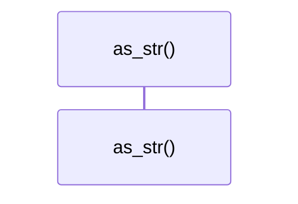
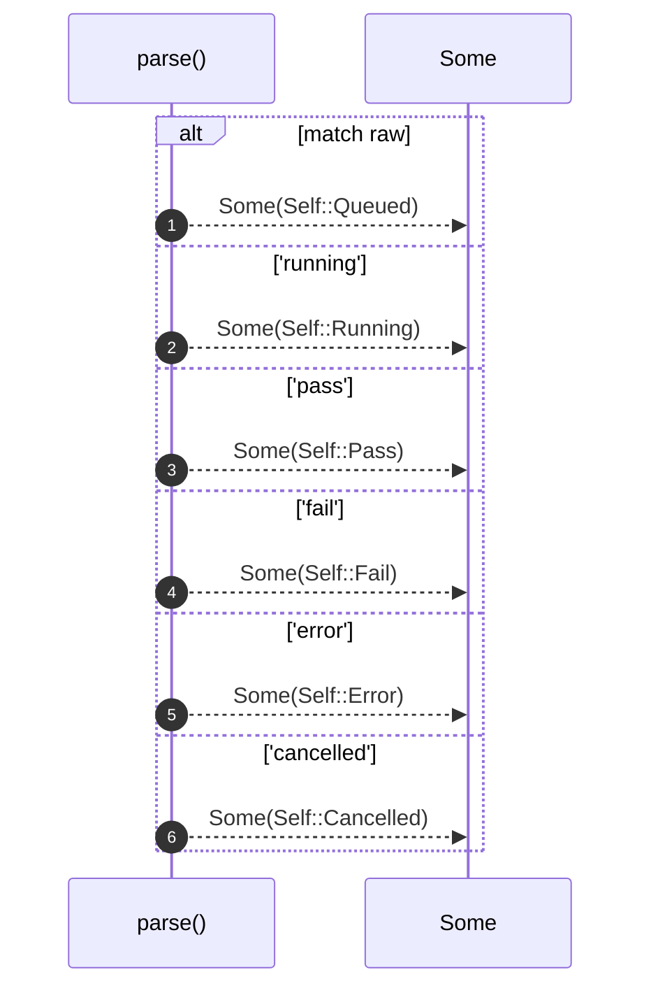
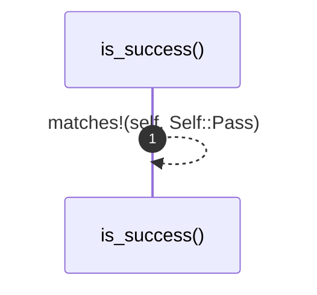
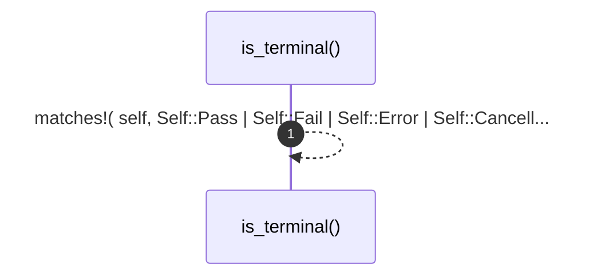

# `robby_ir::run::impl RunStatus`

[Self-model](../../README.md) · [run](index.md)

| | |
|---|---|
| kind | `code.impl` |
| location | [`crates/robby-ir/src/run.rs:60`](../../../../crates/robby-ir/src/run.rs#L60) |
| provenance | extractor · confidence 1.00 |

```rust
impl RunStatus {
    pub fn as_str(self) -> &'static str {
        match self {
            Self::Queued => "queued",
            Self::Running => "running",
            Self::Pass => "pass",
            Self::Fail => "fail",
            Self::Error => "error",
            Self::Cancelled => "cancelled",
        }
    }

    pub fn parse(raw: &str) -> Option<Self> {
        match raw {
            "queued" => Some(Self::Queued),
            "running" => Some(Self::Running),
            "pass" => Some(Self::Pass),
            "fail" => Some(Self::Fail),
            "error" => Some(Self::Error),
            "cancelled" => Some(Self::Cancelled),
            _ => None,
        }
    }

    /// Terminal success (gate / runner completed ok).
    pub fn is_success(self) -> bool {
        matches!(self, Self::Pass)
    }

    /// Terminal outcome (success or failure), not in-flight.
    pub fn is_terminal(self) -> bool {
        matches!(
            self,
            Self::Pass | Self::Fail | Self::Error | Self::Cancelled
        )
    }
}
```

## Referenced by

- calls ← [`robby_agent::openrouter::impl ChatClient for OpenRouterClient::chat`](../../robby_agent/openrouter/index.md)
- calls ← [`robby_cli::example_self_model::run`](../../robby_cli/example_self_model/run.md)
- calls ← [`robby_cli::run`](../../robby_cli/run.md)
- calls ← [`robby_extract::typescript::extract_file`](../../robby_extract/typescript/extract-file.md)
- calls ← [`robby_render::view::comments::enrichment_fields`](../../robby_render/view/comments/enrichment-fields.md)
- calls ← [`robby_render::view::comments::parse_verdict`](../../robby_render/view/comments/parse-verdict.md)

### `as_str`

| | |
|---|---|
| kind | `code.method` |
| signature | `fn as_str(1)` |
| location | [`crates/robby-ir/src/run.rs:61`](../../../../crates/robby-ir/src/run.rs#L61) |
| provenance | extractor · confidence 1.00 |

```rust
pub fn as_str(self) -> &'static str {
        match self {
            Self::Queued => "queued",
            Self::Running => "running",
            Self::Pass => "pass",
            Self::Fail => "fail",
            Self::Error => "error",
            Self::Cancelled => "cancelled",
        }
    }
```



0 steps · 0 observed · 0 possible only

### `parse`

| | |
|---|---|
| kind | `code.method` |
| signature | `fn parse(1)` |
| location | [`crates/robby-ir/src/run.rs:72`](../../../../crates/robby-ir/src/run.rs#L72) |
| provenance | extractor · confidence 1.00 |

```rust
pub fn parse(raw: &str) -> Option<Self> {
        match raw {
            "queued" => Some(Self::Queued),
            "running" => Some(Self::Running),
            "pass" => Some(Self::Pass),
            "fail" => Some(Self::Fail),
            "error" => Some(Self::Error),
            "cancelled" => Some(Self::Cancelled),
            _ => None,
        }
    }
```



6 steps · 0 observed · 6 possible only

### `is_success`

| | |
|---|---|
| kind | `code.method` |
| signature | `fn is_success(1)` |
| location | [`crates/robby-ir/src/run.rs:84`](../../../../crates/robby-ir/src/run.rs#L84) |
| provenance | extractor · confidence 1.00 |

> Terminal success (gate / runner completed ok).

```rust
/// Terminal success (gate / runner completed ok).
    pub fn is_success(self) -> bool {
        matches!(self, Self::Pass)
    }
```



1 steps · 0 observed · 1 possible only

### `is_terminal`

| | |
|---|---|
| kind | `code.method` |
| signature | `fn is_terminal(1)` |
| location | [`crates/robby-ir/src/run.rs:89`](../../../../crates/robby-ir/src/run.rs#L89) |
| provenance | extractor · confidence 1.00 |

> Terminal outcome (success or failure), not in-flight.

```rust
/// Terminal outcome (success or failure), not in-flight.
    pub fn is_terminal(self) -> bool {
        matches!(
            self,
            Self::Pass | Self::Fail | Self::Error | Self::Cancelled
        )
    }
```



1 steps · 0 observed · 1 possible only

