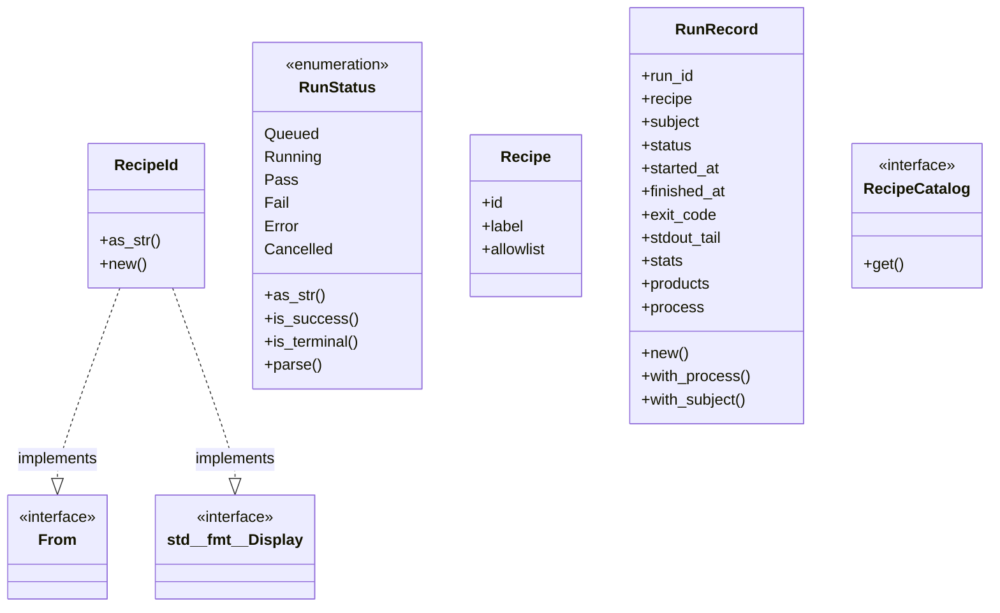
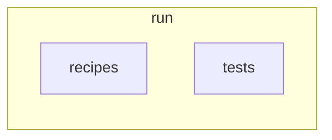
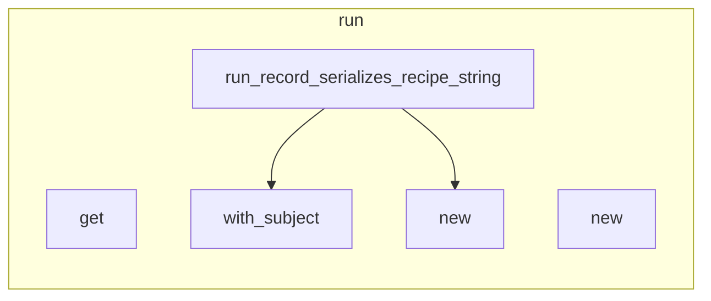

# `robby_ir::run`

[Self-model](../../README.md) · [robby_ir](../index.md)

| | |
|---|---|
| kind | `code.module` |
| declared at | [`crates/robby-ir/src/lib.rs:24`](../../../../crates/robby-ir/src/lib.rs#L24) |
| provenance | extractor · confidence 1.00 |
| nodes | 64 |

## Types



## Package diagram



## Module coupling



## Dependency matrix

| | run | tests | recipes |
|---|---:|---:|---:|
| **run** | · | | |
| **tests** | | · | |
| **recipes** | | | · |

## Comments

- `crates/robby-ir/src/run.rs:108:1` (docs, `robby_ir::run::RunRecord`): "One invocation: past, live, or queued. Persist the same shape as an `agent.run` node payload and/or `runs/<run_id>.json…"
  ```
  /// One invocation: past, live, or queued.
  ///
  /// Persist the same shape as an `agent.run` node payload and/or
  /// `runs/<run_id>.json`. Optional [`Process`] is the **run** stage timeline
  /// (extract → check → write), not the subject function body.
  #[derive(Debug, Clone, PartialEq, Serialize, Deserialize, JsonSchema)]
  pub struct RunRecord {
      pub run_id: String,
      pub recipe: RecipeId,
      /// Subject node id or stable id (tests).
      #[serde(default, skip_serializing_if = "Option::is_none")]
      pub subject: Option<String>,
      pub status: RunStatus,
      #[serde(default, skip_serializing_if = "Option::is_none")]
      pub started_at: Option<i64>,
      #[serde(default, skip_serializing_if = "Option::is_none")]
      pub finished_at: Option<i64>,
      #[serde(default, skip_serializing_if = "Option::is_none")]
      pub exit_code: Option<i32>,
      #[serde(default, skip_serializing_if = "Option::is_none")]
      pub stdout_tail: Option<String>,
      #[serde(default, skip_serializing_if = "BTreeMap::is_empty")]
      pub stats: BTreeMap<String, String>,
      #[serde(default, skip_serializing_if = "Vec::is_empty")]
      pub products: Vec<String>,
      #[serde(default, skip_serializing_if = "Option::is_none")]
      pub process: Option<Process>,
  }
  ```
- `crates/robby-ir/src/run.rs:13:1` (docs, `robby_ir::run::RecipeId`): "Stable recipe identifier, e.g. `robby.extract` or `cargo.test`."
  ```
  /// Stable recipe identifier, e.g. `robby.extract` or `cargo.test`.
  #[derive(
      Debug, Clone, PartialEq, Eq, PartialOrd, Ord, Hash, Serialize, Deserialize, JsonSchema,
  )]
  #[serde(transparent)]
  pub struct RecipeId(String);
  ```
- `crates/robby-ir/src/run.rs:175:1` (docs, `robby_ir::run::RecipeCatalog`): "Lookup over a recipe catalog (pipelines.json, in-memory, …)."
  ```
  /// Lookup over a recipe catalog (pipelines.json, in-memory, …).
  pub trait RecipeCatalog {
      fn get(&self, id: &RecipeId) -> Option<&Recipe>;
  }
  ```
- `crates/robby-ir/src/run.rs:48:1` (docs, `robby_ir::run::RunStatus`): "Shared status for tests, extract, enrich, and future trace runs."
  ```
  /// Shared status for tests, extract, enrich, and future trace runs.
  #[derive(Debug, Clone, Copy, PartialEq, Eq, Serialize, Deserialize, JsonSchema)]
  #[serde(rename_all = "snake_case")]
  pub enum RunStatus {
      Queued,
      Running,
      Pass,
      Fail,
      Error,
      Cancelled,
  }
  ```
- `crates/robby-ir/src/run.rs:84:5` (docs, `robby_ir::run::impl RunStatus::is_success`): "Terminal success (gate / runner completed ok)."
  ```
  /// Terminal success (gate / runner completed ok).
      pub fn is_success(self) -> bool {
          matches!(self, Self::Pass)
      }
  ```
- `crates/robby-ir/src/run.rs:89:5` (docs, `robby_ir::run::impl RunStatus::is_terminal`): "Terminal outcome (success or failure), not in-flight."
  ```
  /// Terminal outcome (success or failure), not in-flight.
      pub fn is_terminal(self) -> bool {
          matches!(
              self,
              Self::Pass | Self::Fail | Self::Error | Self::Cancelled
          )
      }
  ```
- `crates/robby-ir/src/run.rs:98:1` (docs, `robby_ir::run::Recipe`): "Catalog entry for an invokable procedure."
  ```
  /// Catalog entry for an invokable procedure.
  #[derive(Debug, Clone, PartialEq, Eq, Serialize, Deserialize, JsonSchema)]
  pub struct Recipe {
      pub id: RecipeId,
      pub label: String,
      /// Policy / allowlist key for local invoke (optional).
      #[serde(default, skip_serializing_if = "Option::is_none")]
      pub allowlist: Option<String>,
  }
  ```
## Referenced by

- calls ← [`robby_agent::context::has_decision_child`](../../robby_agent/context/has-decision-child.md)
- calls ← [`robby_agent::context::line_window`](../../robby_agent/context/line-window.md)
- calls ← [`robby_agent::context::nearest_following_item`](../../robby_agent/context/nearest-following-item.md)
- calls ← [`robby_agent::context::parent_has_comment_with_text`](../../robby_agent/context/parent-has-comment-with-text.md)
- calls ← [`robby_agent::context::slice_node`](../../robby_agent/context/slice-node.md)
- calls ← [`robby_agent::enrich::insert_decision`](../../robby_agent/enrich/insert-decision.md)
- calls ← [`robby_agent::model::parse_decision`](../../robby_agent/model/parse-decision.md)
- calls ← [`robby_agent::model::parse_note`](../../robby_agent/model/parse-note.md)
- calls ← [`robby_agent::openrouter::impl ChatClient for OpenRouterClient::chat`](../../robby_agent/openrouter/index.md)
- calls ← [`robby_cli::example_self_model::run`](../../robby_cli/example_self_model/run.md)
- calls ← [`robby_cli::run`](../../robby_cli/run.md)
- calls ← [`robby_extract::rust::resolve_calls`](../../robby_extract/rust/resolve-calls.md)
- calls ← [`robby_extract::rust::slice`](../../robby_extract/rust/slice.md)
- calls ← [`robby_extract::typescript::attach_leading_docs`](../../robby_extract/typescript/attach-leading-docs.md)
- calls ← [`robby_extract::typescript::emit_comments`](../../robby_extract/typescript/emit-comments.md)
- calls ← [`robby_extract::typescript::extract_file`](../../robby_extract/typescript/extract-file.md)
- calls ← [`robby_extract::typescript::gap_is_attachable`](../../robby_extract/typescript/gap-is-attachable.md)
- calls ← [`robby_extract::typescript::read_package_name`](../../robby_extract/typescript/read-package-name.md)
- calls ← [`robby_extract::typescript::resolve_calls`](../../robby_extract/typescript/resolve-calls.md)
- calls ← [`robby_ir::codepath::impl CodePath::from_entry`](../codepath/index.md)
- calls ← [`robby_ir::coverage::document_coverage`](../coverage/document-coverage.md)
- calls ← [`robby_ir::coverage::has_span_descendant`](../coverage/has-span-descendant.md)
- calls ← [`robby_ir::test_coverage::frontier_spans_exclude_parents_that_have_span_children`](../test_coverage/frontier-spans-exclude-parents-that-have-span-children.md)
- calls ← [`robby_render::markdown::heading_depth`](../../robby_render/markdown/heading-depth.md)
- calls ← [`robby_render::markdown::node_section`](../../robby_render/markdown/node-section.md)
- calls ← [`robby_render::markdown::report`](../../robby_render/markdown/report.md)
- calls ← [`robby_render::render::mermaid::dsm_markdown_table`](../../robby_render/render/mermaid/dsm-markdown-table.md)
- calls ← [`robby_render::render::mermaid::emit_coupling_subgraph`](../../robby_render/render/mermaid/emit-coupling-subgraph.md)
- calls ← [`robby_render::render::tui::impl Renderer for TuiRenderer::process`](../../robby_render/render/tui/index.md)
- calls ← [`robby_render::render::tui::impl Renderer for TuiRenderer::sibling_graph`](../../robby_render/render/tui/index.md)
- calls ← [`robby_render::test_render::externals_and_comments_sections_render`](../../robby_render/test_render/externals-and-comments-sections-render.md)
- calls ← [`robby_render::test_tree::modules_link_out_and_back`](../../robby_render/test_tree/modules-link-out-and-back.md)
- calls ← [`robby_render::test_web::demo_doc`](../../robby_render/test_web/demo-doc.md)
- calls ← [`robby_render::test_web::entrypoints_scene_roots_mains_and_nests_callees`](../../robby_render/test_web/entrypoints-scene-roots-mains-and-nests-callees.md)
- calls ← [`robby_render::test_web::frame_detail_includes_execution_mermaid_for_call_path`](../../robby_render/test_web/frame-detail-includes-execution-mermaid-for-call-path.md)
- calls ← [`robby_render::test_web::leaf_payload_includes_source_and_process`](../../robby_render/test_web/leaf-payload-includes-source-and-process.md)
- calls ← [`robby_render::tree::global_index`](../../robby_render/tree/global-index.md)
- calls ← [`robby_render::tree::item_children`](../../robby_render/tree/item-children.md)
- calls ← [`robby_render::tree::module_page`](../../robby_render/tree/module-page.md)
- calls ← [`robby_render::tree::module_pages`](../../robby_render/tree/module-pages.md)
- calls ← [`robby_render::tree::module_tree_line`](../../robby_render/tree/module-tree-line.md)
- calls ← [`robby_render::tree::nav`](../../robby_render/tree/nav.md)
- calls ← [`robby_render::tree::page_of_node`](../../robby_render/tree/page-of-node.md)
- calls ← [`robby_render::tree::render_links`](../../robby_render/tree/render-links.md)
- calls ← [`robby_render::tree::render_node`](../../robby_render/tree/render-node.md)
- calls ← [`robby_render::tree::resolve_use_path`](../../robby_render/tree/resolve-use-path.md)
- calls ← [`robby_render::tree::slice`](../../robby_render/tree/slice.md)
- calls ← [`robby_render::view::comments::decision_child`](../../robby_render/view/comments/decision-child.md)
- calls ← [`robby_render::view::comments::enrichment_fields`](../../robby_render/view/comments/enrichment-fields.md)
- calls ← [`robby_render::view::comments::impl CommentsView::from_root`](../../robby_render/view/comments/index.md)
- calls ← [`robby_render::view::comments::line_window`](../../robby_render/view/comments/line-window.md)
- calls ← [`robby_render::view::comments::nearest_following_item`](../../robby_render/view/comments/nearest-following-item.md)
- calls ← [`robby_render::view::comments::parse_verdict`](../../robby_render/view/comments/parse-verdict.md)
- calls ← [`robby_render::view::comments::slice_node`](../../robby_render/view/comments/slice-node.md)
- calls ← [`robby_render::view::deps::best_scope_prefix`](../../robby_render/view/deps/best-scope-prefix.md)
- calls ← [`robby_render::view::deps::container_of`](../../robby_render/view/deps/container-of.md)
- calls ← [`robby_render::view::deps::crate_of`](../../robby_render/view/deps/crate-of.md)
- calls ← [`robby_render::view::deps::impl CouplingGraph::from_root`](../../robby_render/view/deps/index.md)
- calls ← [`robby_render::view::deps::impl PackageStructure::from_root`](../../robby_render/view/deps/index.md)
- calls ← [`robby_render::view::deps::lift_to_scope`](../../robby_render/view/deps/lift-to-scope.md)
- calls ← [`robby_render::view::deps::owning_in_scope`](../../robby_render/view/deps/owning-in-scope.md)
- calls ← [`robby_render::view::deps::package_edges`](../../robby_render/view/deps/package-edges.md)
- calls ← [`robby_render::view::entrypoints::collect_cross_edges`](../../robby_render/view/entrypoints/collect-cross-edges.md)
- calls ← [`robby_render::view::entrypoints::impl CallTree::children_of`](../../robby_render/view/entrypoints/index.md)
- calls ← [`robby_render::view::entrypoints::impl CallTree::from_code_paths`](../../robby_render/view/entrypoints/index.md)
- calls ← [`robby_render::view::execution::from_code_path`](../../robby_render/view/execution/from-code-path.md)
- calls ← [`robby_render::view::execution::owning_type_label`](../../robby_render/view/execution/owning-type-label.md)
- calls ← [`robby_render::view::externals::impl ExternalsView::from_root`](../../robby_render/view/externals/index.md)
- calls ← [`robby_render::view::externals::is_external_package`](../../robby_render/view/externals/is-external-package.md)
- calls ← [`robby_render::view::externals::owning_container_fqn`](../../robby_render/view/externals/owning-container-fqn.md)
- calls ← [`robby_render::view::hierarchy::build`](../../robby_render/view/hierarchy/build.md)
- calls ← [`robby_render::view::hierarchy::impl HierarchyView::from_node`](../../robby_render/view/hierarchy/index.md)
- calls ← [`robby_render::view::links::inbound`](../../robby_render/view/links/inbound.md)
- calls ← [`robby_render::view::links::outbound`](../../robby_render/view/links/outbound.md)
- calls ← [`robby_render::view::links::owning_module`](../../robby_render/view/links/owning-module.md)
- calls ← [`robby_render::view::scene::attach_call_portals`](../../robby_render/view/scene/attach-call-portals.md)
- calls ← [`robby_render::view::scene::build_call_frame`](../../robby_render/view/scene/build-call-frame.md)
- calls ← [`robby_render::view::scene::build_frame`](../../robby_render/view/scene/build-frame.md)
- calls ← [`robby_render::view::scene::crate_roots`](../../robby_render/view/scene/crate-roots.md)
- calls ← [`robby_render::view::scene::impl Scene::from_entrypoints`](../../robby_render/view/scene/index.md)
- calls ← [`robby_render::view::scene::portals_for`](../../robby_render/view/scene/portals-for.md)
- calls ← [`robby_render::view::select::is_binary_module`](../../robby_render/view/select/is-binary-module.md)
- calls ← [`robby_render::view::select::main_process`](../../robby_render/view/select/main-process.md)
- calls ← [`robby_render::view::sibling::impl SiblingGraph::from_root`](../../robby_render/view/sibling/index.md)
- calls ← [`robby_render::view::source::impl SourceSlice::from_node`](../../robby_render/view/source/index.md)
- calls ← [`robby_render::view::types::class_from_node`](../../robby_render/view/types/class-from-node.md)
- calls ← [`robby_render::view::types::impl TypeModel::from_module`](../../robby_render/view/types/index.md)
- calls ← [`robby_render::view::types::impl_methods`](../../robby_render/view/types/impl-methods.md)
- calls ← [`robby_render::web::write_site`](../../robby_render/web/write-site.md)

## Modules

- [`run::recipes`](recipes/index.md) — 7 nodes
- [`run::tests`](tests/index.md) — 4 nodes

## Items

| Item | Kind | Steps | Location |
|---|---|---:|---|
| [`RecipeId`](recipeid.md) | `code.struct` | — | `crates/robby-ir/src/run.rs:13:1` |
| [`impl RecipeId`](impl-recipeid.md) | `code.impl` | — | `crates/robby-ir/src/run.rs:20:1` |
| [`Display for RecipeId`](display-for-recipeid.md) | `code.impl` | — | `crates/robby-ir/src/run.rs:30:1` |
| [`impl From<&str> for RecipeId`](impl-from-str-for-recipeid.md) | `code.impl` | — | `crates/robby-ir/src/run.rs:36:1` |
| [`impl From<String> for RecipeId`](impl-from-string-for-recipeid.md) | `code.impl` | — | `crates/robby-ir/src/run.rs:42:1` |
| [`RunStatus`](runstatus.md) | `code.enum` | — | `crates/robby-ir/src/run.rs:48:1` |
| [`impl RunStatus`](impl-runstatus.md) | `code.impl` | — | `crates/robby-ir/src/run.rs:60:1` |
| [`Recipe`](recipe.md) | `code.struct` | — | `crates/robby-ir/src/run.rs:98:1` |
| [`RunRecord`](runrecord.md) | `code.struct` | — | `crates/robby-ir/src/run.rs:108:1` |
| [`impl RunRecord`](impl-runrecord.md) | `code.impl` | — | `crates/robby-ir/src/run.rs:137:1` |
| [`RecipeCatalog`](recipecatalog.md) | `code.trait` | — | `crates/robby-ir/src/run.rs:175:1` |
| [`impl RecipeCatalog for [Recipe]`](impl-recipecatalog-for-recipe.md) | `code.impl` | — | `crates/robby-ir/src/run.rs:180:1` |
| [`impl RecipeCatalog for Vec<Recipe>`](impl-recipecatalog-for-vec-recipe.md) | `code.impl` | — | `crates/robby-ir/src/run.rs:186:1` |

## Imports

- `use std::collections::BTreeMap;`
- `use schemars::JsonSchema;`
- `use serde::{Deserialize, Serialize};`
- `use crate::process::Process;`

