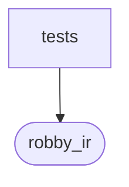

# `robby_ir::run::tests`

[Self-model](../../../README.md) · [run](../index.md)

| | |
|---|---|
| kind | `code.module` |
| declared at | [`crates/robby-ir/src/run.rs:192`](../../../../../crates/robby-ir/src/run.rs#L192) |
| provenance | extractor · confidence 1.00 |
| nodes | 4 |

## Package diagram

## Dependency matrix

| | tests | robby_ir |
|---|---:|---:|
| **tests** | · | 2 |
| **robby_ir** | | · |
## References

- calls → [`robby_ir::run`](../index.md) — new, with_subject

## Items

| Item | Kind | Steps | Location |
|---|---|---:|---|
| [`run_status_round_trips`](run-status-round-trips.md) | `code.function` | 4 | `crates/robby-ir/src/run.rs:196:5` |
| [`run_record_serializes_recipe_string`](run-record-serializes-recipe-string.md) | `code.function` | 7 | `crates/robby-ir/src/run.rs:213:5` |

## Imports

- `use super::*;`

