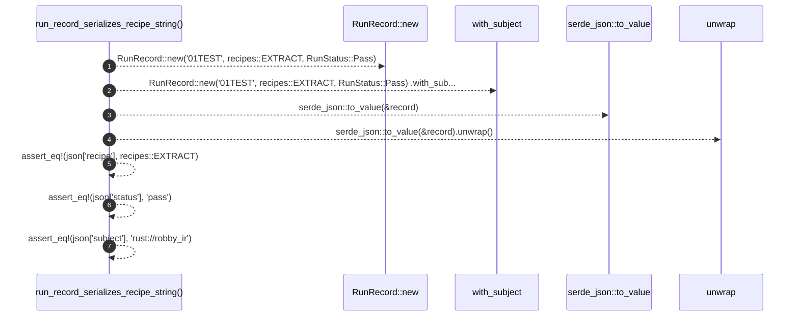

# `robby_ir::run::run_record_serializes_recipe_string`

[Self-model](../../../README.md) · [run::tests](index.md)

| | |
|---|---|
| kind | `code.function` |
| signature | `fn run_record_serializes_recipe_string()` |
| location | [`crates/robby-ir/src/run.rs:213`](../../../../../crates/robby-ir/src/run.rs#L213) |
| provenance | extractor · confidence 1.00 |

```rust
#[test]
    fn run_record_serializes_recipe_string() {
        let record = RunRecord::new("01TEST", recipes::EXTRACT, RunStatus::Pass)
            .with_subject("rust://robby_ir");
        let json = serde_json::to_value(&record).unwrap();
        assert_eq!(json["recipe"], recipes::EXTRACT);
        assert_eq!(json["status"], "pass");
        assert_eq!(json["subject"], "rust://robby_ir");
    }
```



7 steps · 0 observed · 7 possible only

**Edges**

- calls → [`robby_ir::run::impl RecipeId::new`](../index.md)
- calls → [`robby_ir::run::impl RunRecord::with_subject`](../index.md)

## References

- calls → [`robby_ir::run`](../index.md) — new, with_subject

