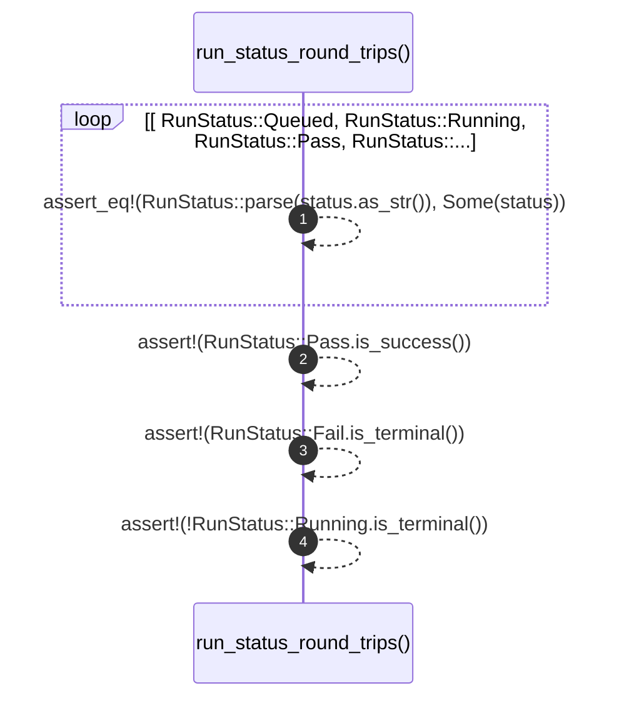

# `robby_ir::run::run_status_round_trips`

[Self-model](../../../README.md) · [run::tests](index.md)

| | |
|---|---|
| kind | `code.function` |
| signature | `fn run_status_round_trips()` |
| location | [`crates/robby-ir/src/run.rs:196`](../../../../../crates/robby-ir/src/run.rs#L196) |
| provenance | extractor · confidence 1.00 |

```rust
#[test]
    fn run_status_round_trips() {
        for status in [
            RunStatus::Queued,
            RunStatus::Running,
            RunStatus::Pass,
            RunStatus::Fail,
            RunStatus::Error,
            RunStatus::Cancelled,
        ] {
            assert_eq!(RunStatus::parse(status.as_str()), Some(status));
        }
        assert!(RunStatus::Pass.is_success());
        assert!(RunStatus::Fail.is_terminal());
        assert!(!RunStatus::Running.is_terminal());
    }
```



4 steps · 0 observed · 4 possible only

