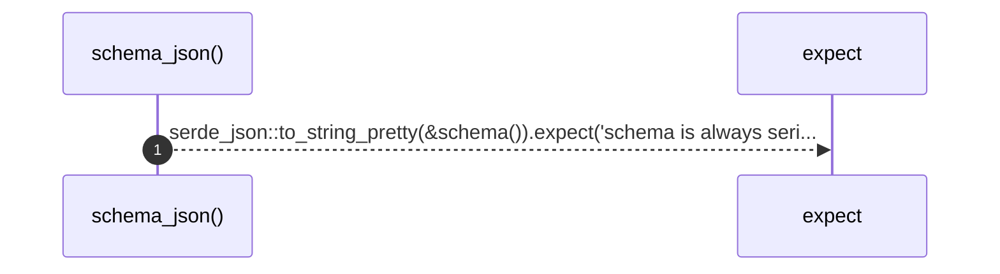

# `robby_ir::schema_json`

[Self-model](../README.md) · [robby_ir](index.md)

| | |
|---|---|
| kind | `code.function` |
| signature | `fn schema_json() -> String` |
| location | [`crates/robby-ir/src/lib.rs:42`](../../../crates/robby-ir/src/lib.rs#L42) |
| provenance | extractor · confidence 1.00 |

> Pretty-printed JSON Schema.

```rust
/// Pretty-printed JSON Schema.
pub fn schema_json() -> String {
    serde_json::to_string_pretty(&schema()).expect("schema is always serializable")
}
```



1 steps · 0 observed · 1 possible only

