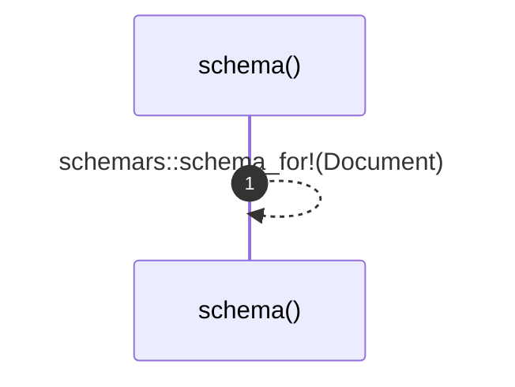

# `robby_ir::schema`

[Self-model](../README.md) · [robby_ir](index.md)

| | |
|---|---|
| kind | `code.function` |
| signature | `fn schema() -> schemars::Schema` |
| location | [`crates/robby-ir/src/lib.rs:39`](../../../crates/robby-ir/src/lib.rs#L39) |
| provenance | extractor · confidence 1.00 |

> The JSON Schema for [`Document`], derived from the Rust types.
> 
> This is the single source of truth for the contract. TypeScript types are
> generated from this later rather than maintained by hand.

```rust
/// The JSON Schema for [`Document`], derived from the Rust types.
///
/// This is the single source of truth for the contract. TypeScript types are
/// generated from this later rather than maintained by hand.
pub fn schema() -> schemars::Schema {
    schemars::schema_for!(Document)
}
```



1 steps · 0 observed · 1 possible only

## Referenced by

- calls ← [`robby_ir::schema_json`](schema-json.md)

