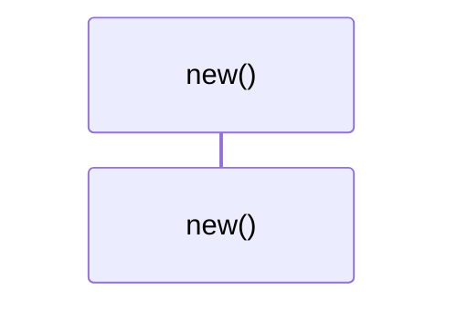
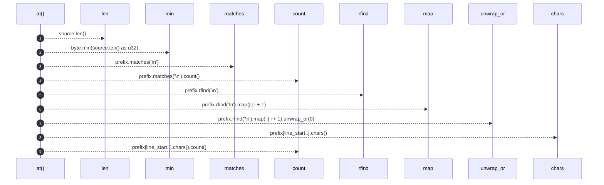

# `robby_ir::span::impl Position`

[Self-model](../../README.md) · [span](index.md)

| | |
|---|---|
| kind | `code.impl` |
| location | [`crates/robby-ir/src/span.rs:21`](../../../../crates/robby-ir/src/span.rs#L21) |
| provenance | extractor · confidence 1.00 |

```rust
impl Position {
    pub fn new(line: u32, column: u32, byte: u32) -> Self {
        Self { line, column, byte }
    }

    /// Resolve a byte offset to a line/column position.
    ///
    /// Out-of-range offsets clamp to the end of the source rather than panicking:
    /// a slightly wrong span must never take down the whole render.
    pub fn at(source: &str, byte: u32) -> Self {
        let byte = byte.min(source.len() as u32);
        let prefix = &source[..byte as usize];
        let line = prefix.matches('\n').count() as u32 + 1;
        let line_start = prefix.rfind('\n').map(|i| i + 1).unwrap_or(0);
        let column = prefix[line_start..].chars().count() as u32 + 1;
        Self { line, column, byte }
    }
}
```

## Referenced by

- calls ← [`robby_ir::coverage::make_gap`](../coverage/make-gap.md)
- calls ← [`robby_ir::span::impl Span::new`](index.md)

### `new`

| | |
|---|---|
| kind | `code.method` |
| signature | `fn new(3)` |
| location | [`crates/robby-ir/src/span.rs:22`](../../../../crates/robby-ir/src/span.rs#L22) |
| provenance | extractor · confidence 1.00 |

```rust
pub fn new(line: u32, column: u32, byte: u32) -> Self {
        Self { line, column, byte }
    }
```



0 steps · 0 observed · 0 possible only

### `at`

| | |
|---|---|
| kind | `code.method` |
| signature | `fn at(2)` |
| location | [`crates/robby-ir/src/span.rs:26`](../../../../crates/robby-ir/src/span.rs#L26) |
| provenance | extractor · confidence 1.00 |

> Resolve a byte offset to a line/column position.
> 
> Out-of-range offsets clamp to the end of the source rather than panicking:
> a slightly wrong span must never take down the whole render.

```rust
/// Resolve a byte offset to a line/column position.
    ///
    /// Out-of-range offsets clamp to the end of the source rather than panicking:
    /// a slightly wrong span must never take down the whole render.
    pub fn at(source: &str, byte: u32) -> Self {
        let byte = byte.min(source.len() as u32);
        let prefix = &source[..byte as usize];
        let line = prefix.matches('\n').count() as u32 + 1;
        let line_start = prefix.rfind('\n').map(|i| i + 1).unwrap_or(0);
        let column = prefix[line_start..].chars().count() as u32 + 1;
        Self { line, column, byte }
    }
```



9 steps · 0 observed · 9 possible only

