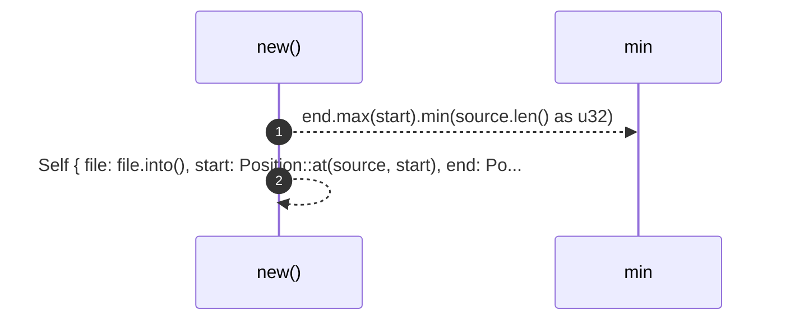
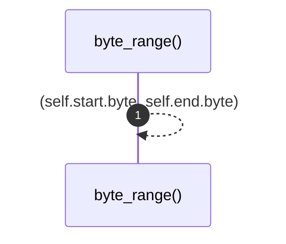
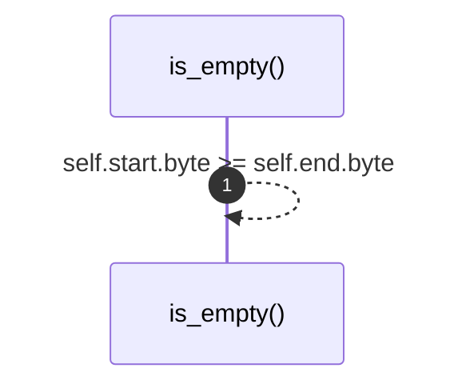
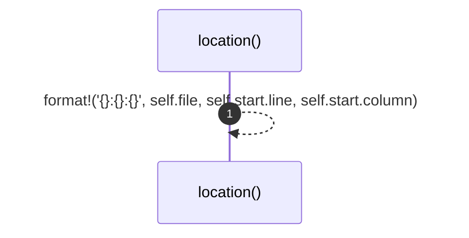

# `robby_ir::span::impl Span`

[Self-model](../../README.md) · [span](index.md)

| | |
|---|---|
| kind | `code.impl` |
| location | [`crates/robby-ir/src/span.rs:49`](../../../../crates/robby-ir/src/span.rs#L49) |
| provenance | extractor · confidence 1.00 |

```rust
impl Span {
    pub fn new(file: impl Into<String>, source: &str, start: u32, end: u32) -> Self {
        let end = end.max(start).min(source.len() as u32);
        Self {
            file: file.into(),
            start: Position::at(source, start),
            end: Position::at(source, end),
        }
    }

    pub fn byte_range(&self) -> (u32, u32) {
        (self.start.byte, self.end.byte)
    }

    pub fn is_empty(&self) -> bool {
        self.start.byte >= self.end.byte
    }

    /// `file:line:column`, suitable for editor links.
    pub fn location(&self) -> String {
        format!("{}:{}:{}", self.file, self.start.line, self.start.column)
    }
}
```

### `new`

| | |
|---|---|
| kind | `code.method` |
| signature | `fn new(4)` |
| location | [`crates/robby-ir/src/span.rs:50`](../../../../crates/robby-ir/src/span.rs#L50) |
| provenance | extractor · confidence 1.00 |

```rust
pub fn new(file: impl Into<String>, source: &str, start: u32, end: u32) -> Self {
        let end = end.max(start).min(source.len() as u32);
        Self {
            file: file.into(),
            start: Position::at(source, start),
            end: Position::at(source, end),
        }
    }
```



2 steps · 0 observed · 2 possible only

### `byte_range`

| | |
|---|---|
| kind | `code.method` |
| signature | `fn byte_range(1)` |
| location | [`crates/robby-ir/src/span.rs:59`](../../../../crates/robby-ir/src/span.rs#L59) |
| provenance | extractor · confidence 1.00 |

```rust
pub fn byte_range(&self) -> (u32, u32) {
        (self.start.byte, self.end.byte)
    }
```



1 steps · 0 observed · 1 possible only

### `is_empty`

| | |
|---|---|
| kind | `code.method` |
| signature | `fn is_empty(1)` |
| location | [`crates/robby-ir/src/span.rs:63`](../../../../crates/robby-ir/src/span.rs#L63) |
| provenance | extractor · confidence 1.00 |

```rust
pub fn is_empty(&self) -> bool {
        self.start.byte >= self.end.byte
    }
```



1 steps · 0 observed · 1 possible only

### `location`

| | |
|---|---|
| kind | `code.method` |
| signature | `fn location(1)` |
| location | [`crates/robby-ir/src/span.rs:67`](../../../../crates/robby-ir/src/span.rs#L67) |
| provenance | extractor · confidence 1.00 |

> `file:line:column`, suitable for editor links.

```rust
/// `file:line:column`, suitable for editor links.
    pub fn location(&self) -> String {
        format!("{}:{}:{}", self.file, self.start.line, self.start.column)
    }
```



1 steps · 0 observed · 1 possible only

