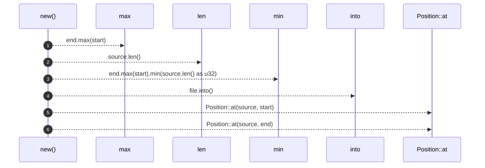
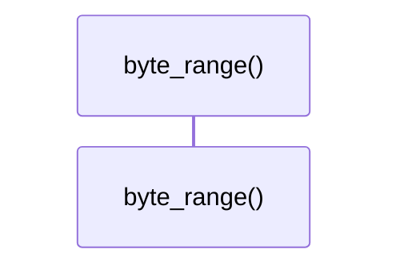
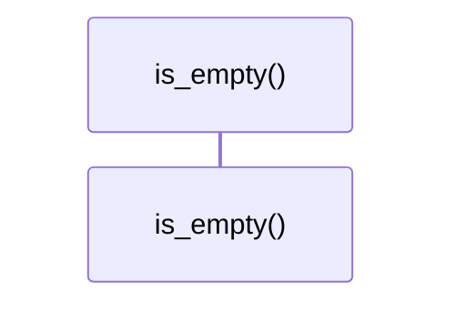
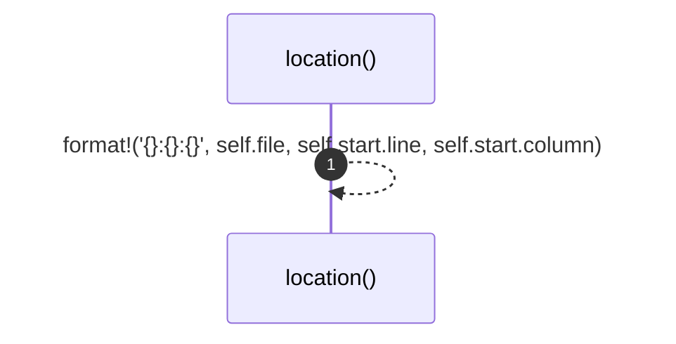

# `robby_ir::span::impl Span`

[Self-model](../../README.md) · [span](index.md)

| | |
|---|---|
| kind | `code.impl` |
| location | [`crates/robby-ir/src/span.rs:49`](../../../../crates/robby-ir/src/span.rs#L49) |
| provenance | extractor · confidence 1.00 |

```rust
impl Span {
    pub fn new(file: impl Into<String>, source: &str, start: u32, end: u32) -> Self {
        let end = end.max(start).min(source.len() as u32);
        Self {
            file: file.into(),
            start: Position::at(source, start),
            end: Position::at(source, end),
        }
    }

    pub fn byte_range(&self) -> (u32, u32) {
        (self.start.byte, self.end.byte)
    }

    pub fn is_empty(&self) -> bool {
        self.start.byte >= self.end.byte
    }

    /// `file:line:column`, suitable for editor links.
    pub fn location(&self) -> String {
        format!("{}:{}:{}", self.file, self.start.line, self.start.column)
    }
}
```

## References

- calls → [`robby_ir::span`](index.md) — at

## Referenced by

- calls ← [`robby_agent::context::collect_comment_contexts`](../../robby_agent/context/collect-comment-contexts.md)
- calls ← [`robby_agent::context::file_location`](../../robby_agent/context/file-location.md)
- calls ← [`robby_agent::context::line_window`](../../robby_agent/context/line-window.md)
- calls ← [`robby_agent::enrich::impl ChatClient for FakeClient::chat`](../../robby_agent/enrich/tests/index.md)
- calls ← [`robby_agent::enrich::insert_decision`](../../robby_agent/enrich/insert-decision.md)
- calls ← [`robby_agent::model::parse_note`](../../robby_agent/model/parse-note.md)
- calls ← [`robby_agent::openrouter::impl OpenRouterClient::from_env`](../../robby_agent/openrouter/index.md)
- calls ← [`robby_extract::rust::docs_of`](../../robby_extract/rust/docs-of.md)
- calls ← [`robby_extract::rust::sanitize`](../../robby_extract/rust/sanitize.md)
- calls ← [`robby_extract::typescript::attach_leading_docs`](../../robby_extract/typescript/attach-leading-docs.md)
- calls ← [`robby_extract::typescript::emit_comments`](../../robby_extract/typescript/emit-comments.md)
- calls ← [`robby_extract::typescript::is_bare_specifier`](../../robby_extract/typescript/is-bare-specifier.md)
- calls ← [`robby_extract::typescript::package_at`](../../robby_extract/typescript/package-at.md)
- calls ← [`robby_extract::typescript::resolve_relative_import`](../../robby_extract/typescript/resolve-relative-import.md)
- calls ← [`robby_extract::typescript::sanitize`](../../robby_extract/typescript/sanitize.md)
- calls ← [`robby_ir::coverage::file_coverage`](../coverage/file-coverage.md)
- calls ← [`robby_render::markdown::index`](../../robby_render/markdown/index-n_fadae9.md)
- calls ← [`robby_render::tree::module_page`](../../robby_render/tree/module-page.md)
- calls ← [`robby_render::tree::render_node`](../../robby_render/tree/render-node.md)
- calls ← [`robby_render::view::comments::impl CommentsView::from_root`](../../robby_render/view/comments/index.md)
- calls ← [`robby_render::view::select::collect`](../../robby_render/view/select/collect.md)
- calls ← [`robby_render::web::impl FrameDetail::from_node_in_doc`](../../robby_render/web/index.md)

### `new`

| | |
|---|---|
| kind | `code.method` |
| signature | `fn new(4)` |
| location | [`crates/robby-ir/src/span.rs:50`](../../../../crates/robby-ir/src/span.rs#L50) |
| provenance | extractor · confidence 1.00 |

```rust
pub fn new(file: impl Into<String>, source: &str, start: u32, end: u32) -> Self {
        let end = end.max(start).min(source.len() as u32);
        Self {
            file: file.into(),
            start: Position::at(source, start),
            end: Position::at(source, end),
        }
    }
```



6 steps · 0 observed · 6 possible only

**Edges**

- calls → [`robby_ir::span::impl Position::at`](index.md)
- calls → [`robby_ir::span::impl Position::at`](index.md)

### `byte_range`

| | |
|---|---|
| kind | `code.method` |
| signature | `fn byte_range(1)` |
| location | [`crates/robby-ir/src/span.rs:59`](../../../../crates/robby-ir/src/span.rs#L59) |
| provenance | extractor · confidence 1.00 |

```rust
pub fn byte_range(&self) -> (u32, u32) {
        (self.start.byte, self.end.byte)
    }
```



0 steps · 0 observed · 0 possible only

### `is_empty`

| | |
|---|---|
| kind | `code.method` |
| signature | `fn is_empty(1)` |
| location | [`crates/robby-ir/src/span.rs:63`](../../../../crates/robby-ir/src/span.rs#L63) |
| provenance | extractor · confidence 1.00 |

```rust
pub fn is_empty(&self) -> bool {
        self.start.byte >= self.end.byte
    }
```



0 steps · 0 observed · 0 possible only

### `location`

| | |
|---|---|
| kind | `code.method` |
| signature | `fn location(1)` |
| location | [`crates/robby-ir/src/span.rs:67`](../../../../crates/robby-ir/src/span.rs#L67) |
| provenance | extractor · confidence 1.00 |

> `file:line:column`, suitable for editor links.

```rust
/// `file:line:column`, suitable for editor links.
    pub fn location(&self) -> String {
        format!("{}:{}:{}", self.file, self.start.line, self.start.column)
    }
```



1 steps · 0 observed · 1 possible only

