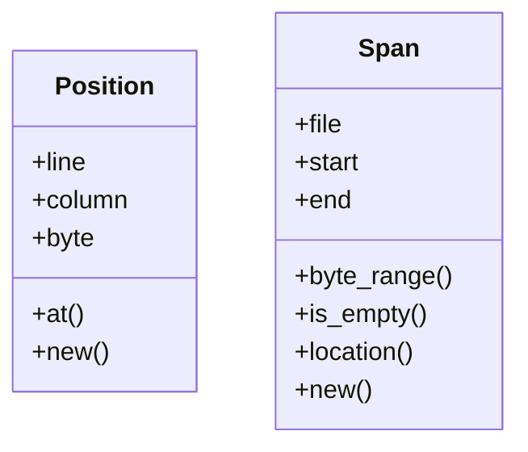
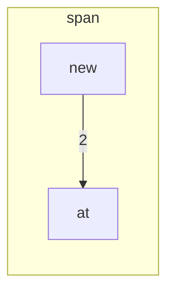

# `robby_ir::span`

[Self-model](../../README.md) · [robby_ir](../index.md)

| | |
|---|---|
| kind | `code.module` |
| declared at | [`crates/robby-ir/src/lib.rs:23`](../../../../crates/robby-ir/src/lib.rs#L23) |
| provenance | extractor · confidence 1.00 |
| nodes | 19 |

## Types



## Package diagram


## Module coupling



## Dependency matrix

| | span |
|---|---:|
| **span** | · |

## Comments

- `crates/robby-ir/src/span.rs:10:1` (docs, `robby_ir::span::Position`): "A single point in a source file."
  ```
  /// A single point in a source file.
  #[derive(Debug, Clone, Copy, PartialEq, Eq, PartialOrd, Ord, Serialize, Deserialize, JsonSchema)]
  pub struct Position {
      /// 1-based line number.
      pub line: u32,
      /// 1-based column, counted in characters.
      pub column: u32,
      /// 0-based byte offset into the file.
      pub byte: u32,
  }
  ```
- `crates/robby-ir/src/span.rs:26:5` (docs, `robby_ir::span::impl Position::at`): "Resolve a byte offset to a line/column position. Out-of-range offsets clamp to the end of the source rather than panick…"
  ```
  /// Resolve a byte offset to a line/column position.
      ///
      /// Out-of-range offsets clamp to the end of the source rather than panicking:
      /// a slightly wrong span must never take down the whole render.
      pub fn at(source: &str, byte: u32) -> Self {
          let byte = byte.min(source.len() as u32);
          let prefix = &source[..byte as usize];
          let line = prefix.matches('\n').count() as u32 + 1;
          let line_start = prefix.rfind('\n').map(|i| i + 1).unwrap_or(0);
          let column = prefix[line_start..].chars().count() as u32 + 1;
          Self { line, column, byte }
      }
  ```
- `crates/robby-ir/src/span.rs:40:1` (docs, `robby_ir::span::Span`): "A half-open byte range within one file."
  ```
  /// A half-open byte range within one file.
  #[derive(Debug, Clone, PartialEq, Eq, Serialize, Deserialize, JsonSchema)]
  pub struct Span {
      /// Repository-relative path, always with forward slashes.
      pub file: String,
      pub start: Position,
      pub end: Position,
  }
  ```
- `crates/robby-ir/src/span.rs:67:5` (docs, `robby_ir::span::impl Span::location`): "`file:line:column`, suitable for editor links."
  ```
  /// `file:line:column`, suitable for editor links.
      pub fn location(&self) -> String {
          format!("{}:{}:{}", self.file, self.start.line, self.start.column)
      }
  ```
## Referenced by

- calls ← [`robby_agent::context::collect_comment_contexts`](../../robby_agent/context/collect-comment-contexts.md)
- calls ← [`robby_agent::context::file_location`](../../robby_agent/context/file-location.md)
- calls ← [`robby_agent::context::line_window`](../../robby_agent/context/line-window.md)
- calls ← [`robby_agent::enrich::impl ChatClient for FakeClient::chat`](../../robby_agent/enrich/tests/index.md)
- calls ← [`robby_agent::enrich::insert_decision`](../../robby_agent/enrich/insert-decision.md)
- calls ← [`robby_agent::model::parse_note`](../../robby_agent/model/parse-note.md)
- calls ← [`robby_agent::openrouter::impl OpenRouterClient::from_env`](../../robby_agent/openrouter/index.md)
- calls ← [`robby_extract::rust::docs_of`](../../robby_extract/rust/docs-of.md)
- calls ← [`robby_extract::rust::sanitize`](../../robby_extract/rust/sanitize.md)
- calls ← [`robby_extract::typescript::attach_leading_docs`](../../robby_extract/typescript/attach-leading-docs.md)
- calls ← [`robby_extract::typescript::emit_comments`](../../robby_extract/typescript/emit-comments.md)
- calls ← [`robby_extract::typescript::is_bare_specifier`](../../robby_extract/typescript/is-bare-specifier.md)
- calls ← [`robby_extract::typescript::package_at`](../../robby_extract/typescript/package-at.md)
- calls ← [`robby_extract::typescript::resolve_relative_import`](../../robby_extract/typescript/resolve-relative-import.md)
- calls ← [`robby_extract::typescript::sanitize`](../../robby_extract/typescript/sanitize.md)
- calls ← [`robby_ir::coverage::file_coverage`](../coverage/file-coverage.md)
- calls ← [`robby_ir::coverage::make_gap`](../coverage/make-gap.md)
- calls ← [`robby_render::markdown::index`](../../robby_render/markdown/index-n_fadae9.md)
- calls ← [`robby_render::tree::module_page`](../../robby_render/tree/module-page.md)
- calls ← [`robby_render::tree::render_node`](../../robby_render/tree/render-node.md)
- calls ← [`robby_render::view::comments::impl CommentsView::from_root`](../../robby_render/view/comments/index.md)
- calls ← [`robby_render::view::select::collect`](../../robby_render/view/select/collect.md)
- calls ← [`robby_render::web::impl FrameDetail::from_node_in_doc`](../../robby_render/web/index.md)

## Items

| Item | Kind | Steps | Location |
|---|---|---:|---|
| [`Position`](position.md) | `code.struct` | — | `crates/robby-ir/src/span.rs:10:1` |
| [`impl Position`](impl-position.md) | `code.impl` | — | `crates/robby-ir/src/span.rs:21:1` |
| [`Span`](span.md) | `code.struct` | — | `crates/robby-ir/src/span.rs:40:1` |
| [`impl Span`](impl-span.md) | `code.impl` | — | `crates/robby-ir/src/span.rs:49:1` |

## Imports

- `use schemars::JsonSchema;`
- `use serde::{Deserialize, Serialize};`

