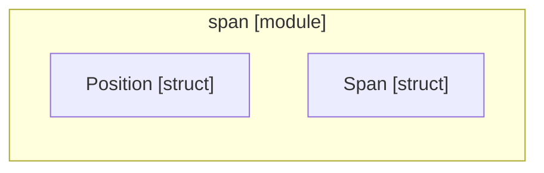

# `robby_ir::span`

[Self-model](../../README.md) · [robby_ir](../index.md)

| | |
|---|---|
| kind | `code.module` |
| declared at | [`crates/robby-ir/src/lib.rs:21`](../../../../crates/robby-ir/src/lib.rs#L21) |
| provenance | extractor · confidence 1.00 |
| nodes | 19 |

## Items

| Item | Kind | Steps | Location |
|---|---|---:|---|
| [`Position`](position.md) | `code.struct` | — | `crates/robby-ir/src/span.rs:10:1` |
| [`impl Position`](impl-position.md) | `code.impl` | — | `crates/robby-ir/src/span.rs:21:1` |
| [`Span`](span.md) | `code.struct` | — | `crates/robby-ir/src/span.rs:40:1` |
| [`impl Span`](impl-span.md) | `code.impl` | — | `crates/robby-ir/src/span.rs:49:1` |

## Imports

- `use schemars::JsonSchema;`
- `use serde::{Deserialize, Serialize};`

