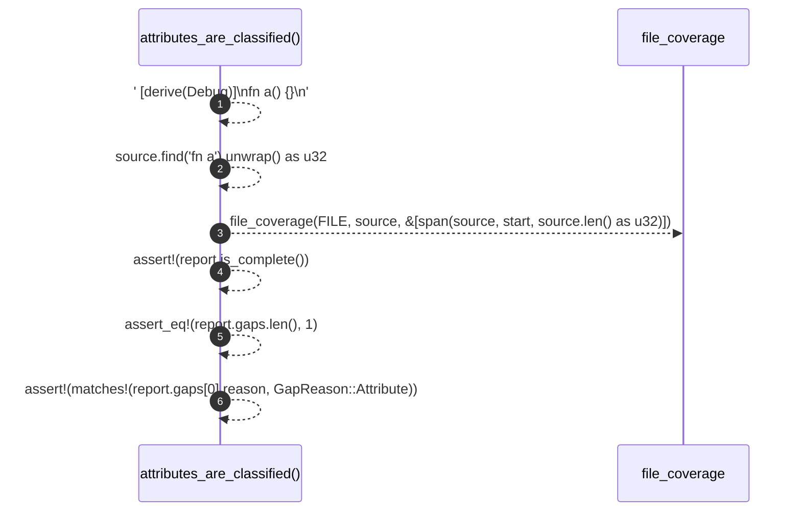

# `robby_ir::test_coverage::attributes_are_classified`

[Self-model](../../README.md) · [test_coverage](index.md)

| | |
|---|---|
| kind | `code.function` |
| signature | `fn attributes_are_classified()` |
| location | [`crates/robby-ir/tests/coverage.rs:56`](../../../../crates/robby-ir/tests/coverage.rs#L56) |
| provenance | extractor · confidence 1.00 |

```rust
#[test]
fn attributes_are_classified() {
    let source = "#[derive(Debug)]\nfn a() {}\n";
    let start = source.find("fn a").unwrap() as u32;
    let report = file_coverage(FILE, source, &[span(source, start, source.len() as u32)]);

    assert!(report.is_complete());
    assert_eq!(report.gaps.len(), 1);
    assert!(matches!(report.gaps[0].reason, GapReason::Attribute));
}
```



6 steps · 0 observed · 6 possible only

**Edges**

- calls → [`robby_ir::coverage::file_coverage`](../coverage/file-coverage.md)

