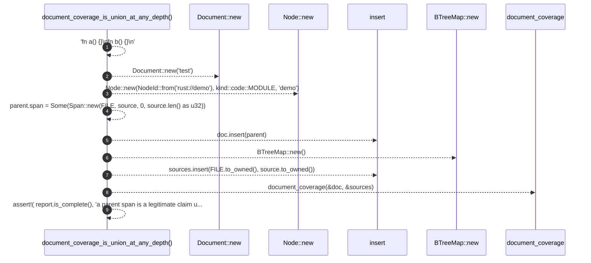

# `robby_ir::test_coverage::document_coverage_is_union_at_any_depth`

[Self-model](../../README.md) · [test_coverage](index.md)

| | |
|---|---|
| kind | `code.function` |
| signature | `fn document_coverage_is_union_at_any_depth()` |
| location | [`crates/robby-ir/tests/coverage.rs:187`](../../../../crates/robby-ir/tests/coverage.rs#L187) |
| provenance | extractor · confidence 1.00 |

```rust
#[test]
fn document_coverage_is_union_at_any_depth() {
    let source = "fn a() {}\nfn b() {}\n";
    let mut doc = Document::new("test");
    let mut parent = Node::new(NodeId::from("rust://demo"), kind::code::MODULE, "demo");
    parent.span = Some(Span::new(FILE, source, 0, source.len() as u32));
    doc.insert(parent);

    let mut sources = BTreeMap::new();
    sources.insert(FILE.to_owned(), source.to_owned());

    let report = document_coverage(&doc, &sources);
    assert!(
        report.is_complete(),
        "a parent span is a legitimate claim under the union model"
    );
}
```



9 steps · 0 observed · 9 possible only

**Edges**

- calls → [`robby_extract::impl LineIndex::new`](../../robby_extract/index.md)
- calls → [`robby_extract::impl LineIndex::new`](../../robby_extract/index.md)
- calls → [`robby_ir::model::impl Document::insert`](../model/index.md)
- calls → [`robby_extract::impl LineIndex::new`](../../robby_extract/index.md)
- calls → [`robby_ir::model::impl Document::insert`](../model/index.md)
- calls → [`robby_ir::coverage::document_coverage`](../coverage/document-coverage.md)

