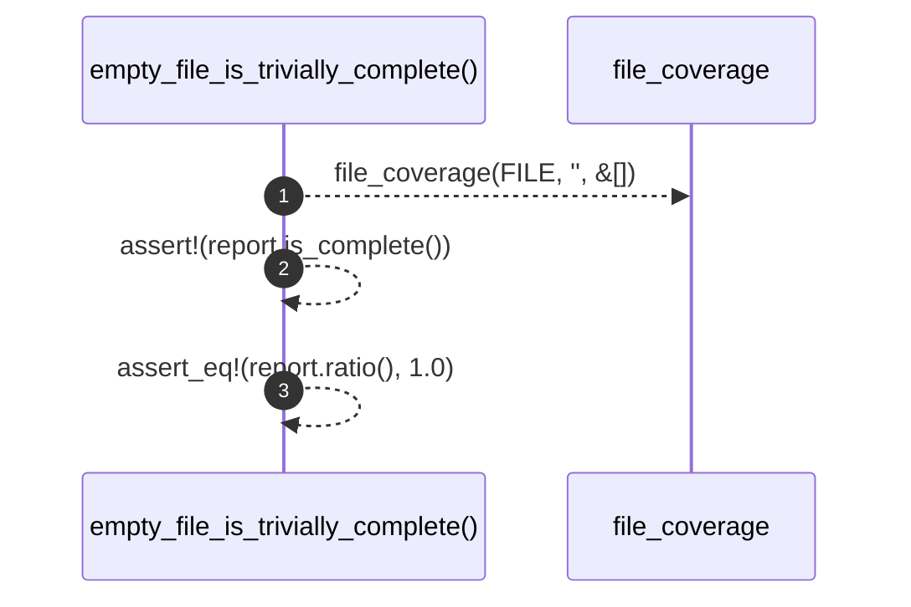

# `robby_ir::test_coverage::empty_file_is_trivially_complete`

[Self-model](../../README.md) · [test_coverage](index.md)

| | |
|---|---|
| kind | `code.function` |
| signature | `fn empty_file_is_trivially_complete()` |
| location | [`crates/robby-ir/tests/coverage.rs:92`](../../../../crates/robby-ir/tests/coverage.rs#L92) |
| provenance | extractor · confidence 1.00 |

```rust
#[test]
fn empty_file_is_trivially_complete() {
    let report = file_coverage(FILE, "", &[]);
    assert!(report.is_complete());
    assert_eq!(report.ratio(), 1.0);
}
```



3 steps · 0 observed · 3 possible only

**Edges**

- calls → [`robby_ir::coverage::file_coverage`](../coverage/file-coverage.md)

## References

- calls → [`robby_ir::coverage`](../coverage/index.md) — file_coverage

