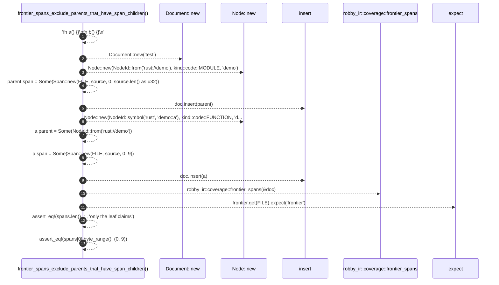

# `robby_ir::test_coverage::frontier_spans_exclude_parents_that_have_span_children`

[Self-model](../../README.md) · [test_coverage](index.md)

| | |
|---|---|
| kind | `code.function` |
| signature | `fn frontier_spans_exclude_parents_that_have_span_children()` |
| location | [`crates/robby-ir/tests/coverage.rs:168`](../../../../crates/robby-ir/tests/coverage.rs#L168) |
| provenance | extractor · confidence 1.00 |

```rust
#[test]
fn frontier_spans_exclude_parents_that_have_span_children() {
    let source = "fn a() {}\nfn b() {}\n";
    let mut doc = Document::new("test");
    let mut parent = Node::new(NodeId::from("rust://demo"), kind::code::MODULE, "demo");
    parent.span = Some(Span::new(FILE, source, 0, source.len() as u32));
    doc.insert(parent);

    let mut a = Node::new(NodeId::symbol("rust", "demo::a"), kind::code::FUNCTION, "demo::a");
    a.parent = Some(NodeId::from("rust://demo"));
    a.span = Some(Span::new(FILE, source, 0, 9));
    doc.insert(a);

    let frontier = robby_ir::coverage::frontier_spans(&doc);
    let spans = frontier.get(FILE).expect("frontier");
    assert_eq!(spans.len(), 1, "only the leaf claims");
    assert_eq!(spans[0].byte_range(), (0, 9));
}
```



13 steps · 0 observed · 13 possible only

**Edges**

- calls → [`robby_extract::impl LineIndex::new`](../../robby_extract/index.md)
- calls → [`robby_extract::impl LineIndex::new`](../../robby_extract/index.md)
- calls → [`robby_ir::model::impl Document::insert`](../model/index.md)
- calls → [`robby_extract::impl LineIndex::new`](../../robby_extract/index.md)
- calls → [`robby_ir::model::impl Document::insert`](../model/index.md)
- calls → [`robby_ir::coverage::frontier_spans`](../coverage/frontier-spans.md)

