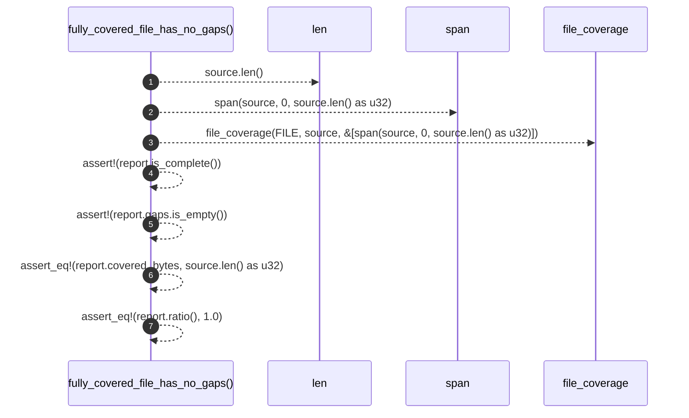

# `robby_ir::test_coverage::fully_covered_file_has_no_gaps`

[Self-model](../../README.md) · [test_coverage](index.md)

| | |
|---|---|
| kind | `code.function` |
| signature | `fn fully_covered_file_has_no_gaps()` |
| location | [`crates/robby-ir/tests/coverage.rs:20`](../../../../crates/robby-ir/tests/coverage.rs#L20) |
| provenance | extractor · confidence 1.00 |

```rust
#[test]
fn fully_covered_file_has_no_gaps() {
    let source = "fn add(a: i32, b: i32) -> i32 { a + b }";
    let report = file_coverage(FILE, source, &[span(source, 0, source.len() as u32)]);

    assert!(report.is_complete());
    assert!(report.gaps.is_empty());
    assert_eq!(report.covered_bytes, source.len() as u32);
    assert_eq!(report.ratio(), 1.0);
}
```



7 steps · 0 observed · 7 possible only

**Edges**

- calls → [`robby_ir::test_coverage::span`](span.md)
- calls → [`robby_ir::coverage::file_coverage`](../coverage/file-coverage.md)

## References

- calls → [`robby_ir::coverage`](../coverage/index.md) — file_coverage
- calls → [`robby_ir::test_coverage`](index.md) — span

