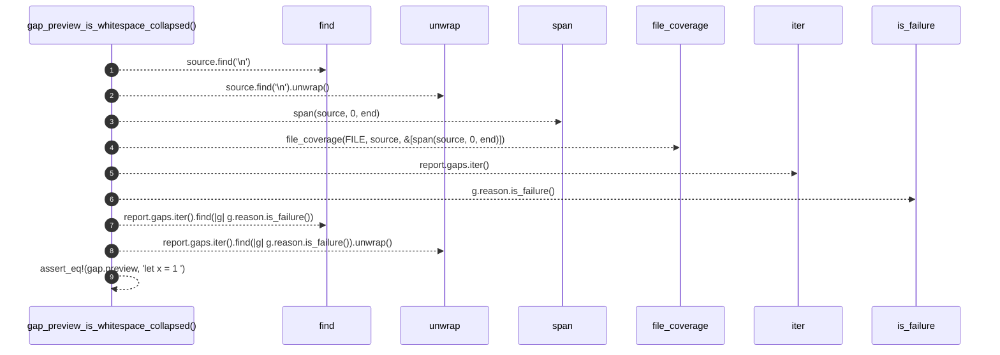

# `robby_ir::test_coverage::gap_preview_is_whitespace_collapsed`

[Self-model](../../README.md) · [test_coverage](index.md)

| | |
|---|---|
| kind | `code.function` |
| signature | `fn gap_preview_is_whitespace_collapsed()` |
| location | [`crates/robby-ir/tests/coverage.rs:158`](../../../../crates/robby-ir/tests/coverage.rs#L158) |
| provenance | extractor · confidence 1.00 |

```rust
#[test]
fn gap_preview_is_whitespace_collapsed() {
    let source = "fn a() {}\n    let   x = 1;\n";
    let end = source.find('\n').unwrap() as u32 + 1;
    let report = file_coverage(FILE, source, &[span(source, 0, end)]);

    let gap = report.gaps.iter().find(|g| g.reason.is_failure()).unwrap();
    assert_eq!(gap.preview, "let x = 1;");
}
```



9 steps · 0 observed · 9 possible only

**Edges**

- calls → [`robby_ir::test_coverage::span`](span.md)
- calls → [`robby_ir::coverage::file_coverage`](../coverage/file-coverage.md)
- calls → [`robby_ir::coverage::impl GapReason::is_failure`](../coverage/index.md)

## References

- calls → [`robby_ir::coverage`](../coverage/index.md) — file_coverage, is_failure
- calls → [`robby_ir::test_coverage`](index.md) — span

