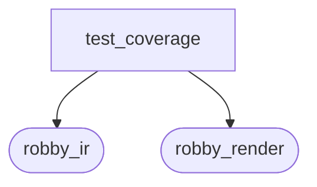
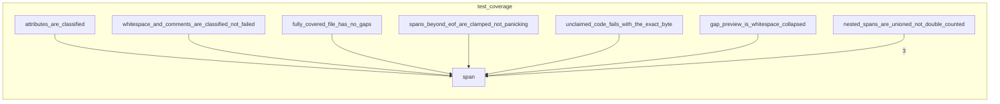

# `robby_ir::test_coverage`

[Self-model](../../README.md) · [robby_ir](../index.md)

| | |
|---|---|
| kind | `code.module` |
| provenance | extractor · confidence 1.00 |
| nodes | 25 |

## Package diagram

## Module coupling

## Dependency matrix

| | test_coverage | robby_ir | robby_render |
|---|---:|---:|---:|
| **test_coverage** | · | 59 | 1 |
| **robby_ir** | | · | |
| **robby_render** | | | · |
## References

- calls → [`robby_ir::coverage`](../coverage/index.md) — 5 items
- calls → [`robby_ir::kind`](../kind/index.md) — as_str, from, new
- calls → [`robby_ir::model`](../model/index.md) — get, insert, symbol, with_lang
- calls → [`robby_render::view::select`](../../robby_render/view/select/index.md) — collect

## Referenced by

- calls ← [`robby_extract::rust::span_of`](../../robby_extract/rust/span-of.md)

## Items

| Item | Kind | Steps | Location |
|---|---|---:|---|
| [`FILE`](file.md) | `code.const` | — | `crates/robby-ir/tests/coverage.rs:14:1` |
| [`span`](span.md) | `code.function` | 1 | `crates/robby-ir/tests/coverage.rs:16:1` |
| [`fully_covered_file_has_no_gaps`](fully-covered-file-has-no-gaps.md) | `code.function` | 7 | `crates/robby-ir/tests/coverage.rs:20:1` |
| [`nested_spans_are_unioned_not_double_counted`](nested-spans-are-unioned-not-double-counted.md) | `code.function` | 7 | `crates/robby-ir/tests/coverage.rs:32:1` |
| [`whitespace_and_comments_are_classified_not_failed`](whitespace-and-comments-are-classified-not-failed.md) | `code.function` | 8 | `crates/robby-ir/tests/coverage.rs:46:1` |
| [`attributes_are_classified`](attributes-are-classified.md) | `code.function` | 8 | `crates/robby-ir/tests/coverage.rs:57:1` |
| [`unclaimed_code_fails_with_the_exact_byte`](unclaimed-code-fails-with-the-exact-byte.md) | `code.function` | 14 | `crates/robby-ir/tests/coverage.rs:68:1` |
| [`empty_file_is_trivially_complete`](empty-file-is-trivially-complete.md) | `code.function` | 3 | `crates/robby-ir/tests/coverage.rs:93:1` |
| [`spans_beyond_eof_are_clamped_not_panicking`](spans-beyond-eof-are-clamped-not-panicking.md) | `code.function` | 4 | `crates/robby-ir/tests/coverage.rs:100:1` |
| [`spans_from_other_files_are_ignored`](spans-from-other-files-are-ignored.md) | `code.function` | 5 | `crates/robby-ir/tests/coverage.rs:108:1` |
| [`unreferenced_files_appear_fully_uncovered`](unreferenced-files-appear-fully-uncovered.md) | `code.function` | 19 | `crates/robby-ir/tests/coverage.rs:118:1` |
| [`report_orders_worst_files_first`](report-orders-worst-files-first.md) | `code.function` | 20 | `crates/robby-ir/tests/coverage.rs:143:1` |
| [`gap_preview_is_whitespace_collapsed`](gap-preview-is-whitespace-collapsed.md) | `code.function` | 9 | `crates/robby-ir/tests/coverage.rs:163:1` |
| [`frontier_spans_exclude_parents_that_have_span_children`](frontier-spans-exclude-parents-that-have-span-children.md) | `code.function` | 19 | `crates/robby-ir/tests/coverage.rs:173:1` |
| [`document_coverage_is_union_at_any_depth`](document-coverage-is-union-at-any-depth.md) | `code.function` | 13 | `crates/robby-ir/tests/coverage.rs:196:1` |
| [`typescript_comments_and_shebang_are_trivia`](typescript-comments-and-shebang-are-trivia.md) | `code.function` | 7 | `crates/robby-ir/tests/coverage.rs:214:1` |
| [`typescript_hash_is_not_a_rust_attribute`](typescript-hash-is-not-a-rust-attribute.md) | `code.function` | 3 | `crates/robby-ir/tests/coverage.rs:232:1` |
| [`leaf_name_handles_path_and_dot_fqns`](leaf-name-handles-path-and-dot-fqns.md) | `code.function` | 3 | `crates/robby-ir/tests/coverage.rs:242:1` |
| [`typescript_node_sets_lang`](typescript-node-sets-lang.md) | `code.function` | 5 | `crates/robby-ir/tests/coverage.rs:249:1` |

## Imports

- `use std::collections::BTreeMap;`
- [`use robby_ir::coverage::{document_coverage, file_coverage};`](../coverage/index.md)
- [`use robby_ir::model::{Document, Node, NodeId};`](../model/index.md)
- [`use robby_ir::span::Span;`](../span/index.md)
- [`use robby_ir::{GapReason, kind};`](../index.md)

