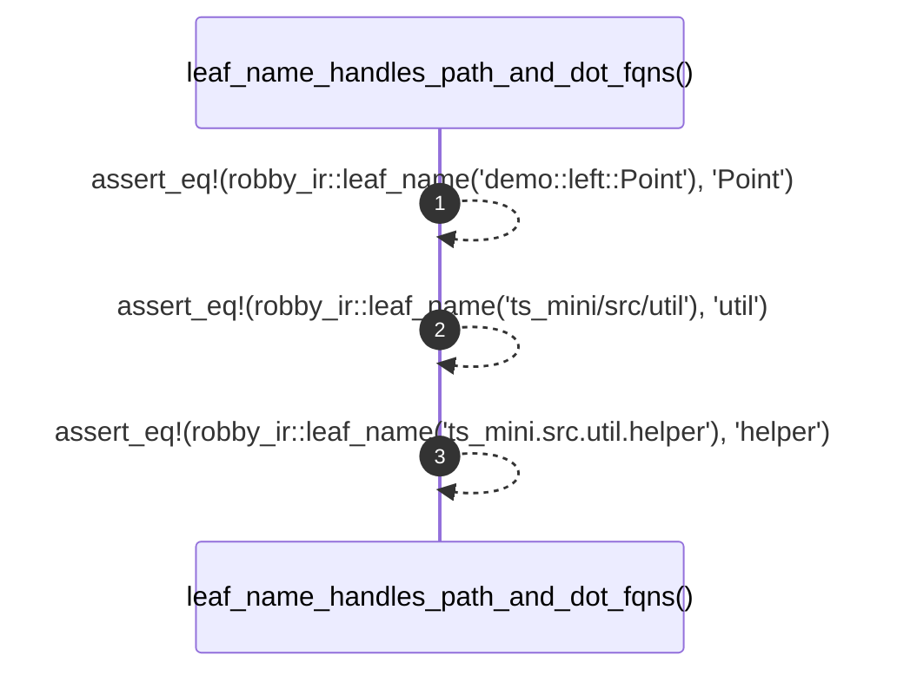

# `robby_ir::test_coverage::leaf_name_handles_path_and_dot_fqns`

[Self-model](../../README.md) · [test_coverage](index.md)

| | |
|---|---|
| kind | `code.function` |
| signature | `fn leaf_name_handles_path_and_dot_fqns()` |
| location | [`crates/robby-ir/tests/coverage.rs:229`](../../../../crates/robby-ir/tests/coverage.rs#L229) |
| provenance | extractor · confidence 1.00 |

```rust
#[test]
fn leaf_name_handles_path_and_dot_fqns() {
    assert_eq!(robby_ir::leaf_name("demo::left::Point"), "Point");
    assert_eq!(robby_ir::leaf_name("ts_mini/src/util"), "util");
    assert_eq!(robby_ir::leaf_name("ts_mini.src.util.helper"), "helper");
}
```



3 steps · 0 observed · 3 possible only

