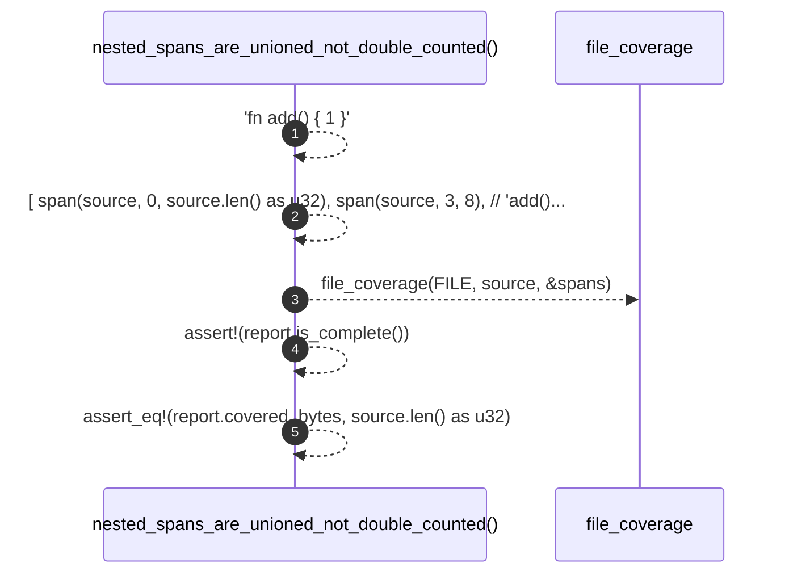

# `robby_ir::test_coverage::nested_spans_are_unioned_not_double_counted`

[Self-model](../../README.md) · [test_coverage](index.md)

| | |
|---|---|
| kind | `code.function` |
| signature | `fn nested_spans_are_unioned_not_double_counted()` |
| location | [`crates/robby-ir/tests/coverage.rs:31`](../../../../crates/robby-ir/tests/coverage.rs#L31) |
| provenance | extractor · confidence 1.00 |

```rust
#[test]
fn nested_spans_are_unioned_not_double_counted() {
    let source = "fn add() { 1 }";
    let spans = [
        span(source, 0, source.len() as u32),
        span(source, 3, 8),  // "add()"
        span(source, 4, 6),  // "dd"
    ];

    let report = file_coverage(FILE, source, &spans);
    assert!(report.is_complete());
    assert_eq!(report.covered_bytes, source.len() as u32);
}
```



5 steps · 0 observed · 5 possible only

**Edges**

- calls → [`robby_ir::coverage::file_coverage`](../coverage/file-coverage.md)

