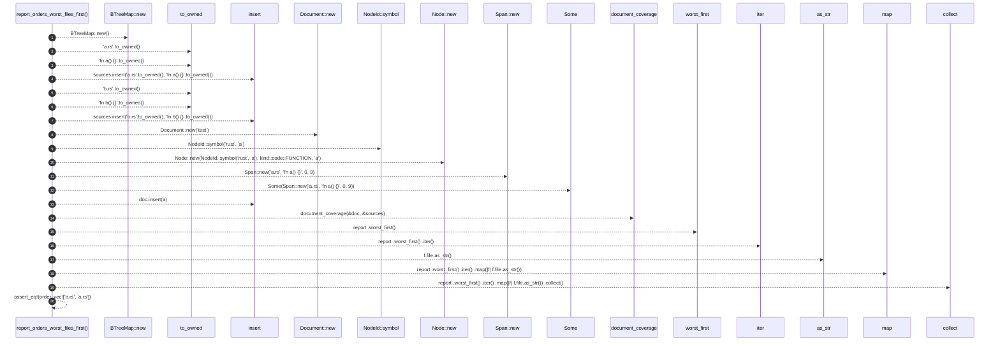

# `robby_ir::test_coverage::report_orders_worst_files_first`

[Self-model](../../README.md) · [test_coverage](index.md)

| | |
|---|---|
| kind | `code.function` |
| signature | `fn report_orders_worst_files_first()` |
| location | [`crates/robby-ir/tests/coverage.rs:143`](../../../../crates/robby-ir/tests/coverage.rs#L143) |
| provenance | extractor · confidence 1.00 |

```rust
#[test]
fn report_orders_worst_files_first() {
    let mut sources = BTreeMap::new();
    sources.insert("a.rs".to_owned(), "fn a() {}".to_owned());
    sources.insert("b.rs".to_owned(), "fn b() {}".to_owned());

    let mut doc = Document::new("test");
    let mut a = Node::new(NodeId::symbol("rust", "a"), kind::code::FUNCTION, "a");
    a.span = Some(Span::new("a.rs", "fn a() {}", 0, 9));
    doc.insert(a);

    let report = document_coverage(&doc, &sources);
    let order: Vec<&str> = report
        .worst_first()
        .iter()
        .map(|f| f.file.as_str())
        .collect();
    assert_eq!(order, vec!["b.rs", "a.rs"]);
}
```



20 steps · 0 observed · 20 possible only

**Edges**

- calls → [`robby_ir::kind::impl Kind::new`](../kind/index.md)
- calls → [`robby_ir::model::impl Document::insert`](../model/index.md)
- calls → [`robby_ir::model::impl Document::insert`](../model/index.md)
- calls → [`robby_ir::kind::impl Kind::new`](../kind/index.md)
- calls → [`robby_ir::model::impl NodeId::symbol`](../model/index.md)
- calls → [`robby_ir::kind::impl Kind::new`](../kind/index.md)
- calls → [`robby_ir::kind::impl Kind::new`](../kind/index.md)
- calls → [`robby_ir::model::impl Document::insert`](../model/index.md)
- calls → [`robby_ir::coverage::document_coverage`](../coverage/document-coverage.md)
- calls → [`robby_ir::coverage::impl CoverageReport::worst_first`](../coverage/index.md)
- calls → [`robby_ir::kind::impl Kind::as_str`](../kind/index.md)
- calls → [`robby_render::view::select::collect`](../../robby_render/view/select/collect.md)

## References

- calls → [`robby_ir::coverage`](../coverage/index.md) — document_coverage, worst_first
- calls → [`robby_ir::kind`](../kind/index.md) — as_str, new
- calls → [`robby_ir::model`](../model/index.md) — insert, symbol
- calls → [`robby_render::view::select`](../../robby_render/view/select/index.md) — collect

