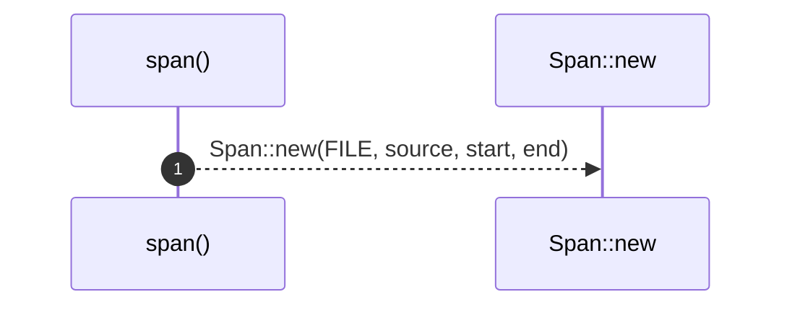

# `robby_ir::test_coverage::span`

[Self-model](../../README.md) · [test_coverage](index.md)

| | |
|---|---|
| kind | `code.function` |
| signature | `fn span(source: &str, start: u32, end: u32) -> Span` |
| location | [`crates/robby-ir/tests/coverage.rs:16`](../../../../crates/robby-ir/tests/coverage.rs#L16) |
| provenance | extractor · confidence 1.00 |

```rust
fn span(source: &str, start: u32, end: u32) -> Span {
    Span::new(FILE, source, start, end)
}
```



1 steps · 0 observed · 1 possible only

**Edges**

- calls → [`robby_extract::impl LineIndex::new`](../../robby_extract/index.md)

