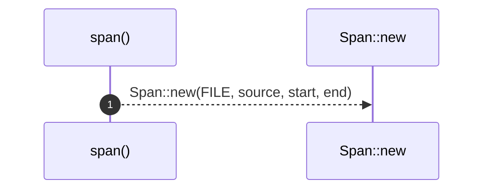

# `robby_ir::test_coverage::span`

[Self-model](../../README.md) · [test_coverage](index.md)

| | |
|---|---|
| kind | `code.function` |
| signature | `fn span(source: &str, start: u32, end: u32) -> Span` |
| location | [`crates/robby-ir/tests/coverage.rs:16`](../../../../crates/robby-ir/tests/coverage.rs#L16) |
| provenance | extractor · confidence 1.00 |

```rust
fn span(source: &str, start: u32, end: u32) -> Span {
    Span::new(FILE, source, start, end)
}
```



1 steps · 0 observed · 1 possible only

**Edges**

- calls → [`robby_ir::kind::impl Kind::new`](../kind/index.md)

## References

- calls → [`robby_ir::kind`](../kind/index.md) — new

## Referenced by

- calls ← [`robby_extract::rust::span_of`](../../robby_extract/rust/span-of.md)
- calls ← [`robby_ir::test_coverage::attributes_are_classified`](attributes-are-classified.md)
- calls ← [`robby_ir::test_coverage::fully_covered_file_has_no_gaps`](fully-covered-file-has-no-gaps.md)
- calls ← [`robby_ir::test_coverage::gap_preview_is_whitespace_collapsed`](gap-preview-is-whitespace-collapsed.md)
- calls ← [`robby_ir::test_coverage::nested_spans_are_unioned_not_double_counted`](nested-spans-are-unioned-not-double-counted.md)
- calls ← [`robby_ir::test_coverage::spans_beyond_eof_are_clamped_not_panicking`](spans-beyond-eof-are-clamped-not-panicking.md)
- calls ← [`robby_ir::test_coverage::unclaimed_code_fails_with_the_exact_byte`](unclaimed-code-fails-with-the-exact-byte.md)
- calls ← [`robby_ir::test_coverage::whitespace_and_comments_are_classified_not_failed`](whitespace-and-comments-are-classified-not-failed.md)

