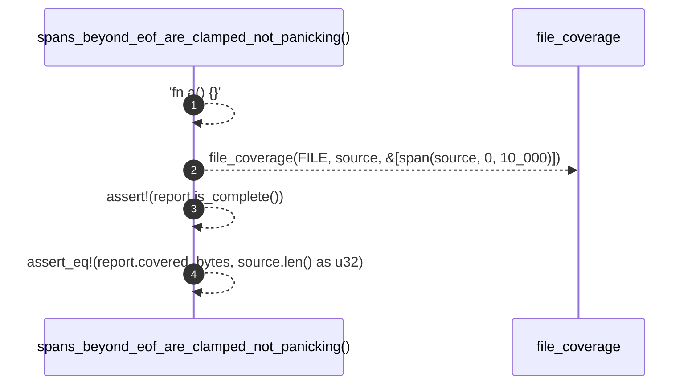

# `robby_ir::test_coverage::spans_beyond_eof_are_clamped_not_panicking`

[Self-model](../../README.md) · [test_coverage](index.md)

| | |
|---|---|
| kind | `code.function` |
| signature | `fn spans_beyond_eof_are_clamped_not_panicking()` |
| location | [`crates/robby-ir/tests/coverage.rs:99`](../../../../crates/robby-ir/tests/coverage.rs#L99) |
| provenance | extractor · confidence 1.00 |

```rust
#[test]
fn spans_beyond_eof_are_clamped_not_panicking() {
    let source = "fn a() {}";
    let report = file_coverage(FILE, source, &[span(source, 0, 10_000)]);
    assert!(report.is_complete());
    assert_eq!(report.covered_bytes, source.len() as u32);
}
```



4 steps · 0 observed · 4 possible only

**Edges**

- calls → [`robby_ir::coverage::file_coverage`](../coverage/file-coverage.md)

