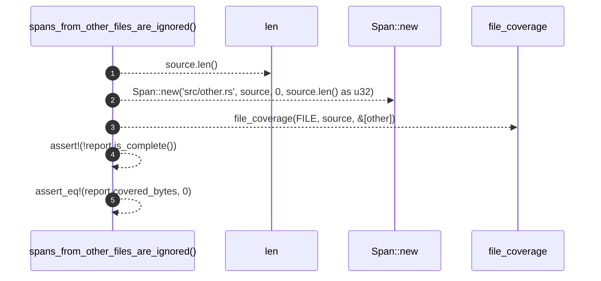

# `robby_ir::test_coverage::spans_from_other_files_are_ignored`

[Self-model](../../README.md) · [test_coverage](index.md)

| | |
|---|---|
| kind | `code.function` |
| signature | `fn spans_from_other_files_are_ignored()` |
| location | [`crates/robby-ir/tests/coverage.rs:107`](../../../../crates/robby-ir/tests/coverage.rs#L107) |
| provenance | extractor · confidence 1.00 |

```rust
#[test]
fn spans_from_other_files_are_ignored() {
    let source = "fn a() {}";
    let other = Span::new("src/other.rs", source, 0, source.len() as u32);
    let report = file_coverage(FILE, source, &[other]);

    assert!(!report.is_complete());
    assert_eq!(report.covered_bytes, 0);
}
```



5 steps · 0 observed · 5 possible only

**Edges**

- calls → [`robby_ir::kind::impl Kind::new`](../kind/index.md)
- calls → [`robby_ir::coverage::file_coverage`](../coverage/file-coverage.md)

## References

- calls → [`robby_ir::coverage`](../coverage/index.md) — file_coverage
- calls → [`robby_ir::kind`](../kind/index.md) — new

