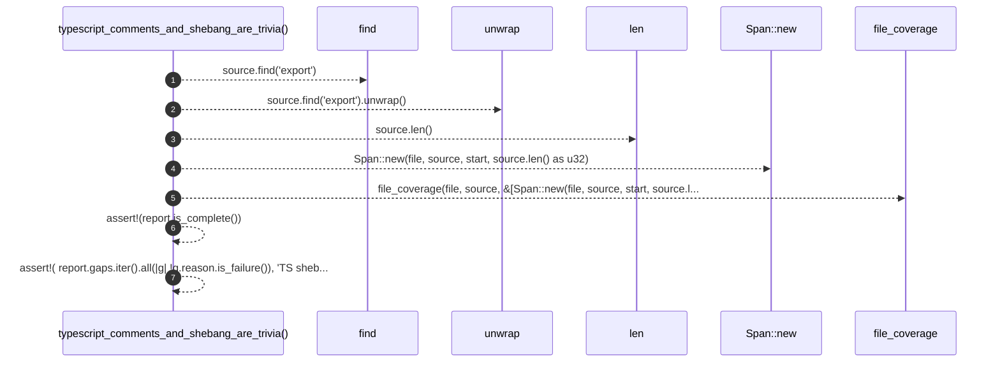

# `robby_ir::test_coverage::typescript_comments_and_shebang_are_trivia`

[Self-model](../../README.md) · [test_coverage](index.md)

| | |
|---|---|
| kind | `code.function` |
| signature | `fn typescript_comments_and_shebang_are_trivia()` |
| location | [`crates/robby-ir/tests/coverage.rs:205`](../../../../crates/robby-ir/tests/coverage.rs#L205) |
| provenance | extractor · confidence 1.00 |

```rust
#[test]
fn typescript_comments_and_shebang_are_trivia() {
    let file = "src/demo.ts";
    let source = "#!/usr/bin/env node\n// leading\n\nexport function a() {}\n";
    let start = source.find("export").unwrap() as u32;
    let report = file_coverage(file, source, &[Span::new(file, source, start, source.len() as u32)]);

    assert!(report.is_complete());
    assert!(
        report.gaps.iter().all(|g| !g.reason.is_failure()),
        "TS shebang/comments must not fail the gate"
    );
}
```



7 steps · 0 observed · 7 possible only

**Edges**

- calls → [`robby_ir::kind::impl Kind::new`](../kind/index.md)
- calls → [`robby_ir::coverage::file_coverage`](../coverage/file-coverage.md)

## References

- calls → [`robby_ir::coverage`](../coverage/index.md) — file_coverage
- calls → [`robby_ir::kind`](../kind/index.md) — new

