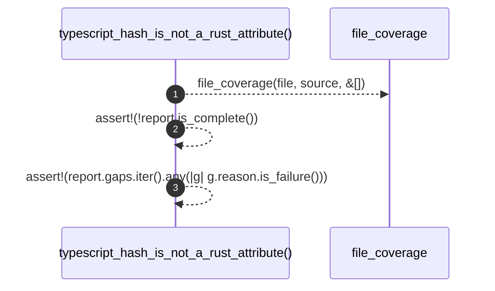

# `robby_ir::test_coverage::typescript_hash_is_not_a_rust_attribute`

[Self-model](../../README.md) · [test_coverage](index.md)

| | |
|---|---|
| kind | `code.function` |
| signature | `fn typescript_hash_is_not_a_rust_attribute()` |
| location | [`crates/robby-ir/tests/coverage.rs:232`](../../../../crates/robby-ir/tests/coverage.rs#L232) |
| provenance | extractor · confidence 1.00 |

```rust
#[test]
fn typescript_hash_is_not_a_rust_attribute() {
    let file = "src/demo.ts";
    // Private fields use `#name` — that is code, not Rust `#[…]` trivia.
    let source = "class A { #x = 1 }\n";
    let report = file_coverage(file, source, &[]);
    assert!(!report.is_complete());
    assert!(report.gaps.iter().any(|g| g.reason.is_failure()));
}
```



3 steps · 0 observed · 3 possible only

**Edges**

- calls → [`robby_ir::coverage::file_coverage`](../coverage/file-coverage.md)

## References

- calls → [`robby_ir::coverage`](../coverage/index.md) — file_coverage

