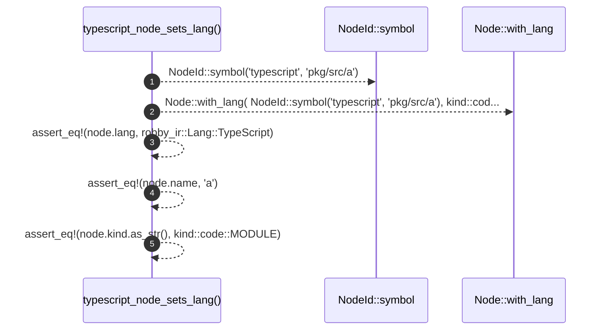

# `robby_ir::test_coverage::typescript_node_sets_lang`

[Self-model](../../README.md) · [test_coverage](index.md)

| | |
|---|---|
| kind | `code.function` |
| signature | `fn typescript_node_sets_lang()` |
| location | [`crates/robby-ir/tests/coverage.rs:236`](../../../../crates/robby-ir/tests/coverage.rs#L236) |
| provenance | extractor · confidence 1.00 |

```rust
#[test]
fn typescript_node_sets_lang() {
    let node = Node::with_lang(
        NodeId::symbol("typescript", "pkg/src/a"),
        kind::code::MODULE,
        "pkg/src/a",
        robby_ir::Lang::TypeScript,
    );
    assert_eq!(node.lang, robby_ir::Lang::TypeScript);
    assert_eq!(node.name, "a");
    assert_eq!(node.kind.as_str(), kind::code::MODULE);
}
```



5 steps · 0 observed · 5 possible only

**Edges**

- calls → [`robby_ir::model::impl NodeId::symbol`](../model/index.md)
- calls → [`robby_ir::model::impl Node::with_lang`](../model/index.md)

## References

- calls → [`robby_ir::model`](../model/index.md) — symbol, with_lang

