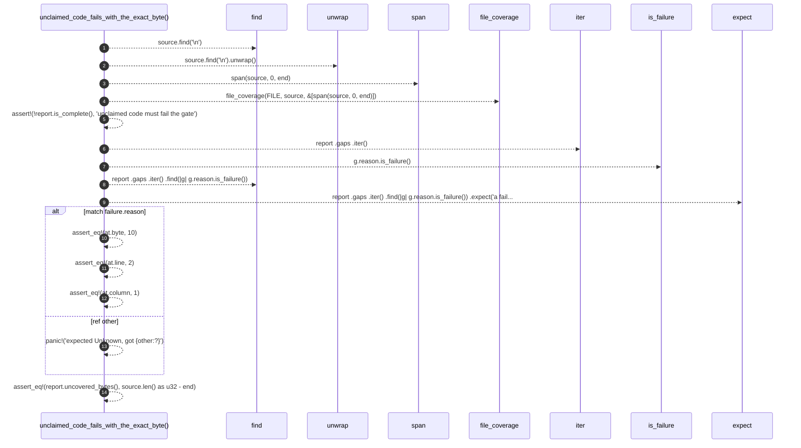

# `robby_ir::test_coverage::unclaimed_code_fails_with_the_exact_byte`

[Self-model](../../README.md) · [test_coverage](index.md)

| | |
|---|---|
| kind | `code.function` |
| signature | `fn unclaimed_code_fails_with_the_exact_byte()` |
| location | [`crates/robby-ir/tests/coverage.rs:68`](../../../../crates/robby-ir/tests/coverage.rs#L68) |
| provenance | extractor · confidence 1.00 |

```rust
#[test]
fn unclaimed_code_fails_with_the_exact_byte() {
    let source = "fn a() {}\nlet x = 1;\n";
    let end = source.find('\n').unwrap() as u32 + 1;
    let report = file_coverage(FILE, source, &[span(source, 0, end)]);

    assert!(!report.is_complete(), "unclaimed code must fail the gate");

    let failure = report
        .gaps
        .iter()
        .find(|g| g.reason.is_failure())
        .expect("a failing gap");

    match failure.reason {
        GapReason::Unknown { at } => {
            assert_eq!(at.byte, 10);
            assert_eq!(at.line, 2);
            assert_eq!(at.column, 1);
        }
        ref other => panic!("expected Unknown, got {other:?}"),
    }
    assert_eq!(report.uncovered_bytes(), source.len() as u32 - end);
}
```



14 steps · 0 observed · 14 possible only

**Edges**

- calls → [`robby_ir::test_coverage::span`](span.md)
- calls → [`robby_ir::coverage::file_coverage`](../coverage/file-coverage.md)
- calls → [`robby_ir::coverage::impl GapReason::is_failure`](../coverage/index.md)

## References

- calls → [`robby_ir::coverage`](../coverage/index.md) — file_coverage, is_failure
- calls → [`robby_ir::test_coverage`](index.md) — span

