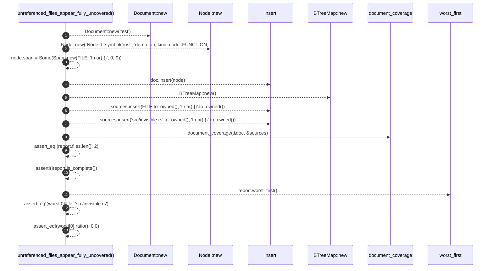

# `robby_ir::test_coverage::unreferenced_files_appear_fully_uncovered`

[Self-model](../../README.md) · [test_coverage](index.md)

| | |
|---|---|
| kind | `code.function` |
| signature | `fn unreferenced_files_appear_fully_uncovered()` |
| location | [`crates/robby-ir/tests/coverage.rs:117`](../../../../crates/robby-ir/tests/coverage.rs#L117) |
| provenance | extractor · confidence 1.00 |

```rust
#[test]
fn unreferenced_files_appear_fully_uncovered() {
    let mut doc = Document::new("test");
    let mut node = Node::new(
        NodeId::symbol("rust", "demo::a"),
        kind::code::FUNCTION,
        "demo::a",
    );
    node.span = Some(Span::new(FILE, "fn a() {}", 0, 9));
    doc.insert(node);

    let mut sources = BTreeMap::new();
    sources.insert(FILE.to_owned(), "fn a() {}".to_owned());
    sources.insert("src/invisible.rs".to_owned(), "fn b() {}".to_owned());

    let report = document_coverage(&doc, &sources);

    assert_eq!(report.files.len(), 2);
    assert!(!report.is_complete());

    let worst = report.worst_first();
    assert_eq!(worst[0].file, "src/invisible.rs");
    assert_eq!(worst[0].ratio(), 0.0);
}
```



13 steps · 0 observed · 13 possible only

**Edges**

- calls → [`robby_extract::impl LineIndex::new`](../../robby_extract/index.md)
- calls → [`robby_extract::impl LineIndex::new`](../../robby_extract/index.md)
- calls → [`robby_ir::model::impl Document::insert`](../model/index.md)
- calls → [`robby_extract::impl LineIndex::new`](../../robby_extract/index.md)
- calls → [`robby_ir::model::impl Document::insert`](../model/index.md)
- calls → [`robby_ir::model::impl Document::insert`](../model/index.md)
- calls → [`robby_ir::coverage::document_coverage`](../coverage/document-coverage.md)
- calls → [`robby_ir::coverage::impl CoverageReport::worst_first`](../coverage/index.md)

