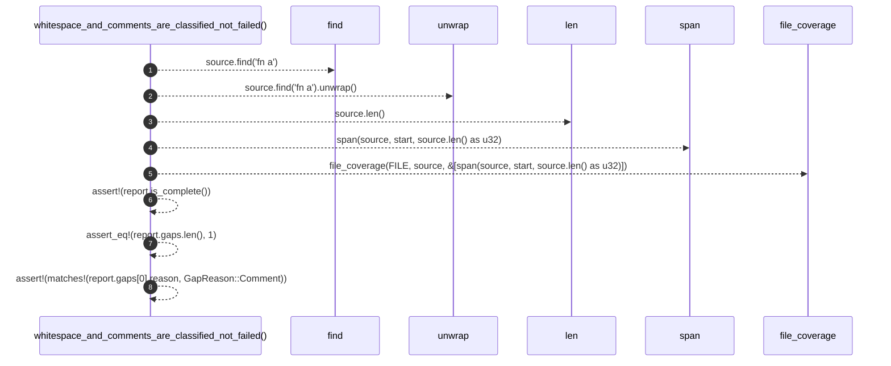

# `robby_ir::test_coverage::whitespace_and_comments_are_classified_not_failed`

[Self-model](../../README.md) · [test_coverage](index.md)

| | |
|---|---|
| kind | `code.function` |
| signature | `fn whitespace_and_comments_are_classified_not_failed()` |
| location | [`crates/robby-ir/tests/coverage.rs:45`](../../../../crates/robby-ir/tests/coverage.rs#L45) |
| provenance | extractor · confidence 1.00 |

```rust
#[test]
fn whitespace_and_comments_are_classified_not_failed() {
    let source = "// leading comment\n\nfn a() {}\n";
    let start = source.find("fn a").unwrap() as u32;
    let report = file_coverage(FILE, source, &[span(source, start, source.len() as u32)]);

    assert!(report.is_complete());
    assert_eq!(report.gaps.len(), 1);
    assert!(matches!(report.gaps[0].reason, GapReason::Comment));
}
```



8 steps · 0 observed · 8 possible only

**Edges**

- calls → [`robby_ir::test_coverage::span`](span.md)
- calls → [`robby_ir::coverage::file_coverage`](../coverage/file-coverage.md)

## References

- calls → [`robby_ir::coverage`](../coverage/index.md) — file_coverage
- calls → [`robby_ir::test_coverage`](index.md) — span

