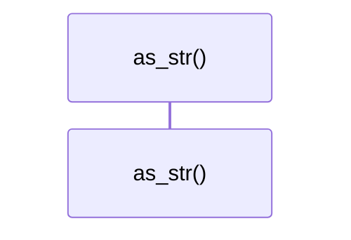
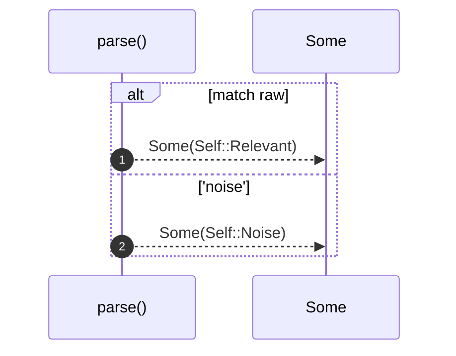

# `robby_ir::vocab::impl Verdict`

[Self-model](../../README.md) · [vocab](index.md)

| | |
|---|---|
| kind | `code.impl` |
| location | [`crates/robby-ir/src/vocab.rs:17`](../../../../crates/robby-ir/src/vocab.rs#L17) |
| provenance | extractor · confidence 1.00 |

```rust
impl Verdict {
    pub fn as_str(self) -> &'static str {
        match self {
            Self::Relevant => "relevant",
            Self::Noise => "noise",
        }
    }

    pub fn parse(raw: &str) -> Option<Self> {
        match raw {
            "relevant" => Some(Self::Relevant),
            "noise" => Some(Self::Noise),
            _ => None,
        }
    }
}
```

## Referenced by

- calls ← [`robby_cli::example_self_model::run`](../../robby_cli/example_self_model/run.md)
- calls ← [`robby_cli::run`](../../robby_cli/run.md)
- calls ← [`robby_extract::typescript::extract_file`](../../robby_extract/typescript/extract-file.md)
- calls ← [`robby_ir::vocab::wire`](tests/wire.md)
- calls ← [`robby_render::view::comments::enrichment_fields`](../../robby_render/view/comments/enrichment-fields.md)
- calls ← [`robby_render::view::comments::parse_verdict`](../../robby_render/view/comments/parse-verdict.md)

### `as_str`

| | |
|---|---|
| kind | `code.method` |
| signature | `fn as_str(1)` |
| location | [`crates/robby-ir/src/vocab.rs:18`](../../../../crates/robby-ir/src/vocab.rs#L18) |
| provenance | extractor · confidence 1.00 |

```rust
pub fn as_str(self) -> &'static str {
        match self {
            Self::Relevant => "relevant",
            Self::Noise => "noise",
        }
    }
```



0 steps · 0 observed · 0 possible only

### `parse`

| | |
|---|---|
| kind | `code.method` |
| signature | `fn parse(1)` |
| location | [`crates/robby-ir/src/vocab.rs:25`](../../../../crates/robby-ir/src/vocab.rs#L25) |
| provenance | extractor · confidence 1.00 |

```rust
pub fn parse(raw: &str) -> Option<Self> {
        match raw {
            "relevant" => Some(Self::Relevant),
            "noise" => Some(Self::Noise),
            _ => None,
        }
    }
```



2 steps · 0 observed · 2 possible only

