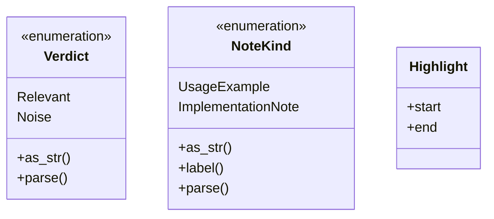
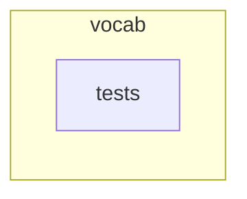
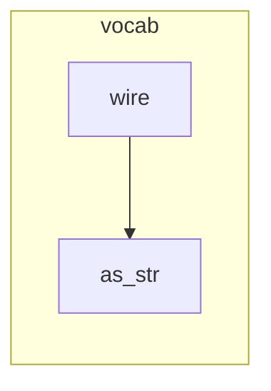

# `robby_ir::vocab`

[Self-model](../../README.md) · [robby_ir](../index.md)

| | |
|---|---|
| kind | `code.module` |
| declared at | [`crates/robby-ir/src/lib.rs:24`](../../../../crates/robby-ir/src/lib.rs#L24) |
| provenance | extractor · confidence 1.00 |
| nodes | 23 |

## Types



## Package diagram



## Module coupling



## Dependency matrix

| | vocab | tests |
|---|---:|---:|
| **vocab** | · | |
| **tests** | | · |

## Comments

- `crates/robby-ir/src/vocab.rs:57:5` (docs, `robby_ir::vocab::impl NoteKind::label`): "Prose label for Markdown and the terminal report."
  ```
  /// Prose label for Markdown and the terminal report.
      pub fn label(self) -> &'static str {
          match self {
              Self::UsageExample => "usage example",
              Self::ImplementationNote => "implementation note",
          }
      }
  ```
- `crates/robby-ir/src/vocab.rs:66:1` (docs, `robby_ir::vocab::Highlight`): "Byte range into a code window. Offsets are UTF-8 bytes."
  ```
  /// Byte range into a code window. Offsets are UTF-8 bytes.
  #[derive(Debug, Clone, PartialEq, Eq, Serialize, Deserialize, JsonSchema)]
  pub struct Highlight {
      pub start: u32,
      pub end: u32,
  }
  ```
## Referenced by

- calls ← [`robby_cli::example_self_model::run`](../../robby_cli/example_self_model/run.md)
- calls ← [`robby_cli::run`](../../robby_cli/run.md)
- calls ← [`robby_extract::typescript::extract_file`](../../robby_extract/typescript/extract-file.md)
- calls ← [`robby_render::view::comments::enrichment_fields`](../../robby_render/view/comments/enrichment-fields.md)
- calls ← [`robby_render::view::comments::parse_verdict`](../../robby_render/view/comments/parse-verdict.md)

## Modules

- [`vocab::tests`](tests/index.md) — 4 nodes

## Items

| Item | Kind | Steps | Location |
|---|---|---:|---|
| [`Verdict`](verdict.md) | `code.enum` | — | `crates/robby-ir/src/vocab.rs:10:1` |
| [`impl Verdict`](impl-verdict.md) | `code.impl` | — | `crates/robby-ir/src/vocab.rs:17:1` |
| [`NoteKind`](notekind.md) | `code.enum` | — | `crates/robby-ir/src/vocab.rs:34:1` |
| [`impl NoteKind`](impl-notekind.md) | `code.impl` | — | `crates/robby-ir/src/vocab.rs:41:1` |
| [`Highlight`](highlight.md) | `code.struct` | — | `crates/robby-ir/src/vocab.rs:66:1` |

## Imports

- `use schemars::JsonSchema;`
- `use serde::{Deserialize, Serialize};`

