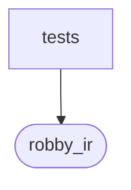

# `robby_ir::vocab::tests`

[Self-model](../../../README.md) · [vocab](../index.md)

| | |
|---|---|
| kind | `code.module` |
| declared at | [`crates/robby-ir/src/vocab.rs:73`](../../../../../crates/robby-ir/src/vocab.rs#L73) |
| provenance | extractor · confidence 1.00 |
| nodes | 4 |

## Package diagram

## Dependency matrix

| | tests | robby_ir |
|---|---:|---:|
| **tests** | · | 1 |
| **robby_ir** | | · |
## References

- calls → [`robby_ir::vocab`](../index.md) — as_str

## Items

| Item | Kind | Steps | Location |
|---|---|---:|---|
| [`wire`](wire.md) | `code.function` | 5 | `crates/robby-ir/src/vocab.rs:77:5` |
| [`names_match_serde`](names-match-serde.md) | `code.function` | 6 | `crates/robby-ir/src/vocab.rs:85:5` |

## Imports

- `use super::*;`

