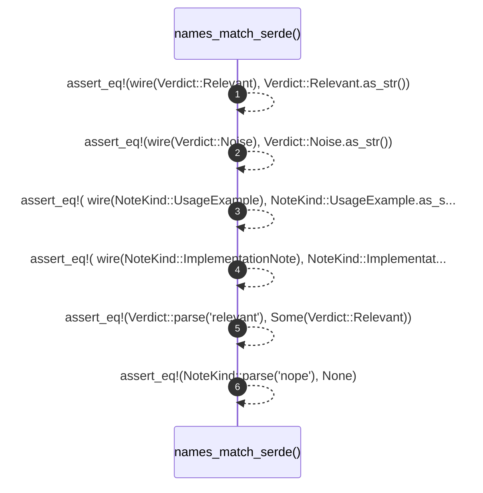

# `robby_ir::vocab::names_match_serde`

[Self-model](../../../README.md) · [vocab::tests](index.md)

| | |
|---|---|
| kind | `code.function` |
| signature | `fn names_match_serde()` |
| location | [`crates/robby-ir/src/vocab.rs:85`](../../../../../crates/robby-ir/src/vocab.rs#L85) |
| provenance | extractor · confidence 1.00 |

```rust
#[test]
    fn names_match_serde() {
        assert_eq!(wire(Verdict::Relevant), Verdict::Relevant.as_str());
        assert_eq!(wire(Verdict::Noise), Verdict::Noise.as_str());
        assert_eq!(
            wire(NoteKind::UsageExample),
            NoteKind::UsageExample.as_str()
        );
        assert_eq!(
            wire(NoteKind::ImplementationNote),
            NoteKind::ImplementationNote.as_str()
        );
        assert_eq!(Verdict::parse("relevant"), Some(Verdict::Relevant));
        assert_eq!(NoteKind::parse("nope"), None);
    }
```



6 steps · 0 observed · 6 possible only

