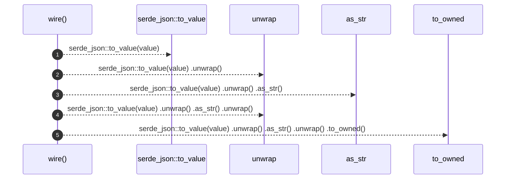

# `robby_ir::vocab::wire`

[Self-model](../../../README.md) · [vocab::tests](index.md)

| | |
|---|---|
| kind | `code.function` |
| signature | `fn wire<T: serde::Serialize>(value: T) -> String` |
| location | [`crates/robby-ir/src/vocab.rs:77`](../../../../../crates/robby-ir/src/vocab.rs#L77) |
| provenance | extractor · confidence 1.00 |

```rust
fn wire<T: serde::Serialize>(value: T) -> String {
        serde_json::to_value(value)
            .unwrap()
            .as_str()
            .unwrap()
            .to_owned()
    }
```



5 steps · 0 observed · 5 possible only

**Edges**

- calls → [`robby_ir::vocab::impl Verdict::as_str`](../index.md)

## References

- calls → [`robby_ir::vocab`](../index.md) — as_str

