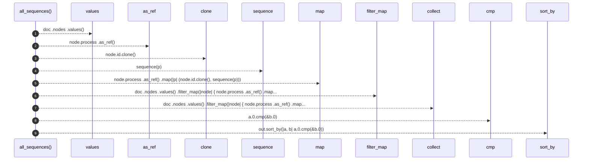

# `robby_render::all_sequences`

[Self-model](../README.md) · [robby_render](index.md)

| | |
|---|---|
| kind | `code.function` |
| signature | `fn all_sequences(doc: &Document) -> Vec<(NodeId, String)>` |
| location | [`crates/robby-render/src/lib.rs:104`](../../../crates/robby-render/src/lib.rs#L104) |
| provenance | extractor · confidence 1.00 |

> Every process in the document as Mermaid, keyed by node id.

```rust
/// Every process in the document as Mermaid, keyed by node id.
pub fn all_sequences(doc: &Document) -> Vec<(NodeId, String)> {
    let mut out: Vec<(NodeId, String)> = doc
        .nodes
        .values()
        .filter_map(|node| {
            node.process
                .as_ref()
                .map(|p| (node.id.clone(), sequence(p)))
        })
        .collect();
    out.sort_by(|a, b| a.0.cmp(&b.0));
    out
}
```



9 steps · 0 observed · 9 possible only

**Edges**

- calls → [`robby_render::sequence`](sequence.md)
- calls → [`robby_render::view::select::collect`](view/select/collect.md)

## References

- calls → [`robby_render`](index.md) — sequence
- calls → [`robby_render::view::select`](view/select/index.md) — collect

## Referenced by

- calls ← [`robby_render::pipeline::render_files`](pipeline/render-files.md)

