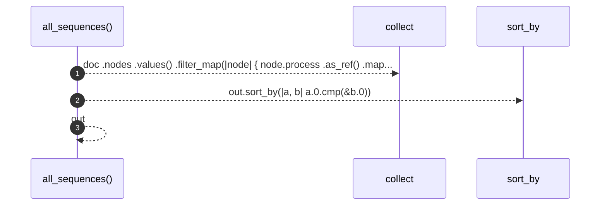

# `robby_render::all_sequences`

[Self-model](../README.md) · [robby_render](index.md)

| | |
|---|---|
| kind | `code.function` |
| signature | `fn all_sequences(doc: &Document) -> Vec<(NodeId, String)>` |
| location | [`crates/robby-render/src/lib.rs:245`](../../../crates/robby-render/src/lib.rs#L245) |
| provenance | extractor · confidence 1.00 |

> Convenience: render every process in a document, keyed by node id.

```rust
/// Convenience: render every process in a document, keyed by node id.
pub fn all_sequences(doc: &Document) -> Vec<(NodeId, String)> {
    let mut out: Vec<(NodeId, String)> = doc
        .nodes
        .values()
        .filter_map(|node| {
            node.process
                .as_ref()
                .map(|p| (node.id.clone(), sequence(p)))
        })
        .collect();
    out.sort_by(|a, b| a.0.cmp(&b.0));
    out
}
```



3 steps · 0 observed · 3 possible only

