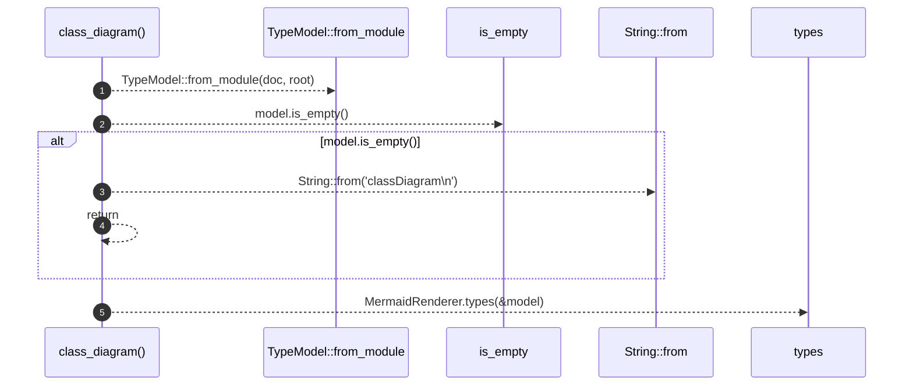

# `robby_render::class_diagram`

[Self-model](../README.md) · [robby_render](index.md)

| | |
|---|---|
| kind | `code.function` |
| signature | `fn class_diagram(doc: &Document, root: &NodeId) -> String` |
| location | [`crates/robby-render/src/lib.rs:42`](../../../crates/robby-render/src/lib.rs#L42) |
| provenance | extractor · confidence 1.00 |

> UML class diagram for a module's types.

```rust
/// UML class diagram for a module's types.
pub fn class_diagram(doc: &Document, root: &NodeId) -> String {
    let model = TypeModel::from_module(doc, root);
    if model.is_empty() {
        return String::from("classDiagram\n");
    }
    MermaidRenderer.types(&model)
}
```



5 steps · 0 observed · 5 possible only

**Edges**

- calls → [`robby_render::view::types::impl TypeModel::from_module`](view/types/index.md)
- calls → [`robby_render::view::links::impl LinkGraph::is_empty`](view/links/index.md)
- calls → [`robby_ir::kind::impl From<&str> for Kind::from`](../robby_ir/kind/index.md)
- calls → [`robby_render::render::Renderer::types`](render/index.md)

## References

- calls → [`robby_ir::kind`](../robby_ir/kind/index.md) — from
- calls → [`robby_render::render`](render/index.md) — types
- calls → [`robby_render::view::links`](view/links/index.md) — is_empty
- calls → [`robby_render::view::types`](view/types/index.md) — from_module

## Referenced by

- calls ← [`robby_render::test_render::class_diagram_marks_traits_as_interfaces`](test_render/class-diagram-marks-traits-as-interfaces.md)
- calls ← [`robby_render::test_render::dependencies_emits_package_weighted_and_dsm`](test_render/dependencies-emits-package-weighted-and-dsm.md)

