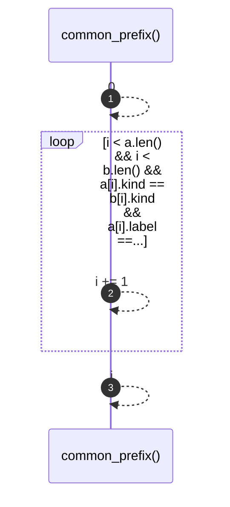

# `robby_render::common_prefix`

[Self-model](../README.md) · [robby_render](index.md)

| | |
|---|---|
| kind | `code.function` |
| signature | `fn common_prefix(a: &[Block], b: &[Block]) -> usize` |
| location | [`crates/robby-render/src/lib.rs:83`](../../../crates/robby-render/src/lib.rs#L83) |
| provenance | extractor · confidence 1.00 |

```rust
fn common_prefix(a: &[Block], b: &[Block]) -> usize {
    let mut i = 0;
    while i < a.len() && i < b.len() && a[i].kind == b[i].kind && a[i].label == b[i].label {
        i += 1;
    }
    i
}
```



3 steps · 0 observed · 3 possible only

