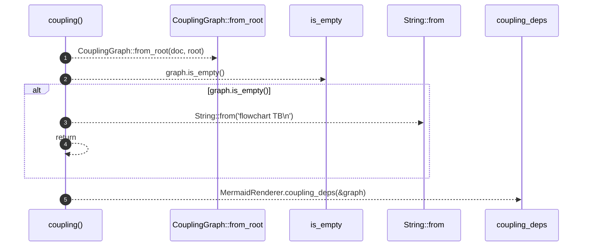

# `robby_render::coupling`

[Self-model](../README.md) · [robby_render](index.md)

| | |
|---|---|
| kind | `code.function` |
| signature | `fn coupling(doc: &Document, root: &NodeId) -> String` |
| location | [`crates/robby-render/src/lib.rs:62`](../../../crates/robby-render/src/lib.rs#L62) |
| provenance | extractor · confidence 1.00 |

> Internal call-coupling digraph (Mermaid) for a module/crate root.

```rust
/// Internal call-coupling digraph (Mermaid) for a module/crate root.
pub fn coupling(doc: &Document, root: &NodeId) -> String {
    let graph = CouplingGraph::from_root(doc, root);
    if graph.is_empty() {
        return String::from("flowchart TB\n");
    }
    MermaidRenderer.coupling_deps(&graph)
}
```



5 steps · 0 observed · 5 possible only

**Edges**

- calls → [`robby_render::view::deps::impl CouplingGraph::from_root`](view/deps/index.md)
- calls → [`robby_render::view::links::impl LinkGraph::is_empty`](view/links/index.md)
- calls → [`robby_ir::kind::impl From<&str> for Kind::from`](../robby_ir/kind/index.md)
- calls → [`robby_render::render::Renderer::coupling_deps`](render/index.md)

## References

- calls → [`robby_ir::kind`](../robby_ir/kind/index.md) — from
- calls → [`robby_render::render`](render/index.md) — coupling_deps
- calls → [`robby_render::view::deps`](view/deps/index.md) — from_root
- calls → [`robby_render::view::links`](view/links/index.md) — is_empty

## Referenced by

- calls ← [`robby_render::test_render::dependencies_emits_package_weighted_and_dsm`](test_render/dependencies-emits-package-weighted-and-dsm.md)

