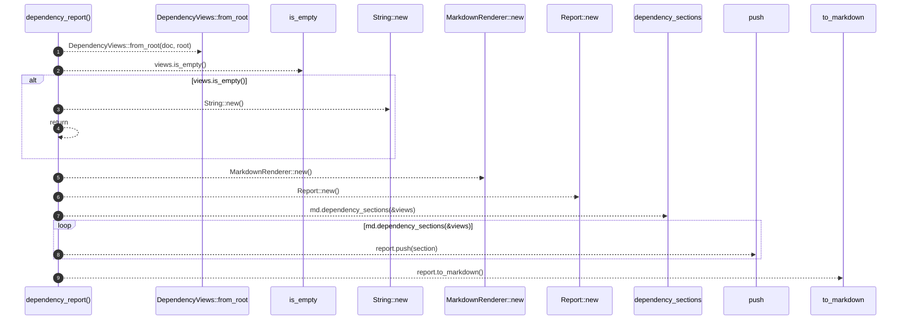

# `robby_render::dependency_report`

[Self-model](../README.md) · [robby_render](index.md)

| | |
|---|---|
| kind | `code.function` |
| signature | `fn dependency_report(doc: &Document, root: &NodeId) -> String` |
| location | [`crates/robby-render/src/lib.rs:71`](../../../crates/robby-render/src/lib.rs#L71) |
| provenance | extractor · confidence 1.00 |

> All three dependency formalisms for a root, as a Markdown report fragment.

```rust
/// All three dependency formalisms for a root, as a Markdown report fragment.
pub fn dependency_report(doc: &Document, root: &NodeId) -> String {
    let views = DependencyViews::from_root(doc, root);
    if views.is_empty() {
        return String::new();
    }
    let md = MarkdownRenderer::new();
    let mut report = Report::new();
    for section in md.dependency_sections(&views) {
        report.push(section);
    }
    report.to_markdown()
}
```



9 steps · 0 observed · 9 possible only

**Edges**

- calls → [`robby_render::view::deps::impl CouplingGraph::from_root`](view/deps/index.md)
- calls → [`robby_render::view::links::impl LinkGraph::is_empty`](view/links/index.md)
- calls → [`robby_render::report::impl Report::new`](report/index.md)
- calls → [`robby_render::report::impl Report::new`](report/index.md)
- calls → [`robby_render::report::impl Report::new`](report/index.md)
- calls → [`robby_render::render::Renderer::dependency_sections`](render/index.md)
- calls → [`robby_render::report::impl Report::push`](report/index.md)
- calls → [`robby_render::report::impl Report::to_markdown`](report/index.md)

## References

- calls → [`robby_render::render`](render/index.md) — dependency_sections
- calls → [`robby_render::report`](report/index.md) — new, push, to_markdown
- calls → [`robby_render::view::deps`](view/deps/index.md) — from_root
- calls → [`robby_render::view::links`](view/links/index.md) — is_empty

