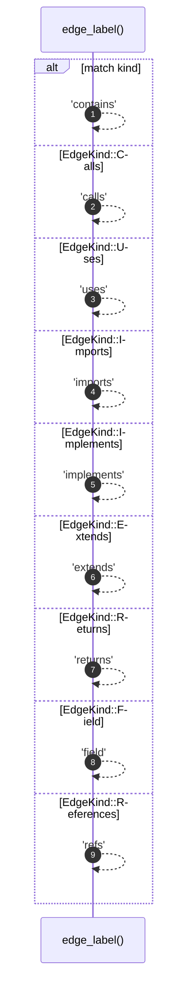

# `robby_render::edge_label`

[Self-model](../README.md) · [robby_render](index.md)

| | |
|---|---|
| kind | `code.function` |
| signature | `fn edge_label(kind: EdgeKind) -> &'static str` |
| location | [`crates/robby-render/src/lib.rs:175`](../../../crates/robby-render/src/lib.rs#L175) |
| provenance | extractor · confidence 1.00 |

```rust
fn edge_label(kind: EdgeKind) -> &'static str {
    match kind {
        EdgeKind::Contains => "contains",
        EdgeKind::Calls => "calls",
        EdgeKind::Uses => "uses",
        EdgeKind::Imports => "imports",
        EdgeKind::Implements => "implements",
        EdgeKind::Extends => "extends",
        EdgeKind::Returns => "returns",
        EdgeKind::Field => "field",
        EdgeKind::References => "refs",
    }
}
```



9 steps · 0 observed · 9 possible only

