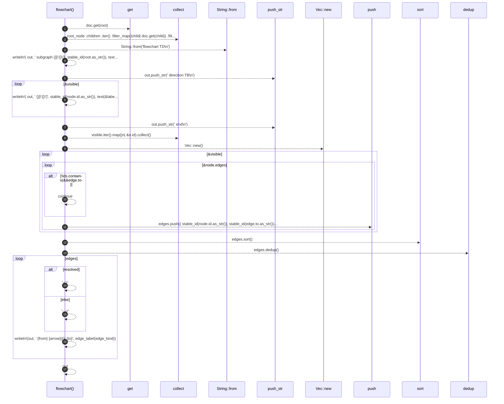

# `robby_render::flowchart`

[Self-model](../README.md) · [robby_render](index.md)

| | |
|---|---|
| kind | `code.function` |
| signature | `fn flowchart(doc: &Document, root: &NodeId) -> String` |
| location | [`crates/robby-render/src/lib.rs:101`](../../../crates/robby-render/src/lib.rs#L101) |
| provenance | extractor · confidence 1.00 |

> Render a module overview as a Mermaid `flowchart`.
> 
> This shows the *structure* of one module: its items and how they reference
> each other. Imports, fields, variants and impl bodies are in the map but not
> in this view — they are detail, reachable by drilling down. Presentation is
> progressive; representation is not.

```rust
/// Render a module overview as a Mermaid `flowchart`.
///
/// This shows the *structure* of one module: its items and how they reference
/// each other. Imports, fields, variants and impl bodies are in the map but not
/// in this view — they are detail, reachable by drilling down. Presentation is
/// progressive; representation is not.
pub fn flowchart(doc: &Document, root: &NodeId) -> String {
    let Some(root_node) = doc.get(root) else {
        return String::from("flowchart TD\n");
    };

    let visible: Vec<&Node> = root_node
        .children
        .iter()
        .filter_map(|child| doc.get(child))
        .filter(|node| is_structural(&node.kind))
        .collect();

    let mut out = String::from("flowchart TD\n");
    let _ = writeln!(
        out,
        "    subgraph {}[\"{}\"]",
        stable_id(root.as_str()),
        text(&label(root_node))
    );
    out.push_str("        direction TB\n");
    for node in &visible {
        let _ = writeln!(
            out,
            "        {}[\"{}\"]",
            stable_id(node.id.as_str()),
            text(&label(node))
        );
    }
    out.push_str("    end\n");

    let ids: Vec<&NodeId> = visible.iter().map(|n| &n.id).collect();
    let mut edges: Vec<(String, String, EdgeKind, bool)> = Vec::new();
    for node in &visible {
        for edge in &node.edges {
            if !ids.contains(&&edge.to) {
                continue;
            }
            edges.push((
                stable_id(node.id.as_str()),
                stable_id(edge.to.as_str()),
                edge.kind,
                edge.resolved,
            ));
        }
    }
    edges.sort();
    edges.dedup();

    for (from, to, edge_kind, resolved) in edges {
        let arrow = if resolved { "-->" } else { "-.->" };
        let _ = writeln!(out, "    {from} {arrow}|{}| {to}", edge_label(edge_kind));
    }

    out
}
```



17 steps · 0 observed · 17 possible only

**Edges**

- calls → [`robby_ir::model::impl Document::get`](../robby_ir/model/index.md)
- calls → [`robby_ir::kind::impl From<&str> for Kind::from`](../robby_ir/kind/index.md)
- calls → [`robby_extract::impl LineIndex::new`](../robby_extract/index.md)

