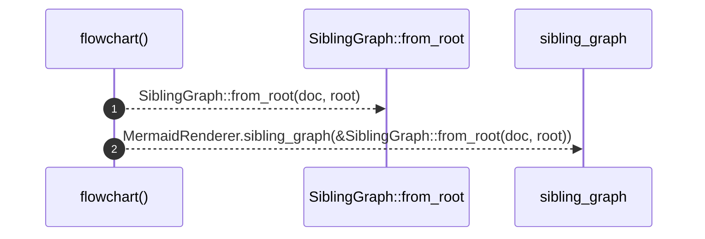

# `robby_render::flowchart`

[Self-model](../README.md) · [robby_render](index.md)

| | |
|---|---|
| kind | `code.function` |
| signature | `fn flowchart(doc: &Document, root: &NodeId) -> String` |
| location | [`crates/robby-render/src/lib.rs:39`](../../../crates/robby-render/src/lib.rs#L39) |
| provenance | extractor · confidence 1.00 |

> Legacy sibling inventory flowchart.

```rust
/// Legacy sibling inventory flowchart.
pub fn flowchart(doc: &Document, root: &NodeId) -> String {
    MermaidRenderer.sibling_graph(&SiblingGraph::from_root(doc, root))
}
```



2 steps · 0 observed · 2 possible only

**Edges**

- calls → [`robby_render::view::deps::impl CouplingGraph::from_root`](view/deps/index.md)
- calls → [`robby_render::render::Renderer::sibling_graph`](render/index.md)

## References

- calls → [`robby_render::render`](render/index.md) — sibling_graph
- calls → [`robby_render::view::deps`](view/deps/index.md) — from_root

## Referenced by

- calls ← [`robby_render::pipeline::render_files`](pipeline/render-files.md)
- calls ← [`robby_render::test_render::flowchart_clusters_modules`](test_render/flowchart-clusters-modules.md)

