# `robby_render`

[Self-model](../README.md)

| | |
|---|---|
| kind | `code.crate` |
| provenance | extractor · confidence 1.00 |
| nodes | 819 |

## Package diagram

```mermaid
flowchart TB
    subgraph n_9c636b098ca4450e["robby_render"]
        direction TB
        n_58704dd7dd5e44a7["markdown"]
        n_77294f3b6f21b79c["pipeline"]
        subgraph n_c53db78a9ef33eb6["render"]
            direction TB
            n_6f40e2fa7b42a40f["markdown"]
            n_1b88225e3fbd26cd["mermaid"]
            n_eeb2a2cd375a2e2c["tui"]
        end
        n_05b9b679aaf35ec8["report"]
        n_94a590d1410dd3da["test_markdown"]
        n_092b7abcfcf260db["test_render"]
        n_2790416a72a81c1b["test_tree"]
        n_310d14cf579135a7["test_web"]
        n_d59428013b05fa6e["tree"]
        n_4fd64543ae69ff04["tui"]
        n_23dac307afb8bcf6["util"]
        subgraph n_ca65ecef8a7529fb["view"]
            direction TB
            n_2bf7728895532b9d["comments"]
            n_55531c5d49993a41["deps"]
            subgraph n_ad6e3f155bb8c0b6["entrypoints"]
                direction TB
                n_d9491199caac034b["tests"]
            end
            subgraph n_5534aafb5d116cdb["execution"]
                direction TB
                n_a97bf31e52b55584["tests"]
            end
            n_575b84f39392c791["externals"]
            n_d6a4c714f5ebd9ce["hierarchy"]
            n_d98da197ad772974["links"]
            n_6b09e2da2b3d3ec0["process"]
            n_f006da06b5256ba9["scene"]
            n_534805da25f902cb["select"]
            n_3d4b89e4d03574c3["sibling"]
            n_af0e6cd35d46a66e["source"]
            n_f7b09b6570bc03a0["types"]
        end
        n_458e2543a821af84["web"]
    end
    n_a331a60ee1568354(["robby_cli"])
    n_356bf2c23da68961(["robby_ir"])
    n_05b9b679aaf35ec8 -.-> n_d98da197ad772974
    n_05b9b679aaf35ec8 -.-> n_eeb2a2cd375a2e2c
    n_092b7abcfcf260db -.-> n_05b9b679aaf35ec8
    n_092b7abcfcf260db --> n_356bf2c23da68961
    n_092b7abcfcf260db -.-> n_534805da25f902cb
    n_092b7abcfcf260db -.-> n_55531c5d49993a41
    n_092b7abcfcf260db -.-> n_58704dd7dd5e44a7
    n_092b7abcfcf260db -.-> n_9c636b098ca4450e
    n_092b7abcfcf260db --> n_c53db78a9ef33eb6
    n_1b88225e3fbd26cd -.-> n_05b9b679aaf35ec8
    n_1b88225e3fbd26cd -.-> n_2bf7728895532b9d
    n_1b88225e3fbd26cd --> n_356bf2c23da68961
    n_1b88225e3fbd26cd -.-> n_534805da25f902cb
    n_1b88225e3fbd26cd -.-> n_55531c5d49993a41
    n_1b88225e3fbd26cd -.-> n_d98da197ad772974
    n_1b88225e3fbd26cd -.-> n_eeb2a2cd375a2e2c
    n_23dac307afb8bcf6 -.-> n_05b9b679aaf35ec8
    n_23dac307afb8bcf6 -.-> n_2bf7728895532b9d
    n_23dac307afb8bcf6 --> n_356bf2c23da68961
    n_23dac307afb8bcf6 -.-> n_534805da25f902cb
    n_23dac307afb8bcf6 -.-> n_d98da197ad772974
    n_2790416a72a81c1b -.-> n_05b9b679aaf35ec8
    n_2790416a72a81c1b --> n_356bf2c23da68961
    n_2790416a72a81c1b -.-> n_4fd64543ae69ff04
    n_2790416a72a81c1b -.-> n_534805da25f902cb
    n_2790416a72a81c1b --> n_a331a60ee1568354
    n_2790416a72a81c1b -.-> n_f006da06b5256ba9
    n_2bf7728895532b9d -.-> n_05b9b679aaf35ec8
    n_2bf7728895532b9d --> n_356bf2c23da68961
    n_2bf7728895532b9d -.-> n_534805da25f902cb
    n_2bf7728895532b9d -.-> n_f006da06b5256ba9
    n_310d14cf579135a7 --> n_05b9b679aaf35ec8
    n_310d14cf579135a7 --> n_092b7abcfcf260db
    n_310d14cf579135a7 --> n_2bf7728895532b9d
    n_310d14cf579135a7 --> n_356bf2c23da68961
    n_310d14cf579135a7 --> n_458e2543a821af84
    n_310d14cf579135a7 --> n_534805da25f902cb
    n_310d14cf579135a7 --> n_77294f3b6f21b79c
    n_310d14cf579135a7 --> n_9c636b098ca4450e
    n_310d14cf579135a7 --> n_f006da06b5256ba9
    n_3d4b89e4d03574c3 --> n_05b9b679aaf35ec8
    n_3d4b89e4d03574c3 --> n_23dac307afb8bcf6
    n_3d4b89e4d03574c3 --> n_2bf7728895532b9d
    n_3d4b89e4d03574c3 --> n_356bf2c23da68961
    n_3d4b89e4d03574c3 --> n_534805da25f902cb
    n_3d4b89e4d03574c3 --> n_9c636b098ca4450e
    n_3d4b89e4d03574c3 --> n_f006da06b5256ba9
    n_458e2543a821af84 -.-> n_05b9b679aaf35ec8
    n_458e2543a821af84 -.-> n_092b7abcfcf260db
    n_458e2543a821af84 -.-> n_2bf7728895532b9d
    n_458e2543a821af84 --> n_356bf2c23da68961
    n_458e2543a821af84 -.-> n_534805da25f902cb
    n_458e2543a821af84 -.-> n_5534aafb5d116cdb
    n_458e2543a821af84 -.-> n_6b09e2da2b3d3ec0
    n_458e2543a821af84 -.-> n_77294f3b6f21b79c
    n_458e2543a821af84 -.-> n_9c636b098ca4450e
    n_458e2543a821af84 -.-> n_d98da197ad772974
    n_458e2543a821af84 -.-> n_f006da06b5256ba9
    n_4fd64543ae69ff04 -.-> n_05b9b679aaf35ec8
    n_4fd64543ae69ff04 -.-> n_092b7abcfcf260db
    n_4fd64543ae69ff04 -.-> n_458e2543a821af84
    n_4fd64543ae69ff04 -.-> n_534805da25f902cb
    n_4fd64543ae69ff04 -.-> n_55531c5d49993a41
    n_4fd64543ae69ff04 -.-> n_6b09e2da2b3d3ec0
    n_4fd64543ae69ff04 --> n_c53db78a9ef33eb6
    n_4fd64543ae69ff04 -.-> n_eeb2a2cd375a2e2c
    n_534805da25f902cb -.-> n_2bf7728895532b9d
    n_534805da25f902cb --> n_356bf2c23da68961
    n_534805da25f902cb -.-> n_55531c5d49993a41
    n_534805da25f902cb --> n_af0e6cd35d46a66e
    n_534805da25f902cb -.-> n_d98da197ad772974
    n_534805da25f902cb -.-> n_f7b09b6570bc03a0
    n_5534aafb5d116cdb -.-> n_05b9b679aaf35ec8
    n_5534aafb5d116cdb -.-> n_092b7abcfcf260db
    n_5534aafb5d116cdb -.-> n_23dac307afb8bcf6
    n_5534aafb5d116cdb -.-> n_2bf7728895532b9d
    n_5534aafb5d116cdb --> n_356bf2c23da68961
    n_5534aafb5d116cdb -.-> n_534805da25f902cb
    n_5534aafb5d116cdb --> n_a97bf31e52b55584
    n_5534aafb5d116cdb -.-> n_d98da197ad772974
    n_5534aafb5d116cdb -.-> n_f006da06b5256ba9
    n_55531c5d49993a41 -.-> n_05b9b679aaf35ec8
    n_55531c5d49993a41 -.-> n_23dac307afb8bcf6
    n_55531c5d49993a41 -.-> n_2bf7728895532b9d
    n_55531c5d49993a41 --> n_356bf2c23da68961
    n_55531c5d49993a41 -.-> n_534805da25f902cb
    n_55531c5d49993a41 -.-> n_9c636b098ca4450e
    n_55531c5d49993a41 -.-> n_ad6e3f155bb8c0b6
    n_55531c5d49993a41 -.-> n_f006da06b5256ba9
    n_575b84f39392c791 --> n_2bf7728895532b9d
    n_575b84f39392c791 --> n_356bf2c23da68961
    n_575b84f39392c791 --> n_534805da25f902cb
    n_575b84f39392c791 --> n_d98da197ad772974
    n_575b84f39392c791 --> n_f006da06b5256ba9
    n_58704dd7dd5e44a7 -.-> n_05b9b679aaf35ec8
    n_58704dd7dd5e44a7 -.-> n_092b7abcfcf260db
    n_58704dd7dd5e44a7 -.-> n_2bf7728895532b9d
    n_58704dd7dd5e44a7 --> n_356bf2c23da68961
    n_58704dd7dd5e44a7 -.-> n_534805da25f902cb
    n_58704dd7dd5e44a7 -.-> n_9c636b098ca4450e
    n_58704dd7dd5e44a7 --> n_c53db78a9ef33eb6
    n_58704dd7dd5e44a7 -.-> n_d98da197ad772974
    n_6b09e2da2b3d3ec0 -.-> n_05b9b679aaf35ec8
    n_6b09e2da2b3d3ec0 -.-> n_23dac307afb8bcf6
    n_6b09e2da2b3d3ec0 -.-> n_534805da25f902cb
    n_6b09e2da2b3d3ec0 -.-> n_f006da06b5256ba9
    n_6f40e2fa7b42a40f --> n_05b9b679aaf35ec8
    n_6f40e2fa7b42a40f --> n_1b88225e3fbd26cd
    n_6f40e2fa7b42a40f --> n_2bf7728895532b9d
    n_6f40e2fa7b42a40f --> n_356bf2c23da68961
    n_6f40e2fa7b42a40f --> n_534805da25f902cb
    n_6f40e2fa7b42a40f --> n_d98da197ad772974
    n_6f40e2fa7b42a40f --> n_eeb2a2cd375a2e2c
    n_77294f3b6f21b79c -.-> n_05b9b679aaf35ec8
    n_77294f3b6f21b79c --> n_356bf2c23da68961
    n_77294f3b6f21b79c -.-> n_4fd64543ae69ff04
    n_77294f3b6f21b79c -.-> n_534805da25f902cb
    n_77294f3b6f21b79c -.-> n_9c636b098ca4450e
    n_77294f3b6f21b79c -.-> n_d98da197ad772974
    n_94a590d1410dd3da --> n_05b9b679aaf35ec8
    n_94a590d1410dd3da --> n_092b7abcfcf260db
    n_94a590d1410dd3da --> n_356bf2c23da68961
    n_94a590d1410dd3da --> n_58704dd7dd5e44a7
    n_9c636b098ca4450e -.-> n_05b9b679aaf35ec8
    n_9c636b098ca4450e -.-> n_092b7abcfcf260db
    n_9c636b098ca4450e -.-> n_2790416a72a81c1b
    n_9c636b098ca4450e --> n_356bf2c23da68961
    n_9c636b098ca4450e -.-> n_534805da25f902cb
    n_9c636b098ca4450e -.-> n_55531c5d49993a41
    n_9c636b098ca4450e -.-> n_6b09e2da2b3d3ec0
    n_9c636b098ca4450e --> n_c53db78a9ef33eb6
    n_9c636b098ca4450e -.-> n_d98da197ad772974
    n_9c636b098ca4450e -.-> n_f7b09b6570bc03a0
    n_ad6e3f155bb8c0b6 -.-> n_05b9b679aaf35ec8
    n_ad6e3f155bb8c0b6 -.-> n_2bf7728895532b9d
    n_ad6e3f155bb8c0b6 --> n_356bf2c23da68961
    n_ad6e3f155bb8c0b6 -.-> n_534805da25f902cb
    n_ad6e3f155bb8c0b6 --> n_d9491199caac034b
    n_ad6e3f155bb8c0b6 -.-> n_d98da197ad772974
    n_ad6e3f155bb8c0b6 -.-> n_f006da06b5256ba9
    n_af0e6cd35d46a66e --> n_356bf2c23da68961
    n_d59428013b05fa6e --> n_05b9b679aaf35ec8
    n_d59428013b05fa6e --> n_092b7abcfcf260db
    n_d59428013b05fa6e --> n_2bf7728895532b9d
    n_d59428013b05fa6e --> n_356bf2c23da68961
    n_d59428013b05fa6e --> n_534805da25f902cb
    n_d59428013b05fa6e --> n_58704dd7dd5e44a7
    n_d59428013b05fa6e --> n_9c636b098ca4450e
    n_d59428013b05fa6e --> n_c53db78a9ef33eb6
    n_d59428013b05fa6e --> n_d98da197ad772974
    n_d6a4c714f5ebd9ce --> n_05b9b679aaf35ec8
    n_d6a4c714f5ebd9ce --> n_2bf7728895532b9d
    n_d6a4c714f5ebd9ce --> n_356bf2c23da68961
    n_d6a4c714f5ebd9ce --> n_f006da06b5256ba9
    n_d98da197ad772974 -.-> n_23dac307afb8bcf6
    n_d98da197ad772974 --> n_356bf2c23da68961
    n_d98da197ad772974 -.-> n_534805da25f902cb
    n_d98da197ad772974 -.-> n_f006da06b5256ba9
    n_eeb2a2cd375a2e2c -.-> n_05b9b679aaf35ec8
    n_eeb2a2cd375a2e2c -.-> n_1b88225e3fbd26cd
    n_eeb2a2cd375a2e2c -.-> n_2bf7728895532b9d
    n_eeb2a2cd375a2e2c --> n_356bf2c23da68961
    n_eeb2a2cd375a2e2c -.-> n_534805da25f902cb
    n_eeb2a2cd375a2e2c -.-> n_55531c5d49993a41
    n_eeb2a2cd375a2e2c --> n_c53db78a9ef33eb6
    n_eeb2a2cd375a2e2c -.-> n_d98da197ad772974
    n_f006da06b5256ba9 -.-> n_05b9b679aaf35ec8
    n_f006da06b5256ba9 -.-> n_23dac307afb8bcf6
    n_f006da06b5256ba9 -.-> n_2bf7728895532b9d
    n_f006da06b5256ba9 --> n_356bf2c23da68961
    n_f006da06b5256ba9 -.-> n_534805da25f902cb
    n_f006da06b5256ba9 -.-> n_55531c5d49993a41
    n_f006da06b5256ba9 -.-> n_9c636b098ca4450e
    n_f006da06b5256ba9 -.-> n_ad6e3f155bb8c0b6
    n_f006da06b5256ba9 -.-> n_d98da197ad772974
    n_f7b09b6570bc03a0 -.-> n_05b9b679aaf35ec8
    n_f7b09b6570bc03a0 -.-> n_23dac307afb8bcf6
    n_f7b09b6570bc03a0 -.-> n_2bf7728895532b9d
    n_f7b09b6570bc03a0 --> n_356bf2c23da68961
    n_f7b09b6570bc03a0 -.-> n_534805da25f902cb
    n_f7b09b6570bc03a0 -.-> n_f006da06b5256ba9
```



## Module coupling

```mermaid
flowchart TB
    subgraph n_9c636b098ca4450e["robby_render"]
        direction TB
        subgraph n_58704dd7dd5e44a7["markdown"]
            direction TB
            n_742a0cec2e78e8fe["anchor"]
            n_3f2b66ab38cc5d65["coverage_section"]
            n_84ee9201a5b54929["heading_depth"]
            n_fadae9084bd096ed["index"]
            n_161877e5328c261f["node_section"]
            n_d1bec2e55ee10959["report"]
        end
        subgraph n_77294f3b6f21b79c["pipeline"]
            direction TB
            n_632a84e110a5dc84["from_document"]
            n_470f85c178206b14["load"]
            n_21de05adf7688d68["load_document"]
            n_55b8c37d0badb78d["load_sources"]
            n_f19279b0043fe2d4["remove_markdown"]
            n_8bacd3e44796f7f0["render_files"]
            n_b3c04f794cd90823["slug"]
            n_2ee15b18fda893be["watched_files"]
            n_273b2347595a4a92["write_report"]
        end
        subgraph n_c53db78a9ef33eb6["render"]
            direction TB
            subgraph n_6f40e2fa7b42a40f["markdown"]
                direction TB
                n_8ff5a307b7777fb9["comments"]
                n_c85b951c411a59cf["coupling_deps"]
                n_a0e8d63eb6251d3a["dependency_matrix"]
                n_b788aee11cf3dbed["externals"]
                n_27f283958f7b3bc6["fence"]
                n_2f40f9b922edd53a["hierarchy"]
                n_302e6be037d2c928["links"]
                n_5e80afda1320de5a["meta"]
                n_ea8679fdc5a30ae1["new"]
                n_4a581ee9a238d7f8["package_deps"]
                n_d957da81bd0d16e4["process"]
                n_cf84a0e43b973e14["sibling_graph"]
                n_5ac99e1c84ebd9ad["trim_comment"]
                n_1da2b6c82b3cdf34["types"]
            end
            subgraph n_1b88225e3fbd26cd["mermaid"]
                direction TB
                n_edc2d5920ba40a37["comments"]
                n_12d6cac4f8626411["coupling_deps"]
                n_05d26057b5ff7308["dependency_matrix"]
                n_e9aacb4720bb8e4e["dsm_markdown_table"]
                n_0ca465745abea557["emit_coupling_subgraph"]
                n_5862da4f52732478["emit_package_subgraph"]
                n_c2ef34cf599b22b2["emit_workspace_coupling"]
                n_06683849abba9bbb["externals"]
                n_c7e4963e5c8a73c8["hierarchy"]
                n_c83f092a6de3dd2e["links"]
                n_11bb4f1dcd2a9098["meta"]
                n_09278f41badf9212["package_deps"]
                n_f4f9ee4915c71018["source"]
            end
            subgraph n_eeb2a2cd375a2e2c["tui"]
                direction TB
                n_32780da9ddf75af3["ascii_coupling"]
                n_8208ba2b40e6adfa["ascii_package_structure"]
                n_34052eece36e7f4e["clip"]
                n_0877d202cb3d1db5["comments"]
                n_6526ab43ccd69d23["coupling_deps"]
                n_1795c187bd51093a["default"]
                n_2157cbc8b72be24e["dependency_matrix"]
                n_45a8dbe34e997f29["externals"]
                n_2d7b3d99a600dc16["hierarchy"]
                n_1fb1e54d52a9fcbc["links"]
                n_92067e3e318325fe["meta"]
                n_5d9930b67863fdc3["new"]
                n_f3eaf8a36e3f327c["package_deps"]
                n_9ca36d5dba653bd8["process"]
                n_92c00755071fede2["render_report"]
                n_fc276d517df85552["select_opts"]
                n_15ef501f822ee7c6["show"]
                n_b0cef0aada7c7ad0["sibling_graph"]
                n_0d5be6053804de16["source"]
                n_3d335e8af528db78["types"]
            end
            n_d281c2e01d11e1fb["comments"]
            n_b958b963d1f5507d["coupling_deps"]
            n_7d5fb902366c2255["dependency_sections"]
            n_93d514f336bc1f3f["externals"]
            n_0fe77a472938eb6c["hierarchy"]
            n_05e754cd2b3a102e["package_deps"]
            n_7db5ab3630099277["report"]
            n_bfa30f461d12b7ee["sibling_graph"]
            n_9aac12cb4c9e0e26["types"]
        end
        subgraph n_05b9b679aaf35ec8["report"]
            direction TB
            n_68970d6d58680b18["is_blank"]
            n_11e080982eb2281e["new"]
            n_465730a4067bc4e4["push"]
            n_985af810c4fa74f1["push_body"]
            n_b3037e5414d1f82b["push_titled"]
            n_1a089c25759f11f3["titled"]
            n_7f5f84584126cbf7["to_markdown"]
            n_f183bbce1bbc0436["to_plain"]
            n_d351f6940188701a["to_terminal"]
            n_7222783df6ca47e4["untitled"]
        end
        subgraph n_94a590d1410dd3da["test_markdown"]
            direction TB
            n_5cc8cf51165d164e["fences_are_balanced"]
            n_3c079b97f8351ae3["fixture"]
            n_40fd118f8ee57918["report_embeds_source_and_diagram_together"]
            n_74c96613b6250856["report_is_byte_stable"]
            n_bac59c77f333c3ad["report_without_sources_still_renders"]
        end
        subgraph n_092b7abcfcf260db["test_render"]
            direction TB
            n_8cf48f47344fc0c8["class_diagram_marks_traits_as_interfaces"]
            n_d147ca198858d187["dependencies_emits_package_weighted_and_dsm"]
            n_8eba10265997f105["emits_else_for_a_second_branch"]
            n_e768a1fd4a5c1d40["externals_and_comments_sections_render"]
            n_7a167edd9760d943["flowchart_clusters_modules"]
            n_ae1563fdedf3f116["nests_blocks_by_frame_stack"]
            n_85e74789245bccf1["opens_and_closes_alt_blocks"]
            n_3ff0d4fa507d354d["output_is_byte_identical_across_runs"]
            n_016efff8aa636e20["process"]
            n_f34932bdcafaaace["renders_a_flat_sequence"]
            n_32370c79df1f48c9["step"]
            n_7cea0c557227a35f["unobserved_steps_use_dashed_arrows"]
        end
        subgraph n_2790416a72a81c1b["test_tree"]
            direction TB
            n_197157e39be2dfd1["every_internal_link_resolves"]
            n_32cf4d2ecb5a0a21["every_module_has_an_index_page"]
            n_323013ead64fbe04["markdown_links"]
            n_9f9d6bd897ae1852["modules_link_out_and_back"]
            n_1a89d16c1861baae["no_page_is_a_wall_of_text"]
            n_2bde649864bf1146["normalize"]
            n_4080fdf0b68d4a87["page_names_never_collide_with_index"]
            n_9ed0f9b7842fbcc9["pages"]
            n_13a9263f385f07c0["workspace"]
        end
        subgraph n_310d14cf579135a7["test_web"]
            direction TB
            n_6c39fec40a174770["child_world_rects_lie_inside_parent_world"]
            n_5d64ffe3865383a1["demo_doc"]
            n_5d18d5212c5cf3a9["entrypoints_demo_doc"]
            n_7f6f7186631adb12["entrypoints_demo_stores_code_paths_in_ir"]
            n_8a5da80d612a110c["entrypoints_scene_json_is_deterministic"]
            n_0ccee746718d0bcc["entrypoints_scene_roots_mains_and_nests_callees"]
            n_a38744c649815c94["every_child_and_resolved_portal_is_a_frame"]
            n_ce2aa79a890e3168["frame_detail_includes_execution_mermaid_for_call_path"]
            n_ccc4db85332b95a2["leaf_payload_includes_source_and_process"]
            n_0572a55b97877ef3["scene_json_is_byte_identical_across_runs"]
            n_9ca9be67b573c9bf["sibling_local_rects_do_not_overlap"]
            n_eff1ef85ab0370f2["sibling_world_rects_do_not_collapse_onto_each_other"]
            n_707a7b55bf4d7e1f["tempfile_dir"]
            n_cc261f5078ecd444["unresolved_portal_has_no_zoom_target"]
            n_a7f44ae87911cf31["write_site_emits_scene_and_frames"]
        end
        subgraph n_d59428013b05fa6e["tree"]
            direction TB
            n_6b907e7f03293147["count_modules"]
            n_7f2a8756106a28dc["crate_index_path"]
            n_22c884af901eb923["crate_of"]
            n_d7e28b7b7f1708a7["first_line"]
            n_a3553c31416c47fa["global_index"]
            n_6de8c81bdaacb2c4["is_compact"]
            n_fdfc429b571e713a["is_crate"]
            n_ebf19a6a762f1087["is_module"]
            n_41a4b741f0d97cfa["is_module_kind"]
            n_eaf247f5644149ed["item_children"]
            n_9bff590e84167ba9["item_page"]
            n_da411402b4350d4d["item_slug"]
            n_11a23e983625805a["item_slugs"]
            n_10b2e100bc5e0821["linked_import"]
            n_562f41d40a0543b1["module_index_path"]
            n_d84657d79773bf18["module_page"]
            n_f346ae5659ae42d1["module_pages"]
            n_c548f4f208a3b71a["module_tree_line"]
            n_a09f9f042f43ca1b["nav"]
            n_01ad3ceef0d0cb80["page_of_node"]
            n_129070ef9a7be2e6["page_paths"]
            n_17c77dd7a6fb25ba["rel_link"]
            n_28370880c5adadf4["render_links"]
            n_465de596eb56125b["render_node"]
            n_8e17337d9a194e54["resolve_use_path"]
            n_bc43405b8f831fa6["short_fqn"]
            n_9f77a6e59badeee8["slice"]
            n_c4f8d8f7672aa0e0["source_link"]
            n_a4770263504cd0ce["tree"]
        end
        subgraph n_4fd64543ae69ff04["tui"]
            direction TB
            n_375dedd004f85044["graph"]
            n_d1306fd34c6f3a19["show"]
            n_a5260953119bad05["show_collected"]
            n_d5f9ec576d1f1fa3["timeline"]
            n_1479adda4c9cb668["tree"]
        end
        subgraph n_23dac307afb8bcf6["util"]
            direction TB
            n_5e81b400a2b82436["alias"]
            n_5ec045eba2e1b6c2["class_id"]
            n_ffe196e6a9593c82["edge_label"]
            n_6b9cfcf51d0346ee["is_container"]
            n_8b2308df3e14a858["is_structural"]
            n_8495a2c77936c8db["is_type"]
            n_2c049509d9088811["keyword"]
            n_fa2582297af08697["short_kind"]
            n_fc1d8ce8ffe60487["strip_generics"]
            n_9d5bfea5c691e091["text"]
        end
        subgraph n_ca65ecef8a7529fb["view"]
            direction TB
            subgraph n_2bf7728895532b9d["comments"]
                direction TB
                n_7d8b6f618e2e2b3d["apply_highlights"]
                n_fab4eeebb9766d7f["as_str"]
                n_641e5b5aeeab0279["code_window"]
                n_3768e26834af3c8a["decision_child"]
                n_c4f28ea180022df8["enrichment_fields"]
                n_9770ebfdac89aad3["from_root"]
                n_22563e829175fdb4["is_empty"]
                n_6133008ee12510fc["line_window"]
                n_b6f5763fd8852f21["nearest_following_item"]
                n_174ca23724aec60a["parse_verdict"]
                n_0f077b1dc0af073e["slice_node"]
            end
            subgraph n_55531c5d49993a41["deps"]
                direction TB
                n_a073468cddadb161["best_scope_prefix"]
                n_62d508d9fb8ad860["build_coupling_tree"]
                n_c6de9edc70837acd["build_package_tree"]
                n_c94f80bcae6304a4["container_of"]
                n_dccc885fe0a44b04["crate_of"]
                n_ef17956e251a25c9["empty"]
                n_f2067b0bd780c963["empty"]
                n_c10325e57e063de6["finalize_edges"]
                n_ca5056d43b6f5293["from_root"]
                n_d7c80243ebd2831f["from_root"]
                n_e8d7eb06ad230a45["from_root"]
                n_d3c4eb93ce09e101["insert_module"]
                n_f8b93f550ab04ba2["is_callable"]
                n_dfa474318a063404["is_direct_package"]
                n_0e4ac560540b7b74["is_empty"]
                n_8e83bc09f24e66a0["is_empty"]
                n_d9177e73eb024a06["is_empty"]
                n_390bde23d800fb4e["is_under_fqn"]
                n_618f2fb865962654["leaf_nodes"]
                n_fad312efa0272c07["lift_to_scope"]
                n_0c8845659c8bf7a2["module_by_stable"]
                n_fa641831e790faa6["owning_in_scope"]
                n_beed62791dc90132["package_edges"]
                n_97d55db8002e6d30["package_leaf"]
                n_e984c401b99e2b91["tarjan"]
                n_f58f9296e7591cf3["topological_layers"]
                n_bcdf29a0a8f79b6c["under_root_fqn"]
                n_6892848a318479b5["workspace"]
                n_a15344ed13186dff["workspace"]
                n_f0f787d7f363627b["workspace"]
            end
            subgraph n_ad6e3f155bb8c0b6["entrypoints"]
                direction TB
                n_43e14e4cbda3060d["children_of"]
                n_4c0cca6140ffbbd2["collect_cross_edges"]
                n_8d4a969d6a37648c["doc_with_mains"]
                n_031015833fb9c9ce["first_parent_wins_shared_callee"]
                n_5ba920c10be0ff4f["from_code_paths"]
                n_fdde931043c1fc58["from_document"]
                n_8df70fa96b2999e7["from_entries"]
                n_acaac7009920f20e["prefers_document_code_paths"]
            end
            subgraph n_5534aafb5d116cdb["execution"]
                direction TB
                n_d22b81485cec051f["add_callable"]
                n_237132f9c87e9cc1["execution_process"]
                n_bb53751168a285fd["from_code_path"]
                n_c3867499cd12f6f1["owning_type_label"]
                n_c5a1b546da6c093c["participant_id"]
                n_25b6e8d6201b38e1["sample"]
                n_abe1887adc956ecf["sequence_includes_call_and_type_lifeline"]
            end
            subgraph n_575b84f39392c791["externals"]
                direction TB
                n_00fad7cf58583263["from_root"]
                n_32c1f67a7062b22e["import_spec"]
                n_c274af82ed9c19c4["is_empty"]
                n_a570dbeb379084c2["is_external_package"]
                n_99d441e4191b295f["owning_container_fqn"]
            end
            subgraph n_d6a4c714f5ebd9ce["hierarchy"]
                direction TB
                n_fcf372bcbbdc728a["build"]
                n_50e81ecfa3776b43["from_node"]
                n_4798894c665ce0e4["is_compact"]
                n_382908ecb7b40c90["is_empty"]
                n_52a53b3b46311577["kind_tag"]
            end
            subgraph n_d98da197ad772974["links"]
                direction TB
                n_b8cfed370f7630fa["for_node"]
                n_4677f91650c8fa9d["inbound"]
                n_0b2e754c404da854["is_empty"]
                n_8775b28cd211f488["is_module_kind"]
                n_a68c20b78787b334["outbound"]
                n_4f04956ed969e78d["owning_module"]
                n_90d23e972bd58ac7["subtree_ids"]
            end
            subgraph n_6b09e2da2b3d3ec0["process"]
                direction TB
                n_570e2c532788087a["common_prefix"]
                n_25dacce096110768["from_process"]
            end
            subgraph n_f006da06b5256ba9["scene"]
                direction TB
                n_28988dd039e06d31["attach_call_portals"]
                n_1923d2917a857926["build_call_frame"]
                n_5d0e4314e8ae7165["build_frame"]
                n_4958b0fbabca34bc["contains"]
                n_d8f08dd1d2200ed6["crate_roots"]
                n_98e09a50ba136685["from_document"]
                n_a226e41874f80197["from_entrypoints"]
                n_744511c2d5a350f5["is_scene_skipped"]
                n_79bed59b1a79eb84["layout_grid"]
                n_362f706ada15eb10["map_local_to_world"]
                n_f2c21d1aff51beb3["new"]
                n_30b6d0144b0642cc["portals_for"]
            end
            subgraph n_534805da25f902cb["select"]
                direction TB
                n_bb9971de7b6aa277["collect"]
                n_52efbca52123222c["default"]
                n_737bc7514c5fccaa["is_binary_module"]
                n_7debed98e7d8376c["main_process"]
                n_d02d0abf1c3600ac["markdown"]
                n_11f6d2fb700cd378["source_name"]
                n_f5a635ba7e165c71["tui_all"]
            end
            subgraph n_3d4b89e4d03574c3["sibling"]
                direction TB
                n_c4e6114e4ad3d4ea["from_root"]
                n_2426cd003b41a293["is_empty"]
            end
            subgraph n_af0e6cd35d46a66e["source"]
                direction TB
                n_daf5ef70c3eb6dee["from_node"]
            end
            subgraph n_f7b09b6570bc03a0["types"]
                direction TB
                n_93c94be41cee362e["class_from_node"]
                n_c7c36b72a1b4ae90["from_module"]
                n_116ac437ecee9baf["impl_methods"]
                n_d317bd47c5c14e11["is_empty"]
                n_796acf395b92fc32["parse_impl_target"]
            end
        end
        subgraph n_458e2543a821af84["web"]
            direction TB
            n_12e10a94bd0b89a4["event_detail"]
            n_1cef7cd777a4897f["for_workspace"]
            n_87904cdb73eb4bef["from_node"]
            n_213e965c602f499e["from_node_in_doc"]
            n_156e84213d588a5f["provenance_name"]
            n_01028a6d08164775["step_kind_name"]
            n_4d3c3f485a9610d6["to_json"]
            n_035881844fb12b4b["write_site"]
        end
        n_5f68a6ec137f4048["all_sequences"]
        n_3980bd571c7eece4["class_diagram"]
        n_9667fb4c94bf5ed9["coupling"]
        n_feb80be7392d555f["dependencies"]
        n_b39972b6ed264192["dependency_report"]
        n_5bcd75ca374195e2["flowchart"]
        n_d55652e93431fabb["sequence"]
        n_a9d8540e2150b923["stable_id"]
        n_4233df2a03ecbf51["workspace_dependencies"]
    end
    n_00fad7cf58583263 --> n_32c1f67a7062b22e
    n_00fad7cf58583263 --> n_99d441e4191b295f
    n_00fad7cf58583263 --> n_a570dbeb379084c2
    n_00fad7cf58583263 -->|"2"| n_bb9971de7b6aa277
    n_00fad7cf58583263 --> n_f2c21d1aff51beb3
    n_00fad7cf58583263 --> n_fab4eeebb9766d7f
    n_016efff8aa636e20 --> n_11e080982eb2281e
    n_016efff8aa636e20 --> n_32370c79df1f48c9
    n_01ad3ceef0d0cb80 --> n_11a23e983625805a
    n_01ad3ceef0d0cb80 --> n_11e080982eb2281e
    n_01ad3ceef0d0cb80 --> n_22c884af901eb923
    n_01ad3ceef0d0cb80 -->|"2"| n_562f41d40a0543b1
    n_01ad3ceef0d0cb80 --> n_6de8c81bdaacb2c4
    n_01ad3ceef0d0cb80 --> n_eaf247f5644149ed
    n_01ad3ceef0d0cb80 -->|"3"| n_ebf19a6a762f1087
    n_01ad3ceef0d0cb80 --> n_fab4eeebb9766d7f
    n_031015833fb9c9ce --> n_8d4a969d6a37648c
    n_031015833fb9c9ce --> n_8df70fa96b2999e7
    n_035881844fb12b4b --> n_11e080982eb2281e
    n_035881844fb12b4b --> n_1cef7cd777a4897f
    n_035881844fb12b4b --> n_213e965c602f499e
    n_035881844fb12b4b -->|"4"| n_4d3c3f485a9610d6
    n_035881844fb12b4b --> n_632a84e110a5dc84
    n_035881844fb12b4b --> n_a226e41874f80197
    n_035881844fb12b4b --> n_fab4eeebb9766d7f
    n_0572a55b97877ef3 -->|"2"| n_4d3c3f485a9610d6
    n_0572a55b97877ef3 --> n_5d64ffe3865383a1
    n_0572a55b97877ef3 -->|"2"| n_632a84e110a5dc84
    n_05d26057b5ff7308 --> n_5d9930b67863fdc3
    n_06683849abba9bbb --> n_5d9930b67863fdc3
    n_0877d202cb3d1db5 --> n_34052eece36e7f4e
    n_0877d202cb3d1db5 --> n_465730a4067bc4e4
    n_0877d202cb3d1db5 --> n_5d9930b67863fdc3
    n_0877d202cb3d1db5 -->|"2"| n_7d8b6f618e2e2b3d
    n_0877d202cb3d1db5 --> n_fab4eeebb9766d7f
    n_09278f41badf9212 --> n_0b2e754c404da854
    n_09278f41badf9212 --> n_5862da4f52732478
    n_0ca465745abea557 -->|"2"| n_0b2e754c404da854
    n_0ca465745abea557 --> n_fab4eeebb9766d7f
    n_0ccee746718d0bcc --> n_4958b0fbabca34bc
    n_0ccee746718d0bcc --> n_5d18d5212c5cf3a9
    n_0ccee746718d0bcc --> n_a226e41874f80197
    n_0ccee746718d0bcc -->|"4"| n_a9d8540e2150b923
    n_0ccee746718d0bcc --> n_bb9971de7b6aa277
    n_0ccee746718d0bcc --> n_fab4eeebb9766d7f
    n_0d5be6053804de16 --> n_465730a4067bc4e4
    n_0d5be6053804de16 --> n_5d9930b67863fdc3
    n_10b2e100bc5e0821 --> n_01ad3ceef0d0cb80
    n_10b2e100bc5e0821 --> n_8e17337d9a194e54
    n_116ac437ecee9baf -.->|"1 circular"| n_9d5bfea5c691e091
    n_116ac437ecee9baf -.->|"1 circular"| n_bb9971de7b6aa277
    n_116ac437ecee9baf --> n_fab4eeebb9766d7f
    n_11a23e983625805a -->|"2"| n_11e080982eb2281e
    n_11a23e983625805a --> n_da411402b4350d4d
    n_11bb4f1dcd2a9098 --> n_5d9930b67863fdc3
    n_11e080982eb2281e --> n_1795c187bd51093a
    n_129070ef9a7be2e6 --> n_a4770263504cd0ce
    n_129070ef9a7be2e6 --> n_bb9971de7b6aa277
    n_12d6cac4f8626411 -->|"2"| n_0b2e754c404da854
    n_12d6cac4f8626411 --> n_0ca465745abea557
    n_12d6cac4f8626411 --> n_465730a4067bc4e4
    n_12d6cac4f8626411 --> n_5d9930b67863fdc3
    n_12d6cac4f8626411 --> n_c2ef34cf599b22b2
    n_12d6cac4f8626411 --> n_fab4eeebb9766d7f
    n_12e10a94bd0b89a4 --> n_01028a6d08164775
    n_1479adda4c9cb668 --> n_0fe77a472938eb6c
    n_1479adda4c9cb668 --> n_11e080982eb2281e
    n_1479adda4c9cb668 --> n_87904cdb73eb4bef
    n_15ef501f822ee7c6 --> n_92c00755071fede2
    n_15ef501f822ee7c6 --> n_bb9971de7b6aa277
    n_15ef501f822ee7c6 --> n_fc276d517df85552
    n_161877e5328c261f -->|"3"| n_0b2e754c404da854
    n_161877e5328c261f -->|"3"| n_465730a4067bc4e4
    n_161877e5328c261f --> n_84ee9201a5b54929
    n_161877e5328c261f --> n_bb9971de7b6aa277
    n_161877e5328c261f --> n_d55652e93431fabb
    n_174ca23724aec60a --> n_fab4eeebb9766d7f
    n_17c77dd7a6fb25ba --> n_11e080982eb2281e
    n_17c77dd7a6fb25ba -->|"2"| n_bb9971de7b6aa277
    n_1923d2917a857926 --> n_362f706ada15eb10
    n_1923d2917a857926 --> n_43e14e4cbda3060d
    n_1923d2917a857926 --> n_465730a4067bc4e4
    n_1923d2917a857926 --> n_4958b0fbabca34bc
    n_1923d2917a857926 --> n_79bed59b1a79eb84
    n_1923d2917a857926 --> n_a9d8540e2150b923
    n_1923d2917a857926 -->|"3"| n_bb9971de7b6aa277
    n_1923d2917a857926 -->|"2"| n_f2c21d1aff51beb3
    n_1923d2917a857926 --> n_fa2582297af08697
    n_1923d2917a857926 -->|"2"| n_fab4eeebb9766d7f
    n_1923d2917a857926 --> n_ffe196e6a9593c82
    n_197157e39be2dfd1 -->|"2"| n_11e080982eb2281e
    n_197157e39be2dfd1 --> n_2bde649864bf1146
    n_197157e39be2dfd1 --> n_323013ead64fbe04
    n_197157e39be2dfd1 --> n_465730a4067bc4e4
    n_197157e39be2dfd1 --> n_4958b0fbabca34bc
    n_197157e39be2dfd1 --> n_9ed0f9b7842fbcc9
    n_197157e39be2dfd1 --> n_bb9971de7b6aa277
    n_1a89d16c1861baae --> n_9ed0f9b7842fbcc9
    n_1cef7cd777a4897f --> n_a9d8540e2150b923
    n_1da2b6c82b3cdf34 --> n_27f283958f7b3bc6
    n_1fb1e54d52a9fcbc -->|"2"| n_0b2e754c404da854
    n_1fb1e54d52a9fcbc -->|"2"| n_465730a4067bc4e4
    n_1fb1e54d52a9fcbc --> n_5d9930b67863fdc3
    n_213e965c602f499e -->|"2"| n_016efff8aa636e20
    n_213e965c602f499e --> n_0b2e754c404da854
    n_213e965c602f499e --> n_156e84213d588a5f
    n_213e965c602f499e --> n_237132f9c87e9cc1
    n_213e965c602f499e -->|"2"| n_25dacce096110768
    n_213e965c602f499e -.->|"1 circular"| n_87904cdb73eb4bef
    n_213e965c602f499e --> n_a9d8540e2150b923
    n_213e965c602f499e -->|"2"| n_bb9971de7b6aa277
    n_213e965c602f499e -->|"3"| n_fab4eeebb9766d7f
    n_2157cbc8b72be24e --> n_e9aacb4720bb8e4e
    n_237132f9c87e9cc1 --> n_bb53751168a285fd
    n_25b6e8d6201b38e1 -->|"2"| n_465730a4067bc4e4
    n_25b6e8d6201b38e1 -->|"7"| n_f2c21d1aff51beb3
    n_25dacce096110768 --> n_2c049509d9088811
    n_25dacce096110768 -->|"5"| n_465730a4067bc4e4
    n_25dacce096110768 --> n_570e2c532788087a
    n_25dacce096110768 --> n_bb9971de7b6aa277
    n_25dacce096110768 -->|"2"| n_f2c21d1aff51beb3
    n_273b2347595a4a92 --> n_1479adda4c9cb668
    n_273b2347595a4a92 --> n_f19279b0043fe2d4
    n_27f283958f7b3bc6 --> n_0b2e754c404da854
    n_27f283958f7b3bc6 -->|"2"| n_465730a4067bc4e4
    n_27f283958f7b3bc6 --> n_ea8679fdc5a30ae1
    n_28370880c5adadf4 -->|"2"| n_01ad3ceef0d0cb80
    n_28370880c5adadf4 -->|"3"| n_0b2e754c404da854
    n_28370880c5adadf4 -->|"2"| n_11e080982eb2281e
    n_28370880c5adadf4 -->|"2"| n_465730a4067bc4e4
    n_28988dd039e06d31 -->|"3"| n_465730a4067bc4e4
    n_28988dd039e06d31 -->|"2"| n_a9d8540e2150b923
    n_28988dd039e06d31 --> n_f2c21d1aff51beb3
    n_28988dd039e06d31 -->|"14"| n_fab4eeebb9766d7f
    n_2bde649864bf1146 --> n_11e080982eb2281e
    n_2bde649864bf1146 --> n_465730a4067bc4e4
    n_2d7b3d99a600dc16 --> n_5d9930b67863fdc3
    n_2ee15b18fda893be --> n_bb9971de7b6aa277
    n_2f40f9b922edd53a --> n_ea8679fdc5a30ae1
    n_302e6be037d2c928 -->|"2"| n_0b2e754c404da854
    n_302e6be037d2c928 -->|"2"| n_465730a4067bc4e4
    n_302e6be037d2c928 --> n_ea8679fdc5a30ae1
    n_30b6d0144b0642cc -->|"3"| n_465730a4067bc4e4
    n_30b6d0144b0642cc -->|"2"| n_4958b0fbabca34bc
    n_30b6d0144b0642cc -->|"2"| n_a9d8540e2150b923
    n_30b6d0144b0642cc --> n_b8cfed370f7630fa
    n_30b6d0144b0642cc -->|"2"| n_bb9971de7b6aa277
    n_30b6d0144b0642cc -->|"2"| n_f2c21d1aff51beb3
    n_30b6d0144b0642cc -->|"11"| n_fab4eeebb9766d7f
    n_30b6d0144b0642cc --> n_ffe196e6a9593c82
    n_323013ead64fbe04 --> n_11e080982eb2281e
    n_323013ead64fbe04 --> n_465730a4067bc4e4
    n_32780da9ddf75af3 -->|"2"| n_0b2e754c404da854
    n_32780da9ddf75af3 --> n_465730a4067bc4e4
    n_32780da9ddf75af3 -->|"3"| n_5d9930b67863fdc3
    n_32780da9ddf75af3 --> n_618f2fb865962654
    n_32780da9ddf75af3 -->|"2"| n_fab4eeebb9766d7f
    n_32cf4d2ecb5a0a21 --> n_9ed0f9b7842fbcc9
    n_34052eece36e7f4e -->|"2"| n_465730a4067bc4e4
    n_34052eece36e7f4e --> n_5d9930b67863fdc3
    n_362f706ada15eb10 --> n_f2c21d1aff51beb3
    n_375dedd004f85044 --> n_11e080982eb2281e
    n_375dedd004f85044 --> n_bfa30f461d12b7ee
    n_375dedd004f85044 --> n_ca5056d43b6f5293
    n_3768e26834af3c8a --> n_fab4eeebb9766d7f
    n_3980bd571c7eece4 --> n_0b2e754c404da854
    n_3980bd571c7eece4 --> n_9aac12cb4c9e0e26
    n_3980bd571c7eece4 --> n_c7c36b72a1b4ae90
    n_3c079b97f8351ae3 -->|"7"| n_11e080982eb2281e
    n_3c079b97f8351ae3 --> n_32370c79df1f48c9
    n_3d335e8af528db78 --> n_465730a4067bc4e4
    n_3d335e8af528db78 --> n_5d9930b67863fdc3
    n_3f2b66ab38cc5d65 --> n_0b2e754c404da854
    n_3f2b66ab38cc5d65 -->|"2"| n_465730a4067bc4e4
    n_3f2b66ab38cc5d65 --> n_bb9971de7b6aa277
    n_3ff0d4fa507d354d --> n_016efff8aa636e20
    n_4080fdf0b68d4a87 --> n_11e080982eb2281e
    n_4080fdf0b68d4a87 --> n_9ed0f9b7842fbcc9
    n_40fd118f8ee57918 --> n_3c079b97f8351ae3
    n_40fd118f8ee57918 --> n_d1bec2e55ee10959
    n_4233df2a03ecbf51 --> n_0b2e754c404da854
    n_4233df2a03ecbf51 -->|"3"| n_11e080982eb2281e
    n_4233df2a03ecbf51 --> n_13a9263f385f07c0
    n_4233df2a03ecbf51 --> n_465730a4067bc4e4
    n_4233df2a03ecbf51 --> n_7d5fb902366c2255
    n_4233df2a03ecbf51 --> n_7f5f84584126cbf7
    n_45a8dbe34e997f29 --> n_5d9930b67863fdc3
    n_465730a4067bc4e4 --> n_68970d6d58680b18
    n_465de596eb56125b --> n_01ad3ceef0d0cb80
    n_465de596eb56125b -->|"2"| n_0b2e754c404da854
    n_465de596eb56125b --> n_28370880c5adadf4
    n_465de596eb56125b -->|"4"| n_465730a4067bc4e4
    n_465de596eb56125b -->|"2"| n_6de8c81bdaacb2c4
    n_465de596eb56125b --> n_9f77a6e59badeee8
    n_465de596eb56125b --> n_b8cfed370f7630fa
    n_465de596eb56125b -->|"2"| n_bb9971de7b6aa277
    n_465de596eb56125b --> n_d55652e93431fabb
    n_465de596eb56125b --> n_ebf19a6a762f1087
    n_465de596eb56125b -->|"2"| n_fab4eeebb9766d7f
    n_4677f91650c8fa9d -->|"2"| n_4958b0fbabca34bc
    n_4677f91650c8fa9d -.->|"1 circular"| n_90d23e972bd58ac7
    n_4677f91650c8fa9d -.->|"2 circular"| n_bb9971de7b6aa277
    n_4677f91650c8fa9d --> n_f2c21d1aff51beb3
    n_4677f91650c8fa9d --> n_ffe196e6a9593c82
    n_470f85c178206b14 --> n_21de05adf7688d68
    n_470f85c178206b14 --> n_632a84e110a5dc84
    n_4a581ee9a238d7f8 --> n_27f283958f7b3bc6
    n_4c0cca6140ffbbd2 --> n_465730a4067bc4e4
    n_4c0cca6140ffbbd2 -->|"2"| n_4958b0fbabca34bc
    n_4c0cca6140ffbbd2 -->|"2"| n_f2c21d1aff51beb3
    n_4c0cca6140ffbbd2 -->|"4"| n_fab4eeebb9766d7f
    n_4f04956ed969e78d -->|"2"| n_6b9cfcf51d0346ee
    n_50e81ecfa3776b43 --> n_fcf372bcbbdc728a
    n_52a53b3b46311577 --> n_fab4eeebb9766d7f
    n_55b8c37d0badb78d --> n_0b2e754c404da854
    n_55b8c37d0badb78d --> n_11e080982eb2281e
    n_55b8c37d0badb78d --> n_bb9971de7b6aa277
    n_562f41d40a0543b1 --> n_7f2a8756106a28dc
    n_5862da4f52732478 --> n_0b2e754c404da854
    n_5ac99e1c84ebd9ad -->|"2"| n_bb9971de7b6aa277
    n_5ba920c10be0ff4f -->|"2"| n_465730a4067bc4e4
    n_5ba920c10be0ff4f --> n_4958b0fbabca34bc
    n_5ba920c10be0ff4f --> n_4c0cca6140ffbbd2
    n_5ba920c10be0ff4f -->|"4"| n_f2c21d1aff51beb3
    n_5bcd75ca374195e2 --> n_bfa30f461d12b7ee
    n_5bcd75ca374195e2 --> n_ca5056d43b6f5293
    n_5cc8cf51165d164e --> n_3c079b97f8351ae3
    n_5cc8cf51165d164e --> n_d1bec2e55ee10959
    n_5d0e4314e8ae7165 --> n_30b6d0144b0642cc
    n_5d0e4314e8ae7165 --> n_362f706ada15eb10
    n_5d0e4314e8ae7165 --> n_465730a4067bc4e4
    n_5d0e4314e8ae7165 --> n_744511c2d5a350f5
    n_5d0e4314e8ae7165 --> n_79bed59b1a79eb84
    n_5d0e4314e8ae7165 --> n_8b2308df3e14a858
    n_5d0e4314e8ae7165 --> n_a9d8540e2150b923
    n_5d0e4314e8ae7165 -->|"2"| n_bb9971de7b6aa277
    n_5d0e4314e8ae7165 --> n_ca5056d43b6f5293
    n_5d0e4314e8ae7165 --> n_f2c21d1aff51beb3
    n_5d0e4314e8ae7165 --> n_fa2582297af08697
    n_5d0e4314e8ae7165 -->|"3"| n_fab4eeebb9766d7f
    n_5d18d5212c5cf3a9 -->|"9"| n_11e080982eb2281e
    n_5d18d5212c5cf3a9 -->|"4"| n_465730a4067bc4e4
    n_5d64ffe3865383a1 -->|"12"| n_11e080982eb2281e
    n_5d64ffe3865383a1 --> n_32370c79df1f48c9
    n_5d64ffe3865383a1 -->|"2"| n_465730a4067bc4e4
    n_5e80afda1320de5a -->|"2"| n_465730a4067bc4e4
    n_5e80afda1320de5a --> n_ea8679fdc5a30ae1
    n_5e81b400a2b82436 --> n_0b2e754c404da854
    n_5e81b400a2b82436 -->|"2"| n_465730a4067bc4e4
    n_5ec045eba2e1b6c2 --> n_5e81b400a2b82436
    n_5ec045eba2e1b6c2 --> n_fc1d8ce8ffe60487
    n_5f68a6ec137f4048 --> n_bb9971de7b6aa277
    n_5f68a6ec137f4048 --> n_d55652e93431fabb
    n_6133008ee12510fc --> n_22563e829175fdb4
    n_6133008ee12510fc --> n_465730a4067bc4e4
    n_6133008ee12510fc --> n_f2c21d1aff51beb3
    n_618f2fb865962654 --> n_0e4ac560540b7b74
    n_62d508d9fb8ad860 -.->|"1 circular"| n_c6de9edc70837acd
    n_632a84e110a5dc84 --> n_55b8c37d0badb78d
    n_641e5b5aeeab0279 --> n_0f077b1dc0af073e
    n_641e5b5aeeab0279 --> n_6133008ee12510fc
    n_6526ab43ccd69d23 --> n_32780da9ddf75af3
    n_6892848a318479b5 --> n_97d55db8002e6d30
    n_6892848a318479b5 --> n_a9d8540e2150b923
    n_6892848a318479b5 -->|"3"| n_bb9971de7b6aa277
    n_6892848a318479b5 --> n_beed62791dc90132
    n_6892848a318479b5 --> n_d9177e73eb024a06
    n_6892848a318479b5 --> n_ef17956e251a25c9
    n_68970d6d58680b18 --> n_0b2e754c404da854
    n_6b907e7f03293147 --> n_fab4eeebb9766d7f
    n_6c39fec40a174770 --> n_5d64ffe3865383a1
    n_6c39fec40a174770 --> n_632a84e110a5dc84
    n_737bc7514c5fccaa --> n_fab4eeebb9766d7f
    n_742a0cec2e78e8fe --> n_a9d8540e2150b923
    n_742a0cec2e78e8fe --> n_fab4eeebb9766d7f
    n_74c96613b6250856 --> n_3c079b97f8351ae3
    n_74c96613b6250856 -->|"2"| n_d1bec2e55ee10959
    n_79bed59b1a79eb84 --> n_465730a4067bc4e4
    n_79bed59b1a79eb84 -->|"2"| n_f2c21d1aff51beb3
    n_7a167edd9760d943 -->|"5"| n_11e080982eb2281e
    n_7a167edd9760d943 --> n_465730a4067bc4e4
    n_7a167edd9760d943 --> n_5bcd75ca374195e2
    n_7cea0c557227a35f --> n_016efff8aa636e20
    n_7cea0c557227a35f --> n_d55652e93431fabb
    n_7d8b6f618e2e2b3d --> n_22563e829175fdb4
    n_7d8b6f618e2e2b3d -->|"2"| n_465730a4067bc4e4
    n_7d8b6f618e2e2b3d --> n_f2c21d1aff51beb3
    n_7debed98e7d8376c --> n_fab4eeebb9766d7f
    n_7f5f84584126cbf7 --> n_11e080982eb2281e
    n_7f5f84584126cbf7 -->|"2"| n_465730a4067bc4e4
    n_7f6f7186631adb12 --> n_5d18d5212c5cf3a9
    n_8208ba2b40e6adfa -->|"3"| n_0b2e754c404da854
    n_8208ba2b40e6adfa -->|"2"| n_0c8845659c8bf7a2
    n_8208ba2b40e6adfa --> n_5d9930b67863fdc3
    n_8208ba2b40e6adfa -->|"4"| n_fab4eeebb9766d7f
    n_85e74789245bccf1 --> n_016efff8aa636e20
    n_85e74789245bccf1 --> n_d55652e93431fabb
    n_87904cdb73eb4bef -.->|"1 circular"| n_213e965c602f499e
    n_8a5da80d612a110c -->|"2"| n_4d3c3f485a9610d6
    n_8a5da80d612a110c --> n_5d18d5212c5cf3a9
    n_8a5da80d612a110c -->|"2"| n_a226e41874f80197
    n_8bacd3e44796f7f0 --> n_5bcd75ca374195e2
    n_8bacd3e44796f7f0 --> n_5f68a6ec137f4048
    n_8cf48f47344fc0c8 -->|"7"| n_11e080982eb2281e
    n_8cf48f47344fc0c8 --> n_3980bd571c7eece4
    n_8d4a969d6a37648c -->|"3"| n_465730a4067bc4e4
    n_8d4a969d6a37648c -->|"8"| n_f2c21d1aff51beb3
    n_8df70fa96b2999e7 --> n_5ba920c10be0ff4f
    n_8df70fa96b2999e7 --> n_bb9971de7b6aa277
    n_8e17337d9a194e54 --> n_0b2e754c404da854
    n_8e17337d9a194e54 --> n_465730a4067bc4e4
    n_8e17337d9a194e54 --> n_ebf19a6a762f1087
    n_8eba10265997f105 --> n_016efff8aa636e20
    n_8eba10265997f105 --> n_d55652e93431fabb
    n_8ff5a307b7777fb9 --> n_465730a4067bc4e4
    n_8ff5a307b7777fb9 --> n_5ac99e1c84ebd9ad
    n_8ff5a307b7777fb9 -->|"2"| n_7d8b6f618e2e2b3d
    n_8ff5a307b7777fb9 --> n_ea8679fdc5a30ae1
    n_8ff5a307b7777fb9 --> n_fab4eeebb9766d7f
    n_90d23e972bd58ac7 -.->|"1 circular"| n_bb9971de7b6aa277
    n_92067e3e318325fe --> n_465730a4067bc4e4
    n_92067e3e318325fe --> n_5d9930b67863fdc3
    n_92c00755071fede2 --> n_7db5ab3630099277
    n_92c00755071fede2 --> n_d351f6940188701a
    n_93c94be41cee362e -->|"4"| n_465730a4067bc4e4
    n_93c94be41cee362e -.->|"4 circular"| n_9d5bfea5c691e091
    n_93c94be41cee362e --> n_f2c21d1aff51beb3
    n_93c94be41cee362e -->|"5"| n_fab4eeebb9766d7f
    n_9667fb4c94bf5ed9 --> n_0b2e754c404da854
    n_9667fb4c94bf5ed9 --> n_b958b963d1f5507d
    n_9667fb4c94bf5ed9 --> n_ca5056d43b6f5293
    n_9770ebfdac89aad3 --> n_0f077b1dc0af073e
    n_9770ebfdac89aad3 -->|"2"| n_22563e829175fdb4
    n_9770ebfdac89aad3 -->|"2"| n_3768e26834af3c8a
    n_9770ebfdac89aad3 -->|"2"| n_465730a4067bc4e4
    n_9770ebfdac89aad3 --> n_4958b0fbabca34bc
    n_9770ebfdac89aad3 --> n_641e5b5aeeab0279
    n_9770ebfdac89aad3 --> n_b6f5763fd8852f21
    n_9770ebfdac89aad3 -->|"2"| n_c4f28ea180022df8
    n_9770ebfdac89aad3 -->|"4"| n_f2c21d1aff51beb3
    n_9770ebfdac89aad3 -->|"5"| n_fab4eeebb9766d7f
    n_97d55db8002e6d30 --> n_a9d8540e2150b923
    n_97d55db8002e6d30 --> n_f2c21d1aff51beb3
    n_97d55db8002e6d30 --> n_fab4eeebb9766d7f
    n_985af810c4fa74f1 --> n_465730a4067bc4e4
    n_985af810c4fa74f1 --> n_7222783df6ca47e4
    n_98e09a50ba136685 --> n_362f706ada15eb10
    n_98e09a50ba136685 --> n_465730a4067bc4e4
    n_98e09a50ba136685 --> n_5d0e4314e8ae7165
    n_98e09a50ba136685 --> n_79bed59b1a79eb84
    n_98e09a50ba136685 --> n_a9d8540e2150b923
    n_98e09a50ba136685 --> n_bb9971de7b6aa277
    n_98e09a50ba136685 --> n_d8f08dd1d2200ed6
    n_98e09a50ba136685 -->|"5"| n_f2c21d1aff51beb3
    n_99d441e4191b295f --> n_8775b28cd211f488
    n_99d441e4191b295f --> n_fab4eeebb9766d7f
    n_9bff590e84167ba9 --> n_11e080982eb2281e
    n_9bff590e84167ba9 --> n_465de596eb56125b
    n_9bff590e84167ba9 --> n_a09f9f042f43ca1b
    n_9ca36d5dba653bd8 --> n_0b2e754c404da854
    n_9ca36d5dba653bd8 -->|"3"| n_34052eece36e7f4e
    n_9ca36d5dba653bd8 -->|"2"| n_465730a4067bc4e4
    n_9ca36d5dba653bd8 --> n_5d9930b67863fdc3
    n_9ca36d5dba653bd8 --> n_bb9971de7b6aa277
    n_9ca36d5dba653bd8 -->|"5"| n_fab4eeebb9766d7f
    n_9ca9be67b573c9bf --> n_5d64ffe3865383a1
    n_9ca9be67b573c9bf --> n_632a84e110a5dc84
    n_9ca9be67b573c9bf --> n_bb9971de7b6aa277
    n_9d5bfea5c691e091 -->|"4"| n_465730a4067bc4e4
    n_9d5bfea5c691e091 -.->|"1 circular"| n_bb9971de7b6aa277
    n_9ed0f9b7842fbcc9 --> n_13a9263f385f07c0
    n_9ed0f9b7842fbcc9 --> n_1479adda4c9cb668
    n_9f9d6bd897ae1852 --> n_9ed0f9b7842fbcc9
    n_9f9d6bd897ae1852 --> n_bb9971de7b6aa277
    n_a09f9f042f43ca1b --> n_11e080982eb2281e
    n_a09f9f042f43ca1b --> n_22c884af901eb923
    n_a09f9f042f43ca1b -->|"2"| n_562f41d40a0543b1
    n_a09f9f042f43ca1b --> n_7f2a8756106a28dc
    n_a09f9f042f43ca1b -->|"2"| n_bc43405b8f831fa6
    n_a09f9f042f43ca1b --> n_fdfc429b571e713a
    n_a0e8d63eb6251d3a --> n_e9aacb4720bb8e4e
    n_a15344ed13186dff -->|"3"| n_0e4ac560540b7b74
    n_a15344ed13186dff --> n_465730a4067bc4e4
    n_a15344ed13186dff -->|"2"| n_4958b0fbabca34bc
    n_a15344ed13186dff --> n_6b9cfcf51d0346ee
    n_a15344ed13186dff --> n_97d55db8002e6d30
    n_a15344ed13186dff -->|"7"| n_a9d8540e2150b923
    n_a15344ed13186dff -->|"7"| n_bb9971de7b6aa277
    n_a15344ed13186dff --> n_c10325e57e063de6
    n_a15344ed13186dff --> n_c94f80bcae6304a4
    n_a15344ed13186dff --> n_dfa474318a063404
    n_a15344ed13186dff -->|"2"| n_f2067b0bd780c963
    n_a15344ed13186dff -->|"6"| n_f2c21d1aff51beb3
    n_a15344ed13186dff --> n_fa641831e790faa6
    n_a15344ed13186dff -->|"6"| n_fab4eeebb9766d7f
    n_a15344ed13186dff --> n_fad312efa0272c07
    n_a226e41874f80197 --> n_1923d2917a857926
    n_a226e41874f80197 --> n_28988dd039e06d31
    n_a226e41874f80197 --> n_362f706ada15eb10
    n_a226e41874f80197 --> n_465730a4067bc4e4
    n_a226e41874f80197 --> n_79bed59b1a79eb84
    n_a226e41874f80197 --> n_98e09a50ba136685
    n_a226e41874f80197 --> n_a9d8540e2150b923
    n_a226e41874f80197 -->|"5"| n_f2c21d1aff51beb3
    n_a3553c31416c47fa --> n_0b2e754c404da854
    n_a3553c31416c47fa --> n_11e080982eb2281e
    n_a3553c31416c47fa --> n_3f2b66ab38cc5d65
    n_a3553c31416c47fa --> n_4233df2a03ecbf51
    n_a3553c31416c47fa -->|"4"| n_465730a4067bc4e4
    n_a3553c31416c47fa --> n_c548f4f208a3b71a
    n_a3553c31416c47fa --> n_ebf19a6a762f1087
    n_a38744c649815c94 --> n_5d64ffe3865383a1
    n_a38744c649815c94 --> n_632a84e110a5dc84
    n_a4770263504cd0ce --> n_11e080982eb2281e
    n_a4770263504cd0ce --> n_465730a4067bc4e4
    n_a4770263504cd0ce --> n_a3553c31416c47fa
    n_a4770263504cd0ce --> n_bb9971de7b6aa277
    n_a4770263504cd0ce --> n_f346ae5659ae42d1
    n_a4770263504cd0ce --> n_fdfc429b571e713a
    n_a5260953119bad05 --> n_11e080982eb2281e
    n_a5260953119bad05 --> n_92c00755071fede2
    n_a5260953119bad05 --> n_bb9971de7b6aa277
    n_a5260953119bad05 --> n_fc276d517df85552
    n_a570dbeb379084c2 -->|"2"| n_fab4eeebb9766d7f
    n_a68c20b78787b334 -->|"2"| n_4958b0fbabca34bc
    n_a68c20b78787b334 --> n_4f04956ed969e78d
    n_a68c20b78787b334 -.->|"1 circular"| n_90d23e972bd58ac7
    n_a68c20b78787b334 -.->|"2 circular"| n_bb9971de7b6aa277
    n_a68c20b78787b334 -->|"2"| n_f2c21d1aff51beb3
    n_a68c20b78787b334 --> n_ffe196e6a9593c82
    n_a7f44ae87911cf31 --> n_035881844fb12b4b
    n_a7f44ae87911cf31 --> n_5d64ffe3865383a1
    n_a7f44ae87911cf31 --> n_707a7b55bf4d7e1f
    n_abe1887adc956ecf --> n_237132f9c87e9cc1
    n_abe1887adc956ecf --> n_25b6e8d6201b38e1
    n_acaac7009920f20e --> n_8d4a969d6a37648c
    n_acaac7009920f20e --> n_fdde931043c1fc58
    n_ae1563fdedf3f116 --> n_016efff8aa636e20
    n_ae1563fdedf3f116 --> n_d55652e93431fabb
    n_b0cef0aada7c7ad0 --> n_0b2e754c404da854
    n_b0cef0aada7c7ad0 --> n_465730a4067bc4e4
    n_b0cef0aada7c7ad0 --> n_5d9930b67863fdc3
    n_b0cef0aada7c7ad0 -->|"2"| n_bb9971de7b6aa277
    n_b0cef0aada7c7ad0 -->|"4"| n_fab4eeebb9766d7f
    n_b3037e5414d1f82b --> n_1a089c25759f11f3
    n_b3037e5414d1f82b --> n_465730a4067bc4e4
    n_b39972b6ed264192 --> n_0b2e754c404da854
    n_b39972b6ed264192 -->|"3"| n_11e080982eb2281e
    n_b39972b6ed264192 --> n_465730a4067bc4e4
    n_b39972b6ed264192 --> n_7d5fb902366c2255
    n_b39972b6ed264192 --> n_7f5f84584126cbf7
    n_b39972b6ed264192 --> n_ca5056d43b6f5293
    n_b3c04f794cd90823 -->|"2"| n_0b2e754c404da854
    n_b3c04f794cd90823 --> n_11e080982eb2281e
    n_b3c04f794cd90823 -->|"2"| n_465730a4067bc4e4
    n_b3c04f794cd90823 --> n_a9d8540e2150b923
    n_b788aee11cf3dbed --> n_ea8679fdc5a30ae1
    n_b8cfed370f7630fa -.->|"1 circular"| n_4677f91650c8fa9d
    n_b8cfed370f7630fa -.->|"1 circular"| n_a68c20b78787b334
    n_bac59c77f333c3ad --> n_3c079b97f8351ae3
    n_bac59c77f333c3ad --> n_d1bec2e55ee10959
    n_bb53751168a285fd -->|"3"| n_0b2e754c404da854
    n_bb53751168a285fd -->|"2"| n_32370c79df1f48c9
    n_bb53751168a285fd --> n_5e81b400a2b82436
    n_bb53751168a285fd --> n_bb9971de7b6aa277
    n_bb53751168a285fd --> n_c3867499cd12f6f1
    n_bb53751168a285fd -->|"2"| n_c5a1b546da6c093c
    n_bb53751168a285fd -->|"3"| n_d22b81485cec051f
    n_bb53751168a285fd -->|"3"| n_f2c21d1aff51beb3
    n_bb9971de7b6aa277 -->|"6"| n_0b2e754c404da854
    n_bb9971de7b6aa277 --> n_11f6d2fb700cd378
    n_bb9971de7b6aa277 --> n_52efbca52123222c
    n_bb9971de7b6aa277 --> n_737bc7514c5fccaa
    n_bb9971de7b6aa277 --> n_7debed98e7d8376c
    n_bb9971de7b6aa277 --> n_8775b28cd211f488
    n_bb9971de7b6aa277 -.->|"1 circular"| n_b8cfed370f7630fa
    n_bb9971de7b6aa277 -.->|"1 circular"| n_c7c36b72a1b4ae90
    n_bb9971de7b6aa277 -.->|"4 circular"| n_ca5056d43b6f5293
    n_bb9971de7b6aa277 -->|"2"| n_daf5ef70c3eb6dee
    n_bb9971de7b6aa277 -->|"2"| n_fab4eeebb9766d7f
    n_bcdf29a0a8f79b6c --> n_390bde23d800fb4e
    n_beed62791dc90132 -->|"4"| n_4958b0fbabca34bc
    n_beed62791dc90132 -->|"2"| n_a9d8540e2150b923
    n_beed62791dc90132 -->|"6"| n_bb9971de7b6aa277
    n_beed62791dc90132 --> n_c94f80bcae6304a4
    n_beed62791dc90132 -->|"3"| n_d3c4eb93ce09e101
    n_beed62791dc90132 --> n_dccc885fe0a44b04
    n_beed62791dc90132 --> n_e984c401b99e2b91
    n_beed62791dc90132 -->|"4"| n_f2c21d1aff51beb3
    n_beed62791dc90132 --> n_f58f9296e7591cf3
    n_beed62791dc90132 --> n_fa641831e790faa6
    n_beed62791dc90132 -->|"2"| n_fab4eeebb9766d7f
    n_beed62791dc90132 --> n_fad312efa0272c07
    n_c10325e57e063de6 -->|"3"| n_4958b0fbabca34bc
    n_c10325e57e063de6 -.->|"2 circular"| n_bb9971de7b6aa277
    n_c10325e57e063de6 --> n_e984c401b99e2b91
    n_c10325e57e063de6 -->|"2"| n_f2c21d1aff51beb3
    n_c2ef34cf599b22b2 --> n_0b2e754c404da854
    n_c3867499cd12f6f1 -->|"2"| n_0b2e754c404da854
    n_c3867499cd12f6f1 --> n_4958b0fbabca34bc
    n_c3867499cd12f6f1 -->|"2"| n_fab4eeebb9766d7f
    n_c4e6114e4ad3d4ea --> n_465730a4067bc4e4
    n_c4e6114e4ad3d4ea --> n_4958b0fbabca34bc
    n_c4e6114e4ad3d4ea --> n_8b2308df3e14a858
    n_c4e6114e4ad3d4ea -->|"2"| n_9d5bfea5c691e091
    n_c4e6114e4ad3d4ea -->|"4"| n_a9d8540e2150b923
    n_c4e6114e4ad3d4ea -->|"4"| n_bb9971de7b6aa277
    n_c4e6114e4ad3d4ea --> n_f2c21d1aff51beb3
    n_c4e6114e4ad3d4ea --> n_fa2582297af08697
    n_c4e6114e4ad3d4ea -->|"4"| n_fab4eeebb9766d7f
    n_c4e6114e4ad3d4ea --> n_ffe196e6a9593c82
    n_c4f28ea180022df8 --> n_bb9971de7b6aa277
    n_c4f28ea180022df8 --> n_fab4eeebb9766d7f
    n_c4f8d8f7672aa0e0 --> n_0b2e754c404da854
    n_c548f4f208a3b71a --> n_562f41d40a0543b1
    n_c548f4f208a3b71a --> n_ebf19a6a762f1087
    n_c5a1b546da6c093c --> n_5e81b400a2b82436
    n_c5a1b546da6c093c --> n_fab4eeebb9766d7f
    n_c6de9edc70837acd --> n_43e14e4cbda3060d
    n_c6de9edc70837acd --> n_97d55db8002e6d30
    n_c6de9edc70837acd -.->|"1 circular"| n_bb9971de7b6aa277
    n_c6de9edc70837acd --> n_fab4eeebb9766d7f
    n_c7c36b72a1b4ae90 -.->|"1 circular"| n_116ac437ecee9baf
    n_c7c36b72a1b4ae90 -->|"6"| n_465730a4067bc4e4
    n_c7c36b72a1b4ae90 -->|"5"| n_5ec045eba2e1b6c2
    n_c7c36b72a1b4ae90 --> n_796acf395b92fc32
    n_c7c36b72a1b4ae90 --> n_8495a2c77936c8db
    n_c7c36b72a1b4ae90 -.->|"2 circular"| n_93c94be41cee362e
    n_c7c36b72a1b4ae90 -.->|"4 circular"| n_bb9971de7b6aa277
    n_c7c36b72a1b4ae90 -->|"4"| n_f2c21d1aff51beb3
    n_c7c36b72a1b4ae90 --> n_fab4eeebb9766d7f
    n_c7c36b72a1b4ae90 -->|"3"| n_fc1d8ce8ffe60487
    n_c7e4963e5c8a73c8 --> n_5d9930b67863fdc3
    n_c83f092a6de3dd2e --> n_5d9930b67863fdc3
    n_c85b951c411a59cf --> n_27f283958f7b3bc6
    n_c94f80bcae6304a4 -->|"2"| n_6b9cfcf51d0346ee
    n_ca5056d43b6f5293 --> n_0e4ac560540b7b74
    n_ca5056d43b6f5293 --> n_390bde23d800fb4e
    n_ca5056d43b6f5293 -.->|"1 circular"| n_62d508d9fb8ad860
    n_ca5056d43b6f5293 --> n_6b9cfcf51d0346ee
    n_ca5056d43b6f5293 -->|"5"| n_a9d8540e2150b923
    n_ca5056d43b6f5293 -.->|"5 circular"| n_bb9971de7b6aa277
    n_ca5056d43b6f5293 --> n_bcdf29a0a8f79b6c
    n_ca5056d43b6f5293 -.->|"1 circular"| n_c10325e57e063de6
    n_ca5056d43b6f5293 --> n_f2067b0bd780c963
    n_ca5056d43b6f5293 -->|"3"| n_f2c21d1aff51beb3
    n_ca5056d43b6f5293 -->|"2"| n_f8b93f550ab04ba2
    n_ca5056d43b6f5293 -->|"2"| n_fa641831e790faa6
    n_ca5056d43b6f5293 -->|"5"| n_fab4eeebb9766d7f
    n_cc261f5078ecd444 --> n_5d64ffe3865383a1
    n_cc261f5078ecd444 --> n_632a84e110a5dc84
    n_cc261f5078ecd444 --> n_bb9971de7b6aa277
    n_ccc4db85332b95a2 --> n_5d64ffe3865383a1
    n_ccc4db85332b95a2 --> n_87904cdb73eb4bef
    n_ce2aa79a890e3168 --> n_11e080982eb2281e
    n_ce2aa79a890e3168 --> n_213e965c602f499e
    n_ce2aa79a890e3168 --> n_5d18d5212c5cf3a9
    n_cf84a0e43b973e14 --> n_27f283958f7b3bc6
    n_d02d0abf1c3600ac --> n_52efbca52123222c
    n_d1306fd34c6f3a19 --> n_11e080982eb2281e
    n_d147ca198858d187 -->|"8"| n_11e080982eb2281e
    n_d147ca198858d187 --> n_3980bd571c7eece4
    n_d147ca198858d187 --> n_4233df2a03ecbf51
    n_d147ca198858d187 --> n_465730a4067bc4e4
    n_d147ca198858d187 --> n_9667fb4c94bf5ed9
    n_d147ca198858d187 --> n_feb80be7392d555f
    n_d1bec2e55ee10959 --> n_016efff8aa636e20
    n_d1bec2e55ee10959 -->|"3"| n_11e080982eb2281e
    n_d1bec2e55ee10959 --> n_161877e5328c261f
    n_d1bec2e55ee10959 --> n_3f2b66ab38cc5d65
    n_d1bec2e55ee10959 --> n_7d5fb902366c2255
    n_d1bec2e55ee10959 --> n_7f5f84584126cbf7
    n_d1bec2e55ee10959 --> n_93d514f336bc1f3f
    n_d1bec2e55ee10959 -->|"2"| n_985af810c4fa74f1
    n_d1bec2e55ee10959 --> n_9aac12cb4c9e0e26
    n_d1bec2e55ee10959 -->|"5"| n_b3037e5414d1f82b
    n_d1bec2e55ee10959 --> n_bb9971de7b6aa277
    n_d1bec2e55ee10959 --> n_d281c2e01d11e1fb
    n_d22b81485cec051f --> n_c5a1b546da6c093c
    n_d351f6940188701a -->|"2"| n_0b2e754c404da854
    n_d351f6940188701a --> n_11e080982eb2281e
    n_d351f6940188701a -->|"3"| n_465730a4067bc4e4
    n_d3c4eb93ce09e101 --> n_9d5bfea5c691e091
    n_d3c4eb93ce09e101 --> n_a9d8540e2150b923
    n_d3c4eb93ce09e101 --> n_fab4eeebb9766d7f
    n_d55652e93431fabb --> n_016efff8aa636e20
    n_d55652e93431fabb --> n_25dacce096110768
    n_d5f9ec576d1f1fa3 --> n_016efff8aa636e20
    n_d5f9ec576d1f1fa3 --> n_1795c187bd51093a
    n_d5f9ec576d1f1fa3 --> n_25dacce096110768
    n_d84657d79773bf18 --> n_016efff8aa636e20
    n_d84657d79773bf18 -->|"3"| n_0b2e754c404da854
    n_d84657d79773bf18 --> n_11a23e983625805a
    n_d84657d79773bf18 -->|"6"| n_11e080982eb2281e
    n_d84657d79773bf18 --> n_28370880c5adadf4
    n_d84657d79773bf18 -->|"8"| n_465730a4067bc4e4
    n_d84657d79773bf18 -->|"2"| n_562f41d40a0543b1
    n_d84657d79773bf18 --> n_7d5fb902366c2255
    n_d84657d79773bf18 --> n_7f5f84584126cbf7
    n_d84657d79773bf18 --> n_93d514f336bc1f3f
    n_d84657d79773bf18 --> n_9aac12cb4c9e0e26
    n_d84657d79773bf18 --> n_9f77a6e59badeee8
    n_d84657d79773bf18 --> n_a09f9f042f43ca1b
    n_d84657d79773bf18 -->|"4"| n_b3037e5414d1f82b
    n_d84657d79773bf18 -->|"3"| n_bb9971de7b6aa277
    n_d84657d79773bf18 --> n_d281c2e01d11e1fb
    n_d84657d79773bf18 --> n_d7e28b7b7f1708a7
    n_d84657d79773bf18 --> n_ebf19a6a762f1087
    n_d84657d79773bf18 --> n_fab4eeebb9766d7f
    n_d8f08dd1d2200ed6 --> n_0b2e754c404da854
    n_d8f08dd1d2200ed6 --> n_8b2308df3e14a858
    n_d8f08dd1d2200ed6 -->|"2"| n_bb9971de7b6aa277
    n_d957da81bd0d16e4 --> n_27f283958f7b3bc6
    n_da411402b4350d4d -->|"2"| n_0b2e754c404da854
    n_da411402b4350d4d --> n_11e080982eb2281e
    n_da411402b4350d4d -->|"2"| n_465730a4067bc4e4
    n_da411402b4350d4d --> n_a9d8540e2150b923
    n_da411402b4350d4d --> n_fab4eeebb9766d7f
    n_dfa474318a063404 --> n_0e4ac560540b7b74
    n_dfa474318a063404 --> n_4958b0fbabca34bc
    n_e768a1fd4a5c1d40 -->|"14"| n_11e080982eb2281e
    n_e768a1fd4a5c1d40 -->|"2"| n_465730a4067bc4e4
    n_e768a1fd4a5c1d40 --> n_7f5f84584126cbf7
    n_e768a1fd4a5c1d40 --> n_93d514f336bc1f3f
    n_e768a1fd4a5c1d40 --> n_bb9971de7b6aa277
    n_e768a1fd4a5c1d40 -->|"2"| n_ca5056d43b6f5293
    n_e768a1fd4a5c1d40 --> n_d02d0abf1c3600ac
    n_e768a1fd4a5c1d40 --> n_d1bec2e55ee10959
    n_e768a1fd4a5c1d40 --> n_d281c2e01d11e1fb
    n_e8d7eb06ad230a45 --> n_390bde23d800fb4e
    n_e8d7eb06ad230a45 --> n_6b9cfcf51d0346ee
    n_e8d7eb06ad230a45 -->|"2"| n_bb9971de7b6aa277
    n_e8d7eb06ad230a45 --> n_beed62791dc90132
    n_e8d7eb06ad230a45 --> n_c6de9edc70837acd
    n_e8d7eb06ad230a45 --> n_d9177e73eb024a06
    n_e8d7eb06ad230a45 --> n_ef17956e251a25c9
    n_e984c401b99e2b91 -->|"5"| n_f2c21d1aff51beb3
    n_e9aacb4720bb8e4e -->|"2"| n_0b2e754c404da854
    n_e9aacb4720bb8e4e -->|"2"| n_0c8845659c8bf7a2
    n_e9aacb4720bb8e4e -->|"6"| n_465730a4067bc4e4
    n_e9aacb4720bb8e4e -->|"4"| n_5d9930b67863fdc3
    n_e9aacb4720bb8e4e -->|"3"| n_bb9971de7b6aa277
    n_e9aacb4720bb8e4e -->|"4"| n_fab4eeebb9766d7f
    n_ea8679fdc5a30ae1 --> n_1795c187bd51093a
    n_eaf247f5644149ed --> n_6de8c81bdaacb2c4
    n_eaf247f5644149ed --> n_bb9971de7b6aa277
    n_eaf247f5644149ed --> n_ebf19a6a762f1087
    n_eaf247f5644149ed --> n_fab4eeebb9766d7f
    n_ebf19a6a762f1087 --> n_41a4b741f0d97cfa
    n_ebf19a6a762f1087 --> n_fab4eeebb9766d7f
    n_edc2d5920ba40a37 --> n_5d9930b67863fdc3
    n_ef17956e251a25c9 -->|"9"| n_f2c21d1aff51beb3
    n_eff1ef85ab0370f2 --> n_5d64ffe3865383a1
    n_eff1ef85ab0370f2 --> n_632a84e110a5dc84
    n_eff1ef85ab0370f2 --> n_bb9971de7b6aa277
    n_f183bbce1bbc0436 --> n_11e080982eb2281e
    n_f183bbce1bbc0436 --> n_465730a4067bc4e4
    n_f2067b0bd780c963 -->|"7"| n_f2c21d1aff51beb3
    n_f346ae5659ae42d1 --> n_11a23e983625805a
    n_f346ae5659ae42d1 --> n_11e080982eb2281e
    n_f346ae5659ae42d1 -->|"2"| n_465730a4067bc4e4
    n_f346ae5659ae42d1 --> n_562f41d40a0543b1
    n_f346ae5659ae42d1 --> n_9bff590e84167ba9
    n_f346ae5659ae42d1 --> n_d84657d79773bf18
    n_f346ae5659ae42d1 --> n_eaf247f5644149ed
    n_f346ae5659ae42d1 --> n_ebf19a6a762f1087
    n_f34932bdcafaaace --> n_016efff8aa636e20
    n_f34932bdcafaaace --> n_d55652e93431fabb
    n_f3eaf8a36e3f327c --> n_8208ba2b40e6adfa
    n_f4f9ee4915c71018 --> n_5d9930b67863fdc3
    n_f58f9296e7591cf3 -->|"2"| n_0e4ac560540b7b74
    n_f58f9296e7591cf3 -->|"2"| n_465730a4067bc4e4
    n_f58f9296e7591cf3 -->|"3"| n_4958b0fbabca34bc
    n_f58f9296e7591cf3 -->|"6"| n_bb9971de7b6aa277
    n_f58f9296e7591cf3 -->|"3"| n_f2c21d1aff51beb3
    n_f5a635ba7e165c71 --> n_52efbca52123222c
    n_fa2582297af08697 -->|"2"| n_fab4eeebb9766d7f
    n_fa641831e790faa6 --> n_4958b0fbabca34bc
    n_fa641831e790faa6 --> n_a073468cddadb161
    n_fad312efa0272c07 --> n_4958b0fbabca34bc
    n_fad312efa0272c07 --> n_a073468cddadb161
    n_fadae9084bd096ed --> n_bb9971de7b6aa277
    n_fcf372bcbbdc728a -->|"2"| n_465730a4067bc4e4
    n_fcf372bcbbdc728a -->|"2"| n_4798894c665ce0e4
    n_fcf372bcbbdc728a --> n_52a53b3b46311577
    n_fcf372bcbbdc728a -->|"3"| n_f2c21d1aff51beb3
    n_fcf372bcbbdc728a -->|"2"| n_fab4eeebb9766d7f
    n_fdde931043c1fc58 --> n_0b2e754c404da854
    n_fdde931043c1fc58 --> n_5ba920c10be0ff4f
    n_fdde931043c1fc58 --> n_8df70fa96b2999e7
    n_feb80be7392d555f --> n_05e754cd2b3a102e
    n_feb80be7392d555f --> n_0b2e754c404da854
    n_feb80be7392d555f --> n_ca5056d43b6f5293
```

## Dependency matrix

| | test_tree | test_web | sibling | tui | execution | deps | externals | process | markdown | test_markdown | entrypoints | view | tree | hierarchy | types | report | test_render | mermaid | util | comments | web | select | markdown | pipeline | robby_render | robby_cli | tests | tests | links | tui | scene | source | render | robby_ir |
|---|---:|---:|---:|---:|---:|---:|---:|---:|---:|---:|---:|---:|---:|---:|---:|---:|---:|---:|---:|---:|---:|---:|---:|---:|---:|---:|---:|---:|---:|---:|---:|---:|---:|---:|
| **test_tree** | · | | | 1⇄ | | | | | | | | | | | | 8⇄ | | | | | | 2⇄ | | | | 1 | | | | | 1⇄ | | | 3 |
| **test_web** | | · | | | | | | | | | | | | | | 28 | 1 | | | 1 | 7 | 4 | | 7 | 4 | | | | | | 4 | | | 46 |
| **sibling** | | | · | | | | | | | | | | | | | 1 | | | 5 | 4 | | 4 | | | 4 | | | | | | 2 | | | 2 |
| **tui** | | | | · | | 1⇄ | | 1⇄ | | | | | | | | 4⇄ | 1⇄ | | | | 1⇄ | 1⇄ | | | | | | | | 3⇄ | | | 2 | |
| **execution** | | | | | · | | | | | | | | | | | 2⇄ | 2⇄ | | 2⇄ | 3⇄ | | 1⇄ | | | | | 1 | | 5⇄ | | 11⇄ | | | 20 |
| **deps** | | | | | | · | | | | | 1⇄ | | | | | 3⇄ | | | 6⇄ | 16⇄ | | 32⇄ | | | 17⇄ | | | | | | 55⇄ | | | 25 |
| **externals** | | | | | | | · | | | | | | | | | | | | | 4 | | 2 | | | | | | | 1 | | 1 | | | 6 |
| **process** | | | | | | | | · | | | | | | | | 5⇄ | | | 1⇄ | | | 1⇄ | | | | | | | | | 2⇄ | | | |
| **markdown** | | | | | | | | | · | | | | | | | 7 | | 1 | | 3 | | 2 | | | | | | | 3 | 1 | | | | 2 |
| **test_markdown** | | | | | | | | | | · | | | | | | 7 | 1 | | | | | | 5 | | | | | | | | | | | 12 |
| **entrypoints** | | | | | | | | | | | · | | | | | 6⇄ | | | | 4⇄ | | 1⇄ | | | | | | 2 | 1⇄ | | 17⇄ | | | 23 |
| **view** | | | | | | | | | | | | · | | | | | | | | | | | | | | | | | | | | | | |
| **tree** | | | | | | | | | | | | | · | | | 47 | 1 | | | 8 | | 10 | 1 | | 3 | | | | 14 | | | | 4 | 33 |
| **hierarchy** | | | | | | | | | | | | | | · | | 2 | | | | 3 | | | | | | | | | | | 3 | | | 4 |
| **types** | | | | | | | | | | | | | | | · | 10⇄ | | | 14⇄ | 7⇄ | | 5⇄ | | | | | | | | | 5⇄ | | | 11 |
| **report** | | | | | | | | | | | | | | | | · | | | | | | | | | | | | | 3⇄ | 1⇄ | | | | |
| **test_render** | | | | | | 2⇄ | | | | | | | | | | 40⇄ | · | | | | | 2⇄ | 1⇄ | | 11⇄ | | | | | | | | 2 | 101 |
| **mermaid** | | | | | | 2⇄ | | | | | | | | | | 7⇄ | | · | | 6⇄ | | 3⇄ | | | | | | | 9⇄ | 12⇄ | | | | 10 |
| **util** | | | | | | | | | | | | | | | | 6⇄ | | | · | 2⇄ | | 1⇄ | | | | | | | 1⇄ | | | | | 2 |
| **comments** | | | | | | | | | | | | | | | | 5⇄ | | | | · | | 1⇄ | | | | | | | | | 7⇄ | | | 15 |
| **web** | | | | | 1⇄ | | | 2⇄ | | | | | | | | 1⇄ | 2⇄ | | | 4⇄ | · | 2⇄ | | 1⇄ | 2⇄ | | | | 1⇄ | | 1⇄ | | | 5 |
| **select** | | | | | | 4⇄ | | | | | | | | | 1⇄ | | | | | 4⇄ | | · | | | | | | | 8⇄ | | | 2 | | 4 |
| **markdown** | | | | | | | | | | | | | | | | 16⇄ | 1⇄ | | | 1⇄ | | 4⇄ | · | | 2⇄ | | | | 4⇄ | | | | 4 | 12 |
| **pipeline** | | | | 1⇄ | | | | | | | | | | | | 4⇄ | | | | | | 2⇄ | | · | 3⇄ | | | | 3⇄ | | | | | 7 |
| **robby_render** | 1⇄ | | | | | 4⇄ | | 1⇄ | | | | | | | 1⇄ | 10⇄ | 1⇄ | | | | | 1⇄ | | | · | | | | 5⇄ | | | | 6 | 3 |
| **robby_cli** | | | | | | | | | | | | | | | | | | | | | | | | | | · | | | | | | | | |
| **tests** | | | | | | | | | | | | | | | | | | | | | | | | | | | · | | | | | | | |
| **tests** | | | | | | | | | | | | | | | | | | | | | | | | | | | | · | | | | | | |
| **links** | | | | | | | | | | | | | | | | | | | 4⇄ | | | 5⇄ | | | | | | | · | | 7⇄ | | | 9 |
| **tui** | | | | | | 3⇄ | | | | | | | | | | 13⇄ | | 1⇄ | | 18⇄ | | 4⇄ | | | | | | | 9⇄ | · | | | 1 | 9 |
| **scene** | | | | | | 1⇄ | | | | | 1⇄ | | | | | 11⇄ | | | 6⇄ | 30⇄ | | 10⇄ | | | 8⇄ | | | | 2⇄ | | · | | | 15 |
| **source** | | | | | | | | | | | | | | | | | | | | | | | | | | | | | | | | · | | 2 |
| **render** | | | | | | | | | | | | | | | | | | | | | | | | | | | | | | | | | · | |
| **robby_ir** | | | | | | | | | | | | | | | | | | | | | | | | | | | | | | | | | | · |

Cycles: report ↔ test_render ↔ mermaid ↔ util ↔ test_tree ↔ comments ↔ web ↔ tui ↔ select ↔ execution ↔ deps ↔ markdown ↔ process ↔ pipeline ↔ robby_render ↔ entrypoints ↔ links ↔ tui ↔ scene ↔ types

## Comments

- `crates/robby-render/src/lib.rs:102:1` (docs, `robby_render::all_sequences`): "Every process in the document as Mermaid, keyed by node id."
  ```
  /// Every process in the document as Mermaid, keyed by node id.
  pub fn all_sequences(doc: &Document) -> Vec<(NodeId, String)> {
      let mut out: Vec<(NodeId, String)> = doc
          .nodes
          .values()
          .filter_map(|node| {
              node.process
                  .as_ref()
                  .map(|p| (node.id.clone(), sequence(p)))
          })
          .collect();
      out.sort_by(|a, b| a.0.cmp(&b.0));
      out
  }
  ```
- `crates/robby-render/src/lib.rs:117:1` (docs, `robby_render::step_summary`): "Compact one-liner for a step."
  ```
  /// Compact one-liner for a step.
  pub fn step_summary(step: &Step) -> String {
      let kind = match step.kind {
          StepKind::Call => "call",
          StepKind::Return => "return",
          StepKind::Signal => "signal",
          StepKind::Decision => "decision",
          StepKind::Note => "note",
      };
      format!("{kind} {} -> {}", step.from, step.to)
  }
  ```
- `crates/robby-render/src/lib.rs:32:1` (docs, `robby_render::sequence`): "Render a process as a Mermaid `sequenceDiagram`."
  ```
  /// Render a process as a Mermaid `sequenceDiagram`.
  pub fn sequence(process: &Process) -> String {
      MermaidRenderer.process(&ProcView::from_process(process))
  }
  ```
- `crates/robby-render/src/lib.rs:37:1` (docs, `robby_render::flowchart`): "Legacy sibling inventory flowchart."
  ```
  /// Legacy sibling inventory flowchart.
  pub fn flowchart(doc: &Document, root: &NodeId) -> String {
      MermaidRenderer.sibling_graph(&SiblingGraph::from_root(doc, root))
  }
  ```
- `crates/robby-render/src/lib.rs:42:1` (docs, `robby_render::class_diagram`): "UML class diagram for a module's types."
  ```
  /// UML class diagram for a module's types.
  pub fn class_diagram(doc: &Document, root: &NodeId) -> String {
      let model = TypeModel::from_module(doc, root);
      if model.is_empty() {
          return String::from("classDiagram\n");
      }
      MermaidRenderer.types(&model)
  }
  ```
- `crates/robby-render/src/lib.rs:51:1` (docs, `robby_render::dependencies`): "Nested package-structure digraph (Mermaid) for a module/crate root."
  ```
  /// Nested package-structure digraph (Mermaid) for a module/crate root.
  pub fn dependencies(doc: &Document, root: &NodeId) -> String {
      let graph = PackageStructure::from_root(doc, root);
      if graph.is_empty() {
          return String::from("flowchart TB\n");
      }
      MermaidRenderer.package_deps(&graph)
  }
  ```
- `crates/robby-render/src/lib.rs:60:1` (docs, `robby_render::coupling`): "Internal call-coupling digraph (Mermaid) for a module/crate root."
  ```
  /// Internal call-coupling digraph (Mermaid) for a module/crate root.
  pub fn coupling(doc: &Document, root: &NodeId) -> String {
      let graph = CouplingGraph::from_root(doc, root);
      if graph.is_empty() {
          return String::from("flowchart TB\n");
      }
      MermaidRenderer.coupling_deps(&graph)
  }
  ```
- `crates/robby-render/src/lib.rs:69:1` (docs, `robby_render::dependency_report`): "All three dependency formalisms for a root, as a Markdown report fragment."
  ```
  /// All three dependency formalisms for a root, as a Markdown report fragment.
  pub fn dependency_report(doc: &Document, root: &NodeId) -> String {
      let views = DependencyViews::from_root(doc, root);
      if views.is_empty() {
          return String::new();
      }
      let md = MarkdownRenderer::new();
      let mut report = Report::new();
      for section in md.dependency_sections(&views) {
          report.push(section);
      }
      report.to_markdown()
  }
  ```
- `crates/robby-render/src/lib.rs:83:1` (docs, `robby_render::workspace_dependencies`): "Workspace-wide dependency formalisms (crates)."
  ```
  /// Workspace-wide dependency formalisms (crates).
  pub fn workspace_dependencies(doc: &Document) -> String {
      let views = DependencyViews::workspace(doc);
      if views.is_empty() {
          return String::new();
      }
      let md = MarkdownRenderer::new();
      let mut report = Report::new();
      for section in md.dependency_sections(&views) {
          report.push(section);
      }
      report.to_markdown()
  }
  ```
- `crates/robby-render/src/lib.rs:97:1` (docs, `robby_render::stable_id`): "Stable Mermaid/layout id."
  ```
  /// Stable Mermaid/layout id.
  pub fn stable_id(input: &str) -> String {
      util::stable_id(input)
  }
  ```
- `crates/robby-render/src/markdown.rs:17:1` (docs, `robby_render::markdown::report`): "Render a complete Markdown report artifact. When `sources` is provided, each node's exact source slice is embedded next…"
  ```
  /// Render a complete Markdown report artifact.
  ///
  /// When `sources` is provided, each node's exact source slice is embedded next
  /// to its diagram. That makes the file self-contained: one segment, its
  /// process, and its provenance in the same place.
  pub fn report(
      doc: &Document,
      coverage: Option<&CoverageReport>,
      sources: Option<&BTreeMap<String, String>>,
  ) -> String {
      let mut artifact = Report::new();
      let mut header = String::new();
      header.push_str("# Robby self-model\n\n");
      let _ = writeln!(
          header,
          "> Generated by `{}` · schema v{} · {} nodes\n",
          doc.generator,
          doc.schema_version,
          doc.nodes.len()
      );
      header.push_str(
          "This file is generated. Do not edit it by hand: run `robby report` instead.\n\n",
      );
      if let Some(report) = coverage {
          coverage_section(&mut header, report);
      }
      artifact.push_body(header);
  
      let md = MarkdownRenderer::new();
      for root in &doc.roots {
          let Some(root_node) = doc.get(root) else {
              continue;
          };
          let views = collect(
              doc,
              root_node,
              sources,
              &SelectOpts {
                  hierarchy: false,
                  hierarchy_depth: 0,
                  hierarchy_all: false,
                  sibling: false,
                  source: false,
                  types: true,
                  dependencies: true,
                  externals: true,
                  comments: true,
                  links: false,
                  entry: true,
                  process: false,
              },
          );
          if let Some(entry) = &views.entry {
              artifact.push_titled(format!("Entry — `{root}`"), md.process(entry));
          }
          if let Some(types) = &views.types {
              artifact.push_titled(format!("Types — `{root}`"), md.types(types));
          }
          if let Some(deps) = &views.dependencies {
              for section in md.dependency_sections(deps) {
                  let title = match section.title {
                      Some(t) => format!("{t} — `{root}`"),
                      None => format!("Dependencies — `{root}`"),
                  };
                  artifact.push_titled(title, section.body);
              }
          }
          if let Some(externals) = &views.externals {
              artifact.push_titled(format!("Externals — `{root}`"), md.externals(externals));
          }
          if let Some(comments) = &views.comments {
              artifact.push_titled(format!("Comments — `{root}`"), md.comments(comments));
          }
      }
  
      let mut nodes = String::from("## Nodes\n\n");
      for root in &doc.roots {
          for node in doc.subtree(root) {
              node_section(&mut nodes, doc, node, sources);
          }
      }
      artifact.push_body(nodes);
  
      artifact.to_markdown()
  }
  ```
- `crates/robby-render/src/markdown.rs:276:1` (docs, `robby_render::markdown::index`): "A compact index of every node, for the top of the report."
  ```
  /// A compact index of every node, for the top of the report.
  pub fn index(doc: &Document) -> String {
      let mut out = String::from("| Node | Kind | Location |\n|---|---|---|\n");
      let ids: Vec<&NodeId> = doc.nodes.keys().collect();
      for id in ids {
          let node = &doc.nodes[id];
          let location = node
              .span
              .as_ref()
              .map(|s| s.location())
              .unwrap_or_else(|| "—".to_owned());
          let _ = writeln!(
              out,
              "| `{}` | `{}` | `{}` |",
              node.fqn,
              node.kind,
              location
          );
      }
      out
  }
  ```
- `crates/robby-render/src/markdown.rs:298:1` (docs, `robby_render::markdown::anchor`): "Sanity check used by tests: every id has a deterministic short form."
  ```
  /// Sanity check used by tests: every id has a deterministic short form.
  pub fn anchor(id: &NodeId) -> String {
      stable_id(id.as_str())
  }
  ```
- `crates/robby-render/src/pipeline.rs:102:1` (docs, `robby_render::pipeline::render_files`): "Write one `.mmd` file per process and per root graph."
  ```
  /// Write one `.mmd` file per process and per root graph.
  pub fn render_files(doc: &Document, out: &Path) -> std::io::Result<usize> {
      fs::create_dir_all(out)?;
      let mut count = 0;
  
      for (id, mermaid) in crate::all_sequences(doc) {
          fs::write(out.join(format!("seq-{}.mmd", slug(id.as_str()))), mermaid)?;
          count += 1;
      }
      for root in &doc.roots {
          let mermaid = crate::flowchart(doc, root);
          fs::write(out.join(format!("graph-{}.mmd", slug(root.as_str()))), mermaid)?;
          count += 1;
      }
  
      Ok(count)
  }
  ```
- `crates/robby-render/src/pipeline.rs:120:1` (docs, `robby_render::pipeline::write_document`): "Write the IR document itself as a committed artifact."
  ```
  /// Write the IR document itself as a committed artifact.
  pub fn write_document(doc: &Document, out: &Path) -> Result<()> {
      if let Some(parent) = out.parent() {
          fs::create_dir_all(parent)?;
      }
      fs::write(out, serde_json::to_string_pretty(doc)?)?;
      Ok(())
  }
  ```
- `crates/robby-render/src/pipeline.rs:129:1` (docs, `robby_render::pipeline::write_report`): "Render the self-model as a linked tree of Markdown pages. Returns the number of pages written. Stale pages are removed …"
  ```
  /// Render the self-model as a linked tree of Markdown pages.
  ///
  /// Returns the number of pages written. Stale pages are removed first so a
  /// deleted module cannot leave a ghost page behind.
  pub fn write_report(loaded: &Loaded, out_dir: &Path) -> std::io::Result<usize> {
      let out_rel = out_dir
          .strip_prefix(&loaded.root)
          .unwrap_or(out_dir)
          .to_string_lossy()
          .replace('\\', "/");
  
      let pages = crate::tree::tree(
          &loaded.document,
          Some(&loaded.coverage),
          Some(&loaded.sources),
          &out_rel,
      );
  
      fs::create_dir_all(out_dir)?;
      remove_markdown(out_dir)?;
  
      for page in &pages {
          let path = out_dir.join(&page.path);
          if let Some(parent) = path.parent() {
              fs::create_dir_all(parent)?;
          }
          fs::write(&path, &page.body)?;
      }
  
      Ok(pages.len())
  }
  ```
- `crates/robby-render/src/pipeline.rs:161:1` (docs, `robby_render::pipeline::remove_markdown`): "Delete generated Markdown so removed modules do not linger."
  ```
  /// Delete generated Markdown so removed modules do not linger.
  fn remove_markdown(dir: &Path) -> std::io::Result<()> {
      if !dir.is_dir() {
          return Ok(());
      }
      for entry in fs::read_dir(dir)? {
          let path = entry?.path();
          if path.is_dir() {
              remove_markdown(&path)?;
              // Remove directories that became empty.
              let _ = fs::remove_dir(&path);
          } else if path.extension().is_some_and(|ext| ext == "md") {
              fs::remove_file(&path)?;
          }
      }
      Ok(())
  }
  ```
- `crates/robby-render/src/pipeline.rs:179:1` (docs, `robby_render::pipeline::watched_files`): "Files whose change must invalidate a cached build."
  ```
  /// Files whose change must invalidate a cached build.
  pub fn watched_files(loaded: &Loaded) -> Vec<PathBuf> {
      loaded
          .sources
          .keys()
          .map(PathBuf::from)
          .collect::<Vec<_>>()
  }
  ```
- `crates/robby-render/src/pipeline.rs:17:1` (docs, `robby_render::pipeline::Loaded`): "A document plus everything derived from it."
  ```
  /// A document plus everything derived from it.
  pub struct Loaded {
      pub document: Document,
      pub sources: BTreeMap<String, String>,
      pub coverage: CoverageReport,
      pub diagnostics: Vec<Diagnostic>,
      /// Workspace root the source paths are relative to.
      pub root: PathBuf,
  }
  ```
- `crates/robby-render/src/pipeline.rs:28:5` (docs, `robby_render::pipeline::impl Loaded::is_ok`): "True when the coverage gate passes and there are no error diagnostics."
  ```
  /// True when the coverage gate passes and there are no error diagnostics.
      pub fn is_ok(&self) -> bool {
          self.coverage.is_complete()
              && !self
                  .diagnostics
                  .iter()
                  .any(|d| d.severity == Severity::Error)
      }
  ```
- `crates/robby-render/src/pipeline.rs:37:5` (docs, `robby_render::pipeline::impl Loaded::summary`): "One-line summary for build output and CI logs."
  ```
  /// One-line summary for build output and CI logs.
      pub fn summary(&self) -> String {
          let files = self.coverage.files.len();
          let claimed: u32 = self.coverage.files.iter().map(|f| f.covered_bytes).sum();
          let unclaimed: u32 = self.coverage.files.iter().map(|f| f.uncovered_bytes()).sum();
          format!(
              "{files} file(s), {claimed} bytes claimed, {unclaimed} unclaimed, {} diagnostic(s)",
              self.diagnostics.len()
          )
      }
  ```
- `crates/robby-render/src/pipeline.rs:49:1` (docs, `robby_render::pipeline::load_document`): "Read and parse an IR document."
  ```
  /// Read and parse an IR document.
  pub fn load_document(path: &Path) -> Result<Document> {
      let text = fs::read_to_string(path)?;
      Ok(serde_json::from_str(&text)?)
  }
  ```
- `crates/robby-render/src/pipeline.rs:55:1` (docs, `robby_render::pipeline::load_sources`): "Read every source file the document references. A missing file is not an error here: the coverage report will show it a…"
  ```
  /// Read every source file the document references.
  ///
  /// A missing file is not an error here: the coverage report will show it as
  /// fully unclaimed, which is the more useful failure.
  pub fn load_sources(doc: &Document, root: &Path) -> BTreeMap<String, String> {
      let mut sources = BTreeMap::new();
  
      // A document that declares its files is authoritative: a declared file that
      // cannot be read is a missing piece of the map, not something to skip.
      let files: Vec<String> = if doc.files.is_empty() {
          coverage::all_spans(doc).keys().cloned().collect()
      } else {
          doc.files.clone()
      };
  
      for file in files {
          let path = root.join(&file);
          if let Ok(text) = fs::read_to_string(&path) {
              sources.insert(file, text);
          }
      }
      sources
  }
  ```
- `crates/robby-render/src/pipeline.rs:79:1` (docs, `robby_render::pipeline::load`): "Load a document and everything derived from it."
  ```
  /// Load a document and everything derived from it.
  pub fn load(ir: &Path, root: &Path) -> Result<Loaded> {
      let document = load_document(ir)?;
      Ok(from_document(document, root))
  }
  ```
- `crates/robby-render/src/pipeline.rs:85:1` (docs, `robby_render::pipeline::from_document`): "Compute everything derived from an in-memory document."
  ```
  /// Compute everything derived from an in-memory document.
  pub fn from_document(mut document: Document, root: &Path) -> Loaded {
      // Refresh entrypoint call trees so older IR files and post-edit graphs
      // stay consistent with current `Calls` edges.
      document.rebuild_code_paths();
      let sources = load_sources(&document, root);
      let coverage = coverage::document_coverage(&document, &sources);
      let diagnostics = validate(&document);
      Loaded {
          document,
          sources,
          coverage,
          diagnostics,
          root: root.to_path_buf(),
      }
  }
  ```
- `crates/robby-render/src/render/mermaid.rs:284:1` (docs, `robby_render::render::mermaid::dsm_markdown_table`): "Markdown DSM table (row depends on column). Shared by Markdown/TUI."
  ```
  /// Markdown DSM table (row depends on column). Shared by Markdown/TUI.
  pub fn dsm_markdown_table(view: &PackageStructure) -> String {
      if view.modules.is_empty() {
          return String::new();
      }
  
      let order: Vec<&crate::view::DepModule> = {
          // Prefer layer order for headers, then any leftovers by name.
          let mut seen = std::collections::BTreeSet::new();
          let mut ordered = Vec::new();
          for layer in &view.layers {
              for sid in layer {
                  if let Some(m) = view.module_by_stable(sid) {
                      if seen.insert(sid.clone()) {
                          ordered.push(m);
                      }
                  }
              }
          }
          for m in &view.modules {
              if seen.insert(m.stable_id.clone()) {
                  ordered.push(m);
              }
          }
          ordered
      };
  
      let index: std::collections::BTreeMap<&str, usize> = order
          .iter()
          .enumerate()
          .map(|(i, m)| (m.stable_id.as_str(), i))
          .collect();
  
      let n = order.len();
      let mut matrix = vec![vec![0usize; n]; n];
      let mut cyclic = vec![vec![false; n]; n];
      for edge in &view.edges {
          let Some(&i) = index.get(edge.from.as_str()) else {
              continue;
          };
          let Some(&j) = index.get(edge.to.as_str()) else {
              continue;
          };
          matrix[i][j] = edge.weight;
          cyclic[i][j] = edge.in_cycle;
      }
  
      let mut out = String::new();
      out.push_str("| |");
      for m in &order {
          let _ = write!(out, " {} |", m.name);
      }
      out.push('\n');
      out.push_str("|---|");
      for _ in &order {
          out.push_str("---:|");
      }
      out.push('\n');
  
      for (i, row) in order.iter().enumerate() {
          let _ = write!(out, "| **{}** |", row.name);
          for (j, _) in order.iter().enumerate() {
              if i == j {
                  out.push_str(" · |");
              } else if matrix[i][j] == 0 {
                  out.push_str(" |");
              } else if cyclic[i][j] {
                  let _ = write!(out, " {}⇄ |", matrix[i][j]);
              } else {
                  let _ = write!(out, " {} |", matrix[i][j]);
              }
          }
          out.push('\n');
      }
  
      if !view.cycles.is_empty() {
          out.push_str("\nCycles: ");
          let names: Vec<String> = view
              .cycles
              .iter()
              .map(|scc| {
                  scc.iter()
                      .filter_map(|sid| view.module_by_stable(sid).map(|m| m.name.as_str()))
                      .collect::<Vec<_>>()
                      .join(" ↔ ")
              })
              .collect();
          out.push_str(&names.join("; "));
          out.push('\n');
      }
  
      out
  }
  ```
- `crates/robby-render/src/render/mod.rs:18:1` (docs, `robby_render::render::Renderer`): "Transform one view into text. Callers that need a full artifact assemble many of these into a [`Report`]."
  ```
  /// Transform one view into text.
  ///
  /// Callers that need a full artifact assemble many of these into a [`Report`].
  pub trait Renderer {
      fn meta(&self, meta: &NodeMeta) -> String;
      fn process(&self, view: &ProcessView) -> String;
      fn types(&self, view: &TypeModel) -> String;
      /// Nested source-structure package digraph + externals.
      fn package_deps(&self, view: &PackageStructure) -> String;
      /// Internal call coupling (modules as subgraphs, functions as nodes).
      fn coupling_deps(&self, view: &CouplingGraph) -> String;
      /// Design / dependency structure matrix over packages.
      fn dependency_matrix(&self, view: &PackageStructure) -> String;
      fn hierarchy(&self, view: &HierarchyView) -> String;
      fn externals(&self, view: &ExternalsView) -> String;
      fn comments(&self, view: &CommentsView) -> String;
      fn links(&self, view: &LinkGraph) -> String;
      fn sibling_graph(&self, view: &SiblingGraph) -> String;
      fn source(&self, view: &SourceSlice) -> String;
  
      /// Dependency formalisms as report sections (skips empty bodies).
      fn dependency_sections(&self, views: &DependencyViews) -> Vec<Section> {
          let mut sections = Vec::new();
          if !views.packages.is_empty() {
              let body = self.package_deps(&views.packages);
              if !body.trim().is_empty() {
                  sections.push(Section::titled("Package diagram", body));
              }
          }
          if !views.coupling.is_empty() {
              let body = self.coupling_deps(&views.coupling);
              if !body.trim().is_empty() {
                  sections.push(Section::titled("Module coupling", body));
              }
          }
          if !views.packages.is_empty() {
              let body = self.dependency_matrix(&views.packages);
              if !body.trim().is_empty() {
                  sections.push(Section::titled("Dependency matrix", body));
              }
          }
          sections
      }
  
      /// Build a report from the views selected for one node.
      fn report(&self, views: &NodeViews) -> Report {
          let mut report = Report::new();
          let meta = self.meta(&views.meta);
          if !meta.trim().is_empty() {
              report.push_body(meta);
          }
          if let Some(entry) = &views.entry {
              report.push(Section::titled("Entry", self.process(entry)));
          }
          if let Some(types) = &views.types {
              report.push(Section::titled("Types", self.types(types)));
          }
          if let Some(deps) = &views.dependencies {
              for section in self.dependency_sections(deps) {
                  report.push(section);
              }
          }
          if let Some(externals) = &views.externals {
              let body = self.externals(externals);
              if !body.trim().is_empty() {
                  report.push(Section::titled("Externals", body));
              }
          }
          if let Some(comments) = &views.comments {
              let body = self.comments(comments);
              if !body.trim().is_empty() {
                  report.push(Section::titled("Comments", body));
              }
          }
          if let Some(process) = &views.process {
              report.push(Section::titled("Process", self.process(process)));
          }
          if let Some(hierarchy) = &views.hierarchy {
              report.push(Section::titled("Tree", self.hierarchy(hierarchy)));
          }
          if !views.links.is_empty() {
              report.push(Section::titled("Links", self.links(&views.links)));
          }
          if let Some(sibling) = &views.sibling {
              report.push(Section::titled("Graph", self.sibling_graph(sibling)));
          }
          if let Some(source) = &views.source {
              report.push(Section::titled("Source", self.source(source)));
          }
          report
      }
  }
  ```
- `crates/robby-render/src/render/tui.rs:18:1` (docs, `robby_render::render::tui::ShowOptions`): "Options for one `robby show` invocation."
  ```
  /// Options for one `robby show` invocation.
  #[derive(Debug, Clone)]
  pub struct ShowOptions {
      pub depth: usize,
      pub width: usize,
      pub all: bool,
      pub tree: bool,
      pub graph: bool,
      pub process: bool,
      pub source: bool,
      pub entry: bool,
      pub types: bool,
      pub dependencies: bool,
      pub externals: bool,
      pub comments: bool,
      pub references: bool,
  }
  ```
- `crates/robby-render/src/render/tui.rs:91:5` (docs, `robby_render::render::tui::impl TuiRenderer::show`): "Collect views for a node and render a terminal report artifact."
  ```
  /// Collect views for a node and render a terminal report artifact.
      pub fn show(
          &self,
          doc: &Document,
          node: &Node,
          sources: Option<&BTreeMap<String, String>>,
          opts: &ShowOptions,
      ) -> String {
          let views = collect(doc, node, sources, &opts.select_opts());
          self.render_report(&views)
      }
  ```
- `crates/robby-render/src/report.rs:104:5` (docs, `robby_render::report::impl Report::to_plain`): "Raw concatenation (e.g. a single `.mmd` diagram body)."
  ```
  /// Raw concatenation (e.g. a single `.mmd` diagram body).
      pub fn to_plain(&self) -> String {
          let mut out = String::new();
          for section in &self.sections {
              out.push_str(&section.body);
              if !section.body.ends_with('\n') {
                  out.push('\n');
              }
          }
          out
      }
  ```
- `crates/robby-render/src/report.rs:36:1` (docs, `robby_render::report::Report`): "Static artifact built from rendered views."
  ```
  /// Static artifact built from rendered views.
  #[derive(Debug, Clone, PartialEq, Eq, Default)]
  pub struct Report {
      pub sections: Vec<Section>,
  }
  ```
- `crates/robby-render/src/report.rs:61:5` (docs, `robby_render::report::impl Report::to_markdown`): "Markdown artifact: optional `##` headings, bodies as-is (callers fence diagrams)."
  ```
  /// Markdown artifact: optional `##` headings, bodies as-is (callers fence diagrams).
      pub fn to_markdown(&self) -> String {
          let mut out = String::new();
          for (index, section) in self.sections.iter().enumerate() {
              if index > 0 && !out.ends_with("\n\n") {
                  if out.ends_with('\n') {
                      out.push('\n');
                  } else {
                      out.push_str("\n\n");
                  }
              }
              if let Some(title) = &section.title {
                  let _ = writeln!(out, "## {title}\n");
              }
              out.push_str(&section.body);
              if !section.body.ends_with('\n') {
                  out.push('\n');
              }
          }
          out
      }
  ```
- `crates/robby-render/src/report.rs:83:5` (docs, `robby_render::report::impl Report::to_terminal`): "Terminal artifact: rule-separated titled sections."
  ```
  /// Terminal artifact: rule-separated titled sections.
      pub fn to_terminal(&self, width: usize) -> String {
          let rule = "─".repeat(width.clamp(24, 78));
          let mut out = String::new();
          for section in &self.sections {
              if let Some(title) = &section.title {
                  if !out.is_empty() {
                      out.push('\n');
                  }
                  let _ = writeln!(out, "{title}\n{rule}");
              } else if !out.is_empty() && !out.ends_with('\n') {
                  out.push('\n');
              }
              out.push_str(&section.body);
              if !section.body.ends_with('\n') {
                  out.push('\n');
              }
          }
          out
      }
  ```
- `crates/robby-render/src/report.rs:9:1` (docs, `robby_render::report::Section`): "One titled block inside a report."
  ```
  /// One titled block inside a report.
  #[derive(Debug, Clone, PartialEq, Eq)]
  pub struct Section {
      pub title: Option<String>,
      pub body: String,
  }
  ```
- `crates/robby-render/src/tree.rs:104:1` (docs, `robby_render::tree::item_children`): "Direct, non-module, non-trivial children of a module, in source order."
  ```
  /// Direct, non-module, non-trivial children of a module, in source order.
  fn item_children<'a>(doc: &'a Document, node: &Node) -> Vec<&'a Node> {
      node.children
          .iter()
          .filter_map(|child| doc.get(child))
          .filter(|child| {
              !is_module(child) && !is_compact(child.kind.as_str())
          })
          .collect()
  }
  ```
- `crates/robby-render/src/tree.rs:115:1` (docs, `robby_render::tree::item_slugs`): "Page slugs for a module's items. `index` is reserved for the module page."
  ```
  /// Page slugs for a module's items. `index` is reserved for the module page.
  fn item_slugs(items: &[&Node]) -> BTreeMap<NodeId, String> {
      let mut used = BTreeSet::new();
      used.insert("index".to_owned());
      let mut slugs = BTreeMap::new();
      for item in items {
          let slug = item_slug(&item.name, &item.id, &mut used);
          slugs.insert(item.id.clone(), slug);
      }
      slugs
  }
  ```
- `crates/robby-render/src/tree.rs:214:1` (docs, `robby_render::tree::module_page`): "A module page: what is in here, and where to go next."
  ```
  /// A module page: what is in here, and where to go next.
  fn module_page(
      doc: &Document,
      node: &Node,
      crate_dir: &str,
      sources: Option<&BTreeMap<String, String>>,
      out_rel: &str,
  ) -> String {
      let mut out = String::new();
      let page = module_index_path(node, crate_dir).unwrap_or_else(|| PathBuf::from("README.md"));
  
      let _ = writeln!(out, "# `{}`\n", node.fqn);
      out.push_str(&nav(doc, node, &page, false));
  
      let _ = writeln!(out, "| | |");
      let _ = writeln!(out, "|---|---|");
      let _ = writeln!(out, "| kind | `{}` |", node.kind);
      if let Some(span) = &node.span {
          let _ = writeln!(out, "| declared at | {} |", source_link(&page, out_rel, span));
      }
      let _ = writeln!(
          out,
          "| provenance | {} · confidence {:.2} |",
          source_name(node.provenance.source),
          node.provenance.confidence
      );
      let _ = writeln!(out, "| nodes | {} |", doc.subtree(&node.id).len());
      out.push('\n');
  
      if let Some(docs) = &node.docs {
          for line in docs.lines() {
              let _ = writeln!(out, "> {line}");
          }
          out.push('\n');
      }
  
      let children: Vec<&Node> = node
          .children
          .iter()
          .filter_map(|child| doc.get(child))
          .collect();
  
      // Views → rendered sections → report artifact (one formal diagram per concern).
      let views = collect(
          doc,
          node,
          sources,
          &SelectOpts {
              hierarchy: false,
              hierarchy_depth: 0,
              hierarchy_all: false,
              sibling: false,
              source: false,
              types: true,
              dependencies: true,
              externals: true,
              comments: true,
              links: true,
              entry: true,
              process: false,
          },
      );
      let md = MarkdownRenderer::new();
      let mut report = Report::new();
      if let Some(entry) = &views.entry {
          report.push_titled("Entry", md.process(entry));
      }
      if let Some(types) = &views.types {
          report.push_titled("Types", md.types(types));
      }
      if let Some(deps) = &views.dependencies {
          for section in md.dependency_sections(deps) {
              report.push(section);
          }
      }
      if let Some(externals) = &views.externals {
          report.push_titled("Externals", md.externals(externals));
      }
      if let Some(comments) = &views.comments {
          report.push_titled("Comments", md.comments(comments));
      }
      out.push_str(&report.to_markdown());
      out.push_str(&render_links(doc, &views.links, &page));
  
      let submodules: Vec<&&Node> = children.iter().filter(|c| is_module(c)).collect();
      if !submodules.is_empty() {
          out.push_str("## Modules\n\n");
          for sub in submodules {
              if let Some(target) = module_index_path(sub, crate_dir) {
                  let _ = writeln!(
                      out,
                      "- [`{}`]({}) — {} nodes",
                      short_fqn(sub, crate_dir),
                      rel_link(&page, &target),
                      doc.subtree(&sub.id).len()
                  );
              }
          }
          out.push('\n');
      }
  
      let mut imports: Vec<&Node> = Vec::new();
      let mut items: Vec<&Node> = Vec::new();
      for child in &children {
          match child.kind.as_str() {
              kind::code::IMPORT => imports.push(child),
              k if is_module_kind(k) => {}
              k if is_compact(k) => {}
              _ => items.push(child),
          }
      }
  
      if !items.is_empty() {
          let module_dir = page.parent().unwrap_or(Path::new("."));
          let slugs = item_slugs(&items);
          out.push_str("## Items\n\n");
          out.push_str("| Item | Kind | Steps | Location |\n|---|---|---:|---|\n");
          for item in items {
              let Some(slug) = slugs.get(&item.id) else { continue };
              let target = module_dir.join(format!("{slug}.md"));
              let location = item
                  .span
                  .as_ref()
                  .map(|span| span.location())
                  .unwrap_or_else(|| "—".to_owned());
              let steps = item
                  .process
                  .as_ref()
                  .map(|process| process.steps.len().to_string())
                  .unwrap_or_else(|| "—".to_owned());
              let _ = writeln!(
                  out,
                  "| [`{}`]({}) | `{}` | {} | `{}` |",
                  item.name,
                  rel_link(&page, &target),
                  item.kind,
                  steps,
                  location
              );
          }
          out.push('\n');
      }
  
      if !imports.is_empty() {
          out.push_str("## Imports\n\n");
          for import in imports {
              let text = sources
                  .and_then(|s| import.span.as_ref().and_then(|span| slice(s, span)))
                  .map(|text| first_line(&text))
                  .unwrap_or_else(|| import.name.clone());
              let _ = writeln!(out, "- {}", linked_import(doc, &page, &text));
          }
          out.push('\n');
      }
  
      out
  }
  ```
- `crates/robby-render/src/tree.rs:29:1` (docs, `robby_render::tree::Page`): "One generated page."
  ```
  /// One generated page.
  pub struct Page {
      pub path: PathBuf,
      pub body: String,
  }
  ```
- `crates/robby-render/src/tree.rs:35:1` (docs, `robby_render::tree::tree`): "Build every page of the self-model. `out_rel` is the output directory relative to the workspace root, e.g. `docs/self-m…"
  ```
  /// Build every page of the self-model.
  ///
  /// `out_rel` is the output directory relative to the workspace root, e.g.
  /// `docs/self-model`. It is only used to compute links back to source files.
  pub fn tree(
      doc: &Document,
      coverage: Option<&CoverageReport>,
      sources: Option<&BTreeMap<String, String>>,
      out_rel: &str,
  ) -> Vec<Page> {
      let mut pages = Vec::new();
  
      let crates: Vec<&Node> = doc
          .nodes
          .values()
          .filter(|node| is_crate(node))
          .collect();
  
      pages.push(Page {
          path: PathBuf::from("README.md"),
          body: global_index(doc, coverage, &crates),
      });
  
      for krate in crates {
          let crate_dir = krate.name.clone();
          module_pages(doc, krate, &crate_dir, &mut pages, sources, out_rel);
      }
  
      pages
  }
  ```
- `crates/robby-render/src/tree.rs:372:1` (docs, `robby_render::tree::item_page`): "An item page: the source, its process, its edges."
  ```
  /// An item page: the source, its process, its edges.
  fn item_page(
      doc: &Document,
      node: &Node,
      page: &Path,
      sources: Option<&BTreeMap<String, String>>,
      out_rel: &str,
  ) -> String {
      let mut out = String::new();
      let _ = writeln!(out, "# `{}`\n", node.fqn);
      out.push_str(&nav(doc, node, page, true));
      render_node(&mut out, doc, node, 2, page, sources, out_rel, false);
      out
  }
  ```
- `crates/robby-render/src/tree.rs:564:1` (docs, `robby_render::tree::render_links`): "Render a [`LinkGraph`] as markdown with resolved page paths."
  ```
  /// Render a [`LinkGraph`] as markdown with resolved page paths.
  fn render_links(doc: &Document, links: &LinkGraph, page: &Path) -> String {
      if links.is_empty() {
          return String::new();
      }
  
      let mut out = String::new();
      if !links.outbound.is_empty() {
          out.push_str("## References\n\n");
          for link in &links.outbound {
              let Some(module) = doc.get(&link.module_id) else {
                  continue;
              };
              let Some(target_page) = page_of_node(doc, module) else {
                  continue;
              };
              let detail = if link.items.len() <= 4 {
                  format!(" — {}", link.items.join(", "))
              } else {
                  format!(" — {} items", link.items.len())
              };
              let _ = writeln!(
                  out,
                  "- {} → [`{}`]({}){detail}",
                  link.kind_label,
                  link.module_fqn,
                  rel_link(page, &target_page)
              );
          }
          out.push('\n');
      }
  
      if !links.inbound.is_empty() {
          out.push_str("## Referenced by\n\n");
          for link in &links.inbound {
              let kinds = link.kinds.join(", ");
              let Some(caller) = doc.get(&link.caller_id) else {
                  let _ = writeln!(out, "- {kinds} ← `{}`", link.caller_fqn);
                  continue;
              };
              match page_of_node(doc, caller) {
                  Some(target_page) => {
                      let _ = writeln!(
                          out,
                          "- {kinds} ← [`{}`]({})",
                          link.caller_fqn,
                          rel_link(page, &target_page)
                      );
                  }
                  None => {
                      let _ = writeln!(out, "- {kinds} ← `{}`", link.caller_fqn);
                  }
              }
          }
          out.push('\n');
      }
  
      out
  }
  ```
- `crates/robby-render/src/tree.rs:715:1` (docs, `robby_render::tree::module_index_path`): "`<crate>/<a>/<b>/index.md` for a module, `<crate>/index.md` for the crate root."
  ```
  /// `<crate>/<a>/<b>/index.md` for a module, `<crate>/index.md` for the crate root.
  fn module_index_path(node: &Node, crate_dir: &str) -> Option<PathBuf> {
      if node.fqn == crate_dir {
          return Some(crate_index_path(crate_dir));
      }
      let rest = node
          .fqn
          .strip_prefix(&format!("{crate_dir}::"))
          .or_else(|| node.fqn.strip_prefix(&format!("{crate_dir}/")))?;
      Some(PathBuf::from(format!(
          "{crate_dir}/{}/index.md",
          rest.replace("::", "/")
      )))
  }
  ```
- `crates/robby-render/src/tree.rs:730:1` (docs, `robby_render::tree::page_of_node`): "The most specific page for a node: its item page if it has one."
  ```
  /// The most specific page for a node: its item page if it has one.
  fn page_of_node(doc: &Document, node: &Node) -> Option<PathBuf> {
      let crate_dir = crate_of(node)?;
  
      if !is_module(node) && !is_compact(node.kind.as_str()) {
          if let Some(parent) = node.parent.as_ref().and_then(|id| doc.get(id)) {
              if is_module(parent) {
                  if let Some(index) = module_index_path(parent, &crate_dir) {
                      let module_dir = index.parent().unwrap_or(Path::new("."));
                      let items = item_children(doc, parent);
                      let slugs = item_slugs(&items);
                      if let Some(slug) = slugs.get(&node.id) {
                          return Some(module_dir.join(format!("{slug}.md")));
                      }
                  }
              }
          }
      }
  
      let mut current = Some(node.id.clone());
      while let Some(id) = current {
          let candidate = doc.get(&id)?;
          if is_module(candidate) {
              return module_index_path(candidate, &crate_dir);
          }
          current = candidate.parent.clone();
      }
      None
  }
  ```
- `crates/robby-render/src/tree.rs:760:1` (docs, `robby_render::tree::rel_link`): "Relative link from one page to another. Both are relative to the output root."
  ```
  /// Relative link from one page to another. Both are relative to the output root.
  fn rel_link(from: &Path, to: &Path) -> String {
      let from_dir: Vec<String> = from
          .parent()
          .map(|parent| {
              parent
                  .components()
                  .map(|c| c.as_os_str().to_string_lossy().to_string())
                  .collect()
          })
          .unwrap_or_default();
      let to_parts: Vec<String> = to
          .components()
          .map(|c| c.as_os_str().to_string_lossy().to_string())
          .collect();
  
      let mut common = 0;
      while common < from_dir.len()
          && common + 1 < to_parts.len()
          && from_dir[common] == to_parts[common]
      {
          common += 1;
      }
  
      let mut out = String::new();
      for _ in common..from_dir.len() {
          out.push_str("../");
      }
      out.push_str(&to_parts[common..].join("/"));
      out
  }
  ```
- `crates/robby-render/src/tree.rs:792:1` (docs, `robby_render::tree::source_link`): "A link from a generated page back to the exact source span."
  ```
  /// A link from a generated page back to the exact source span.
  fn source_link(page: &Path, out_rel: &str, span: &robby_ir::Span) -> String {
      let out_depth = out_rel.split('/').filter(|s| !s.is_empty()).count();
      let page_depth = page.parent().map(|p| p.components().count()).unwrap_or(0);
      let prefix = "../".repeat(out_depth + page_depth);
      format!(
          "[`{}:{}`]({}{}#L{})",
          span.file, span.start.line, prefix, span.file, span.start.line
      )
  }
  ```
- `crates/robby-render/src/tree.rs:827:1` (docs, `robby_render::tree::item_slug`): "A filesystem-safe, human-readable page name, disambiguated on collision."
  ```
  /// A filesystem-safe, human-readable page name, disambiguated on collision.
  fn item_slug(name: &str, id: &NodeId, used: &mut BTreeSet<String>) -> String {
      let mut base = String::new();
      for ch in name.chars() {
          if ch.is_ascii_alphanumeric() {
              base.push(ch.to_ascii_lowercase());
          } else if !base.is_empty() && !base.ends_with('-') {
              base.push('-');
          }
      }
      while base.ends_with('-') {
          base.pop();
      }
      if base.is_empty() {
          base.push_str("item");
      }
  
      if used.insert(base.clone()) {
          return base;
      }
  
      let suffix = crate::stable_id(id.as_str());
      let alt = format!("{base}-{}", &suffix[..suffix.len().min(8)]);
      used.insert(alt.clone());
      alt
  }
  ```
- `crates/robby-render/src/tree.rs:854:1` (docs, `robby_render::tree::page_paths`): "Every page path a document will produce, for tests and stale-file cleanup."
  ```
  /// Every page path a document will produce, for tests and stale-file cleanup.
  pub fn page_paths(doc: &Document) -> Vec<PathBuf> {
      tree(doc, None, None, "docs/self-model")
          .into_iter()
          .map(|page| page.path)
          .collect()
  }
  ```
- `crates/robby-render/src/tui.rs:14:1` (docs, `robby_render::tui::show`): "Render one node as a complete terminal report artifact."
  ```
  /// Render one node as a complete terminal report artifact.
  pub fn show(
      doc: &Document,
      node: &Node,
      sources: Option<&BTreeMap<String, String>>,
      opts: &ShowOptions,
  ) -> String {
      TuiRenderer::new(opts.width).show(doc, node, sources, opts)
  }
  ```
- `crates/robby-render/src/tui.rs:24:1` (docs, `robby_render::tui::tree`): "Box-drawing hierarchy."
  ```
  /// Box-drawing hierarchy.
  pub fn tree(doc: &Document, root: &NodeId, opts: &ShowOptions) -> String {
      let view = HierarchyView::from_node(doc, root, opts.depth, opts.all);
      TuiRenderer::new(opts.width).hierarchy(&view)
  }
  ```
- `crates/robby-render/src/tui.rs:30:1` (docs, `robby_render::tui::graph`): "Legacy sibling ASCII DAG."
  ```
  /// Legacy sibling ASCII DAG.
  pub fn graph(doc: &Document, root: &NodeId, opts: &ShowOptions) -> String {
      let view = SiblingGraph::from_root(doc, root);
      TuiRenderer::new(opts.width).sibling_graph(&view)
  }
  ```
- `crates/robby-render/src/tui.rs:36:1` (docs, `robby_render::tui::timeline`): "Process timeline."
  ```
  /// Process timeline.
  pub fn timeline(process: &Process) -> String {
      TuiRenderer::default().process(&ProcessView::from_process(process))
  }
  ```
- `crates/robby-render/src/tui.rs:41:1` (docs, `robby_render::tui::show_collected`): "Collect + render convenience."
  ```
  /// Collect + render convenience.
  pub fn show_collected(
      doc: &Document,
      node: &Node,
      sources: Option<&BTreeMap<String, String>>,
      opts: &ShowOptions,
  ) -> String {
      let views = collect(doc, node, sources, &opts.select_opts());
      TuiRenderer::new(opts.width).render_report(&views)
  }
  ```
- `crates/robby-render/src/util.rs:15:1` (docs, `robby_render::util::alias`): "Mermaid participant and node ids allow only a restricted alphabet."
  ```
  /// Mermaid participant and node ids allow only a restricted alphabet.
  pub fn alias(id: &str) -> String {
      let mut out = String::with_capacity(id.len());
      for ch in id.chars() {
          if ch.is_ascii_alphanumeric() || ch == '_' {
              out.push(ch);
          } else {
              out.push('_');
          }
      }
      if out.chars().next().is_some_and(|c| c.is_ascii_digit()) {
          out.insert(0, 'p');
      }
      if out.is_empty() {
          out.push_str("p_empty");
      }
      out
  }
  ```
- `crates/robby-render/src/util.rs:34:1` (docs, `robby_render::util::text`): "Sanitize text for a Mermaid label or message."
  ```
  /// Sanitize text for a Mermaid label or message.
  pub fn text(input: &str) -> String {
      let mut out = String::with_capacity(input.len());
      for ch in input.chars() {
          match ch {
              '\n' | '\r' | '\t' => out.push(' '),
              ';' | '#' => out.push(' '),
              '"' => out.push('\''),
              _ => out.push(ch),
          }
      }
      out.split_whitespace().collect::<Vec<_>>().join(" ")
  }
  ```
- `crates/robby-render/src/util.rs:5:1` (docs, `robby_render::util::stable_id`): "FNV-1a stable id for Mermaid / layout keys."
  ```
  /// FNV-1a stable id for Mermaid / layout keys.
  pub fn stable_id(input: &str) -> String {
      let mut hash: u64 = 0xcbf2_9ce4_8422_2325;
      for byte in input.as_bytes() {
          hash ^= u64::from(*byte);
          hash = hash.wrapping_mul(0x0000_0100_0000_01b3);
      }
      format!("n_{hash:016x}")
  }
  ```
- `crates/robby-render/src/view/comments.rs:289:1` (docs, `robby_render::view::comments::apply_highlights`): "Apply «…» markers around highlight ranges in `code` (byte offsets)."
  ```
  /// Apply «…» markers around highlight ranges in `code` (byte offsets).
  pub fn apply_highlights(code: &str, highlights: &[(u32, u32)]) -> String {
      if highlights.is_empty() {
          return code.to_owned();
      }
      let mut ranges = highlights.to_vec();
      ranges.sort_by_key(|(s, _)| *s);
      let bytes = code.as_bytes();
      let mut out = String::new();
      let mut cursor = 0usize;
      for &(start, end) in &ranges {
          let start = start as usize;
          let end = (end as usize).min(bytes.len());
          if start < cursor || start >= end || start > bytes.len() {
              continue;
          }
          out.push_str(&code[cursor..start]);
          out.push('«');
          out.push_str(&code[start..end]);
          out.push('»');
          cursor = end;
      }
      out.push_str(&code[cursor..]);
      out
  }
  ```
- `crates/robby-render/src/view/deps.rs:204:5` (docs, `robby_render::view::deps::impl CouplingGraph::from_root`): "Function-level internal Calls under `root`."
  ```
  /// Function-level internal Calls under `root`.
      pub fn from_root(doc: &Document, root: &NodeId) -> Self {
          let Some(root_node) = doc.get(root) else {
              return Self::empty();
          };
  
          let packages: Vec<&Node> = doc
              .nodes
              .values()
              .filter(|node| {
                  is_container(node)
                      && (node.id == root_node.id || is_under_fqn(root_node, node))
              })
              .collect();
          let package_scope: BTreeSet<NodeId> = packages.iter().map(|p| p.id.clone()).collect();
  
          let mut weights: BTreeMap<(String, String), usize> = BTreeMap::new();
          let mut participants: BTreeMap<String, CouplingFn> = BTreeMap::new();
  
          for node in doc.subtree(root) {
              if !is_callable(node) {
                  continue;
              }
              for edge in &node.edges {
                  if edge.kind != EdgeKind::Calls {
                      continue;
                  }
                  let Some(target) = doc.get(&edge.to) else {
                      continue;
                  };
                  if !is_callable(target) || !under_root_fqn(root_node, target) {
                      continue;
                  }
  
                  let Some(from_mod) = owning_in_scope(doc, &node.id, &package_scope) else {
                      continue;
                  };
                  let Some(to_mod) = owning_in_scope(doc, &target.id, &package_scope) else {
                      continue;
                  };
  
                  let from_sid = stable_id(node.id.as_str());
                  let to_sid = stable_id(target.id.as_str());
                  participants.entry(from_sid.clone()).or_insert_with(|| CouplingFn {
                      id: node.id.clone(),
                      stable_id: from_sid.clone(),
                      name: node.name.clone(),
                      parent_stable_id: stable_id(from_mod.id.as_str()),
                  });
                  participants.entry(to_sid.clone()).or_insert_with(|| CouplingFn {
                      id: target.id.clone(),
                      stable_id: to_sid.clone(),
                      name: target.name.clone(),
                      parent_stable_id: stable_id(to_mod.id.as_str()),
                  });
                  if from_sid != to_sid {
                      *weights.entry((from_sid, to_sid)).or_default() += 1;
                  }
              }
          }
  
          if participants.is_empty() {
              return Self::empty();
          }
  
          let owner_fqns: BTreeSet<String> = participants
              .values()
              .filter_map(|f| {
                  packages
                      .iter()
                      .find(|m| stable_id(m.id.as_str()) == f.parent_stable_id)
                      .map(|m| m.fqn.clone())
              })
              .collect();
  
          // Modules that own a participant, plus every ancestor under root.
          let tree_packages: Vec<&Node> = packages
              .iter()
              .copied()
              .filter(|p| {
                  owner_fqns
                      .iter()
                      .any(|fqn| fqn == &p.fqn || fqn.starts_with(&format!("{}::", p.fqn)))
              })
              .collect();
  
          let root_mod = build_coupling_tree(root_node, &tree_packages);
          let edges = finalize_edges(weights);
          let mut functions: Vec<CouplingFn> = participants.into_values().collect();
          functions.sort_by(|a, b| a.name.cmp(&b.name).then(a.stable_id.cmp(&b.stable_id)));
  
          Self {
              root: root_mod,
              functions,
              edges,
              module_nodes: Vec::new(),
          }
      }
  ```
- `crates/robby-render/src/view/deps.rs:303:5` (docs, `robby_render::view::deps::impl CouplingGraph::workspace`): "Crates as subgraphs; direct modules as nodes; call-weighted module edges."
  ```
  /// Crates as subgraphs; direct modules as nodes; call-weighted module edges.
      pub fn workspace(doc: &Document) -> Self {
          let crates: Vec<&Node> = doc
              .nodes
              .values()
              .filter(|node| {
                  matches!(
                      node.kind.as_str(),
                      kind::code::CRATE | kind::code::PACKAGE
                  )
              })
              .collect();
          if crates.is_empty() {
              return Self::empty();
          }
  
          let mut module_nodes: BTreeMap<String, CouplingFn> = BTreeMap::new();
          let mut crate_children: BTreeMap<String, Vec<PackageNode>> = BTreeMap::new();
  
          for krate in &crates {
              let directs: Vec<&Node> = doc
                  .nodes
                  .values()
                  .filter(|node| is_container(node) && is_direct_package(krate, node))
                  .collect();
              let mut kids = Vec::new();
              for m in &directs {
                  let sid = stable_id(m.id.as_str());
                  module_nodes.insert(
                      sid.clone(),
                      CouplingFn {
                          id: m.id.clone(),
                          stable_id: sid.clone(),
                          name: m.name.clone(),
                          parent_stable_id: stable_id(krate.id.as_str()),
                      },
                  );
                  kids.push(package_leaf(m));
              }
              kids.sort_by(|a, b| a.name.cmp(&b.name));
              crate_children.insert(stable_id(krate.id.as_str()), kids);
          }
  
          // Scope = all direct modules across crates.
          let scope: BTreeSet<NodeId> = module_nodes.values().map(|m| m.id.clone()).collect();
  
          let mut weights: BTreeMap<(String, String), usize> = BTreeMap::new();
          for node in doc.nodes.values() {
              for edge in &node.edges {
                  if edge.kind != EdgeKind::Calls {
                      continue;
                  }
                  let Some(from_mod) = owning_in_scope(doc, &node.id, &scope) else {
                      continue;
                  };
                  let Some(to_owner) = container_of(doc, &edge.to) else {
                      continue;
                  };
                  let Some(to_mod) = lift_to_scope(doc, to_owner, &scope) else {
                      continue;
                  };
                  if from_mod.id == to_mod.id {
                      continue;
                  }
                  let from_sid = stable_id(from_mod.id.as_str());
                  let to_sid = stable_id(to_mod.id.as_str());
                  *weights.entry((from_sid, to_sid)).or_default() += 1;
              }
          }
  
          // Only keep modules that participate in an edge.
          let active: BTreeSet<String> = weights
              .keys()
              .flat_map(|(a, b)| [a.clone(), b.clone()])
              .collect();
          module_nodes.retain(|sid, _| active.contains(sid));
  
          let mut children: Vec<CouplingModule> = crates
              .iter()
              .map(|c| {
                  let sid = stable_id(c.id.as_str());
                  let kids = crate_children
                      .remove(&sid)
                      .unwrap_or_default()
                      .into_iter()
                      .filter(|k| active.contains(&k.stable_id))
                      .map(|k| CouplingModule {
                          id: k.id,
                          stable_id: k.stable_id,
                          name: k.name,
                          fqn: k.fqn,
                          children: Vec::new(),
                      })
                      .collect();
                  CouplingModule {
                      id: c.id.clone(),
                      stable_id: sid,
                      name: c.name.clone(),
                      fqn: c.fqn.clone(),
                      children: kids,
                  }
              })
              .filter(|c| !c.children.is_empty())
              .collect();
          children.sort_by(|a, b| a.name.cmp(&b.name));
  
          let root = CouplingModule {
              id: NodeId::from("workspace://root"),
              stable_id: stable_id("workspace://root"),
              name: "workspace".into(),
              fqn: "workspace".into(),
              children,
          };
  
          let edges = finalize_edges(weights);
          let mut module_nodes: Vec<CouplingFn> = module_nodes.into_values().collect();
          module_nodes.sort_by(|a, b| a.name.cmp(&b.name).then(a.stable_id.cmp(&b.stable_id)));
  
          if module_nodes.is_empty() {
              return Self::empty();
          }
  
          Self {
              root,
              functions: Vec::new(),
              edges,
              module_nodes,
          }
      }
  ```
- `crates/robby-render/src/view/deps.rs:36:1` (docs, `robby_render::view::deps::PackageStructure`): "Nested source-structure packages + inter-package deps (and externals)."
  ```
  /// Nested source-structure packages + inter-package deps (and externals).
  #[derive(Debug, Clone, PartialEq, Eq)]
  pub struct PackageStructure {
      pub root: PackageNode,
      pub externals: Vec<DepModule>,
      pub edges: Vec<WeightedEdge>,
      pub layers: Vec<Vec<String>>,
      pub cycles: Vec<Vec<String>>,
      /// Flat index (tree packages + externals) for DSM / lookups.
      pub modules: Vec<DepModule>,
  }
  ```
- `crates/robby-render/src/view/deps.rs:75:1` (docs, `robby_render::view::deps::CouplingGraph`): "Internal call coupling: modules as nested subgraphs, functions as nodes."
  ```
  /// Internal call coupling: modules as nested subgraphs, functions as nodes.
  #[derive(Debug, Clone, PartialEq, Eq)]
  pub struct CouplingGraph {
      pub root: CouplingModule,
      pub functions: Vec<CouplingFn>,
      pub edges: Vec<WeightedEdge>,
      /// Workspace mode: modules are leaf nodes (no functions).
      pub module_nodes: Vec<CouplingFn>,
  }
  ```
- `crates/robby-render/src/view/deps.rs:9:1` (docs, `robby_render::view::deps::DependencyViews`): "Bundle of the three dependency formalisms for one root."
  ```
  /// Bundle of the three dependency formalisms for one root.
  #[derive(Debug, Clone, PartialEq, Eq)]
  pub struct DependencyViews {
      pub packages: PackageStructure,
      pub coupling: CouplingGraph,
  }
  ```
- `crates/robby-render/src/view/entrypoints.rs:14:1` (docs, `robby_render::view::entrypoints::CallTree`): "Containment tree over `Calls` / code paths: first parent wins; extras are cross edges."
  ```
  /// Containment tree over `Calls` / code paths: first parent wins; extras are cross edges.
  #[derive(Debug, Clone, PartialEq, Eq)]
  pub struct CallTree {
      /// Entrypoint node ids (sorted).
      pub entries: Vec<NodeId>,
      /// Parent → ordered children in the tree.
      pub children: BTreeMap<NodeId, Vec<NodeId>>,
      /// Every node placed in the tree (entries + reachable callees).
      pub placed: BTreeSet<NodeId>,
      /// Resolved `Calls` between placed nodes that are not tree edges.
      pub cross_edges: Vec<(NodeId, NodeId)>,
  }
  ```
- `crates/robby-render/src/view/entrypoints.rs:35:5` (docs, `robby_render::view::entrypoints::impl CallTree::from_code_paths`): "Merge IR code paths into one forest (first parent wins across entries)."
  ```
  /// Merge IR code paths into one forest (first parent wins across entries).
      pub fn from_code_paths(doc: &Document, paths: &[CodePath]) -> Self {
          let mut children: BTreeMap<NodeId, Vec<NodeId>> = BTreeMap::new();
          let mut placed: BTreeSet<NodeId> = BTreeSet::new();
          let mut tree_edges: BTreeSet<(NodeId, NodeId)> = BTreeSet::new();
          let mut entries = Vec::new();
  
          for path in paths {
              if doc.get(&path.entry).is_none() {
                  continue;
              }
              if placed.insert(path.entry.clone()) {
                  entries.push(path.entry.clone());
                  children.entry(path.entry.clone()).or_default();
              }
              for edge in &path.edges {
                  if doc.get(&edge.from).is_none() || doc.get(&edge.to).is_none() {
                      continue;
                  }
                  if !placed.contains(&edge.from) {
                      // Orphan edge — skip until from is placed (paths are BFS-ordered).
                      continue;
                  }
                  if !placed.insert(edge.to.clone()) {
                      continue;
                  }
                  children
                      .entry(edge.from.clone())
                      .or_default()
                      .push(edge.to.clone());
                  tree_edges.insert((edge.from.clone(), edge.to.clone()));
                  children.entry(edge.to.clone()).or_default();
              }
          }
  
          let cross_edges = collect_cross_edges(doc, &placed, &tree_edges);
  
          Self {
              entries,
              children,
              placed,
              cross_edges,
          }
      }
  ```
- `crates/robby-render/src/view/execution.rs:16:1` (docs, `robby_render::view::execution::execution_process`): "Build an execution [`Process`] rooted at `root` (BFS Calls, depth-capped)."
  ```
  /// Build an execution [`Process`] rooted at `root` (BFS Calls, depth-capped).
  pub fn execution_process(doc: &Document, root: &NodeId) -> Option<Process> {
      let path = CodePath::from_entry(doc, root, DEFAULT_MAX_DEPTH)?;
      from_code_path(doc, &path)
  }
  ```
- `crates/robby-render/src/view/execution.rs:92:1` (docs, `robby_render::view::execution::owning_type_label`): "From a method under `impl … for Type`, recover the type name for a lifeline."
  ```
  /// From a method under `impl … for Type`, recover the type name for a lifeline.
  fn owning_type_label(doc: &Document, method: &Node) -> Option<String> {
      if method.kind.as_str() != kind::code::METHOD {
          return None;
      }
      let parent = method.parent.as_ref().and_then(|id| doc.get(id))?;
      if parent.kind.as_str() != kind::code::IMPL {
          return None;
      }
      let name = parent.name.trim();
      if let Some((_, ty)) = name.rsplit_once(" for ") {
          let ty = ty.trim();
          if !ty.is_empty() {
              return Some(ty.to_owned());
          }
      }
      name.strip_prefix("impl")
          .map(str::trim)
          .filter(|s| !s.is_empty() && !s.contains(' '))
          .map(str::to_owned)
  }
  ```
- `crates/robby-render/src/view/process.rs:7:1` (docs, `robby_render::view::process::ProcessView`): "Format-agnostic process diagram data."
  ```
  /// Format-agnostic process diagram data.
  #[derive(Debug, Clone, PartialEq, Eq)]
  pub struct ProcessView {
      pub participants: Vec<ParticipantView>,
      pub events: Vec<ProcessEvent>,
      pub step_count: usize,
      pub observed_count: usize,
  }
  ```
- `crates/robby-render/src/view/scene.rs:117:5` (docs, `robby_render::view::scene::impl Scene::from_document`): "Build the scene from a document. Layout is deterministic integer geometry."
  ```
  /// Build the scene from a document. Layout is deterministic integer geometry.
      pub fn from_document(doc: &Document) -> Self {
          let root_stable = stable_id(WORKSPACE_ID);
          let mut frames = BTreeMap::new();
  
          let crates = crate_roots(doc);
          let child_ids: Vec<NodeId> = crates.iter().map(|n| n.id.clone()).collect();
  
          let mut root = Frame {
              id: WORKSPACE_ID.to_owned(),
              stable_id: root_stable.clone(),
              name: "workspace".to_owned(),
              fqn: "workspace".to_owned(),
              kind_tag: "workspace".to_owned(),
              parent: None,
              children: Vec::new(),
              world: WorldRect::new(0.0, 0.0, CANVAS_W as f64, CANVAS_H as f64),
              local_in_parent: None,
              edges: Vec::new(),
              portals: Vec::new(),
          };
  
          let placements = layout_grid(child_ids.len());
          for (i, node) in crates.iter().enumerate() {
              let local = placements[i];
              let world = map_local_to_world(&root.world, &local);
              let child_stable = build_frame(
                  doc,
                  node,
                  Some(root_stable.clone()),
                  local,
                  world,
                  &mut frames,
              );
              root.children.push(child_stable);
          }
  
          frames.insert(root_stable.clone(), root);
  
          Scene {
              root: root_stable,
              canvas: CanvasSize {
                  w: CANVAS_W,
                  h: CANVAS_H,
              },
              frames,
          }
      }
  ```
- `crates/robby-render/src/view/scene.rs:166:5` (docs, `robby_render::view::scene::impl Scene::from_entrypoints`): "Functional org: workspace → `main` entrypoints → Calls reachability tree."
  ```
  /// Functional org: workspace → `main` entrypoints → Calls reachability tree.
      pub fn from_entrypoints(doc: &Document) -> Self {
          let tree = CallTree::from_document(doc);
          let root_stable = stable_id(WORKSPACE_ID);
          let mut frames = BTreeMap::new();
  
          let mut root = Frame {
              id: WORKSPACE_ID.to_owned(),
              stable_id: root_stable.clone(),
              name: "entrypoints".to_owned(),
              fqn: "entrypoints".to_owned(),
              kind_tag: "entrypoints".to_owned(),
              parent: None,
              children: Vec::new(),
              world: WorldRect::new(0.0, 0.0, CANVAS_W as f64, CANVAS_H as f64),
              local_in_parent: None,
              edges: Vec::new(),
              portals: Vec::new(),
          };
  
          let placements = layout_grid(tree.entries.len());
          for (i, entry_id) in tree.entries.iter().enumerate() {
              let Some(node) = doc.get(entry_id) else {
                  continue;
              };
              let local = placements[i];
              let world = map_local_to_world(&root.world, &local);
              let child_stable = build_call_frame(
                  doc,
                  &tree,
                  node,
                  Some(root_stable.clone()),
                  local,
                  world,
                  &mut frames,
              );
              root.children.push(child_stable);
          }
  
          // Portal strip: tree Calls + shared-callee cross edges.
          attach_call_portals(doc, &tree, &mut frames);
  
          frames.insert(root_stable.clone(), root);
  
          Scene {
              root: root_stable,
              canvas: CanvasSize {
                  w: CANVAS_W,
                  h: CANVAS_H,
              },
              frames,
          }
      }
  ```
- `crates/robby-render/src/view/scene.rs:26:1` (docs, `robby_render::view::scene::Scene`): "Whole zoomable map: one frame per structural node, plus a synthetic workspace."
  ```
  /// Whole zoomable map: one frame per structural node, plus a synthetic workspace.
  #[derive(Debug, Clone, PartialEq, Serialize)]
  pub struct Scene {
      pub root: String,
      pub canvas: CanvasSize,
      pub frames: BTreeMap<String, Frame>,
  }
  ```
- `crates/robby-render/src/view/scene.rs:377:1` (docs, `robby_render::view::scene::attach_call_portals`): "Portals for every Calls hop among placed frames (tree children + cross edges)."
  ```
  /// Portals for every Calls hop among placed frames (tree children + cross edges).
  fn attach_call_portals(
      doc: &Document,
      tree: &CallTree,
      frames: &mut BTreeMap<String, Frame>,
  ) {
      let mut pairs: Vec<(NodeId, NodeId)> = Vec::new();
      for (from_id, kids) in &tree.children {
          for to_id in kids {
              pairs.push((from_id.clone(), to_id.clone()));
          }
      }
      pairs.extend(tree.cross_edges.iter().cloned());
      pairs.sort_by(|a, b| {
          a.0.as_str()
              .cmp(b.0.as_str())
              .then_with(|| a.1.as_str().cmp(b.1.as_str()))
      });
      pairs.dedup();
  
      for (from_id, to_id) in &pairs {
          let from_sid = stable_id(from_id.as_str());
          let to_sid = stable_id(to_id.as_str());
          if !frames.contains_key(&from_sid) || !frames.contains_key(&to_sid) {
              continue;
          }
          let to_name = doc
              .get(to_id)
              .map(|n| n.fqn.clone())
              .unwrap_or_else(|| to_id.as_str().to_owned());
          let from_name = doc
              .get(from_id)
              .map(|n| n.fqn.clone())
              .unwrap_or_else(|| from_id.as_str().to_owned());
  
          if let Some(from_frame) = frames.get_mut(&from_sid) {
              from_frame.portals.push(Portal {
                  label: to_name.clone(),
                  kind_label: "calls".to_owned(),
                  target: Some(to_sid.clone()),
                  target_name: to_name,
              });
          }
          if let Some(to_frame) = frames.get_mut(&to_sid) {
              to_frame.portals.push(Portal {
                  label: format!("from {from_name}"),
                  kind_label: "called".to_owned(),
                  target: Some(from_sid),
                  target_name: from_name,
              });
          }
      }
  
      for frame in frames.values_mut() {
          frame.portals.sort_by(|a, b| {
              (
                  a.kind_label.as_str(),
                  a.target_name.as_str(),
                  a.label.as_str(),
              )
                  .cmp(&(
                      b.kind_label.as_str(),
                      b.target_name.as_str(),
                      b.label.as_str(),
                  ))
          });
          frame.portals.dedup_by(|a, b| {
              a.label == b.label && a.kind_label == b.kind_label && a.target == b.target
          });
      }
  }
  ```
- `crates/robby-render/src/view/scene.rs:40:1` (docs, `robby_render::view::scene::Rect`): "Integer rect on a frame's local 1600×1000 canvas."
  ```
  /// Integer rect on a frame's local 1600×1000 canvas.
  #[derive(Debug, Clone, Copy, PartialEq, Eq, Serialize)]
  pub struct Rect {
      pub x: i64,
      pub y: i64,
      pub w: i64,
      pub h: i64,
  }
  ```
- `crates/robby-render/src/view/scene.rs:522:1` (docs, `robby_render::view::scene::layout_grid`): "Place `n` children in a grid on the local canvas (below the header, above portals)."
  ```
  /// Place `n` children in a grid on the local canvas (below the header, above portals).
  fn layout_grid(n: usize) -> Vec<Rect> {
      if n == 0 {
          return Vec::new();
      }
      let cols = (n as f64).sqrt().ceil() as usize;
      let cols = cols.max(1);
      let rows = n.div_ceil(cols);
  
      let available_w = CANVAS_W - 2 * PAD;
      let available_h = CANVAS_H - HEADER - PORTAL_STRIP - PAD;
      let cell_w = available_w / cols as i64;
      let cell_h = available_h / rows as i64;
  
      let mut out = Vec::with_capacity(n);
      for i in 0..n {
          let col = (i % cols) as i64;
          let row = (i / cols) as i64;
          let fit_w = cell_w - 2 * CELL_MARGIN;
          let fit_h = cell_h - 2 * CELL_MARGIN;
          let scale_num = fit_w.min(fit_h);
          let scale_den = CANVAS_W.max(CANVAS_H);
          // Fit the child canvas into the cell, preserving aspect ratio.
          let child_w = (CANVAS_W * scale_num) / scale_den;
          let child_h = (CANVAS_H * scale_num) / scale_den;
          let x = PAD + col * cell_w + (cell_w - child_w) / 2;
          let y = HEADER + row * cell_h + (cell_h - child_h) / 2;
          out.push(Rect::new(x, y, child_w.max(1), child_h.max(1)));
      }
      out
  }
  ```
- `crates/robby-render/src/view/scene.rs:554:1` (docs, `robby_render::view::scene::is_scene_skipped`): "Comments stay in the IR and markdown tree, but are not Prezi frames."
  ```
  /// Comments stay in the IR and markdown tree, but are not Prezi frames.
  fn is_scene_skipped(kind_name: &str) -> bool {
      kind_name == kind::code::COMMENT
  }
  ```
- `crates/robby-render/src/view/scene.rs:55:1` (docs, `robby_render::view::scene::WorldRect`): "Absolute placement in workspace space. Floats so nested grids do not collapse to 1×1 integer cells and stack on top of …"
  ```
  /// Absolute placement in workspace space. Floats so nested grids do not
  /// collapse to 1×1 integer cells and stack on top of each other.
  #[derive(Debug, Clone, Copy, PartialEq, Serialize)]
  pub struct WorldRect {
      pub x: f64,
      pub y: f64,
      pub w: f64,
      pub h: f64,
  }
  ```
- `crates/robby-render/src/view/select.rs:17:1` (docs, `robby_render::view::select::NodeMeta`): "Identity / provenance shown at the top of every report."
  ```
  /// Identity / provenance shown at the top of every report.
  #[derive(Debug, Clone, PartialEq)]
  pub struct NodeMeta {
      pub fqn: String,
      pub kind: String,
      pub signature: Option<String>,
      pub location: Option<String>,
      pub provenance_source: &'static str,
      pub confidence: f32,
      pub docs: Option<String>,
      pub node_count: usize,
  }
  ```
- `crates/robby-render/src/view/select.rs:30:1` (docs, `robby_render::view::select::SelectOpts`): "Which optional sections to collect."
  ```
  /// Which optional sections to collect.
  #[derive(Debug, Clone)]
  pub struct SelectOpts {
      pub hierarchy: bool,
      pub hierarchy_depth: usize,
      pub hierarchy_all: bool,
      pub sibling: bool,
      pub source: bool,
      pub types: bool,
      pub dependencies: bool,
      pub externals: bool,
      pub comments: bool,
      pub links: bool,
      pub entry: bool,
      pub process: bool,
  }
  ```
- `crates/robby-render/src/view/select.rs:67:5` (docs, `robby_render::view::select::impl SelectOpts::markdown`): "Markdown module/item page defaults."
  ```
  /// Markdown module/item page defaults.
      pub fn markdown() -> Self {
          Self::default()
      }
  ```
- `crates/robby-render/src/view/select.rs:72:5` (docs, `robby_render::view::select::impl SelectOpts::tui_all`): "TUI `show --view all` defaults."
  ```
  /// TUI `show --view all` defaults.
      pub fn tui_all() -> Self {
          Self {
              hierarchy: true,
              ..Self::default()
          }
      }
  ```
- `crates/robby-render/src/view/select.rs:81:1` (docs, `robby_render::view::select::NodeViews`): "All views selected for one node."
  ```
  /// All views selected for one node.
  #[derive(Debug, Clone, PartialEq)]
  pub struct NodeViews {
      pub meta: NodeMeta,
      pub entry: Option<ProcessView>,
      pub types: Option<TypeModel>,
      pub dependencies: Option<DependencyViews>,
      pub externals: Option<ExternalsView>,
      pub comments: Option<CommentsView>,
      pub process: Option<ProcessView>,
      pub hierarchy: Option<HierarchyView>,
      pub links: LinkGraph,
      pub sibling: Option<SiblingGraph>,
      pub source: Option<SourceSlice>,
  }
  ```
- `crates/robby-render/src/view/select.rs:97:1` (docs, `robby_render::view::select::collect`): "Project IR → views for one node."
  ```
  /// Project IR → views for one node.
  pub fn collect(
      doc: &Document,
      node: &Node,
      sources: Option<&BTreeMap<String, String>>,
      opts: &SelectOpts,
  ) -> NodeViews {
      let is_module = is_module_kind(node.kind.as_str());
      let binary = is_module && is_binary_module(doc, node);
  
      let meta = NodeMeta {
          fqn: node.fqn.clone(),
          kind: node.kind.as_str().to_owned(),
          signature: node.signature.clone(),
          location: node.span.as_ref().map(|s| s.location()),
          provenance_source: source_name(node.provenance.source),
          confidence: node.provenance.confidence,
          docs: node.docs.clone(),
          node_count: doc.subtree(&node.id).len(),
      };
  
      let entry = if opts.entry && binary {
          main_process(doc, node).map(ProcessView::from_process)
      } else {
          None
      };
  
      let types = if opts.types && is_module {
          let model = TypeModel::from_module(doc, &node.id);
          if model.is_empty() {
              None
          } else {
              Some(model)
          }
      } else {
          None
      };
  
      let dependencies = if opts.dependencies && is_module {
          let views = DependencyViews::from_root(doc, &node.id);
          if views.is_empty() {
              None
          } else {
              Some(views)
          }
      } else {
          None
      };
  
      let externals = if opts.externals && is_module {
          let view = ExternalsView::from_root(doc, &node.id);
          if view.is_empty() {
              None
          } else {
              Some(view)
          }
      } else {
          None
      };
  
      let comments = if opts.comments && is_module {
          let view = CommentsView::from_root(doc, &node.id, sources);
          if view.is_empty() {
              None
          } else {
              Some(view)
          }
      } else {
          None
      };
  
      let process = if opts.process && !is_module {
          node.process.as_ref().map(ProcessView::from_process)
      } else {
          None
      };
  
      let hierarchy = if opts.hierarchy {
          let view = HierarchyView::from_node(
              doc,
              &node.id,
              opts.hierarchy_depth,
              opts.hierarchy_all,
          );
          if view.is_empty() {
              None
          } else {
              Some(view)
          }
      } else {
          None
      };
  
      let links = if opts.links {
          LinkGraph::for_node(doc, node)
      } else {
          LinkGraph::default()
      };
  
      let sibling = if opts.sibling {
          let graph = SiblingGraph::from_root(doc, &node.id);
          if graph.is_empty() {
              None
          } else {
              Some(graph)
          }
      } else {
          None
      };
  
      let source = if opts.source {
          sources.and_then(|s| SourceSlice::from_node(node, s))
      } else {
          None
      };
  
      NodeViews {
          meta,
          entry,
          types,
          dependencies,
          externals,
          comments,
          process,
          hierarchy,
          links,
          sibling,
          source,
      }
  }
  ```
- `crates/robby-render/src/web.rs:113:5` (docs, `robby_render::web::impl FrameDetail::from_node_in_doc`): "Like [`Self::from_node`], optionally using `doc` for path-level execution."
  ```
  /// Like [`Self::from_node`], optionally using `doc` for path-level execution.
      pub fn from_node_in_doc(
          node: &Node,
          sources: &BTreeMap<String, String>,
          doc: Option<&Document>,
      ) -> Self {
          let (process, process_mermaid) = match node.process.as_ref() {
              Some(p) => {
                  let view = ProcessView::from_process(p);
                  let mermaid = MermaidRenderer.process(&view);
                  let detail = ProcessDetail {
                      participants: view
                          .participants
                          .into_iter()
                          .map(|p| ParticipantDetail {
                              id: p.id,
                              label: p.label,
                          })
                          .collect(),
                      events: view.events.into_iter().map(event_detail).collect(),
                      step_count: view.step_count,
                      observed_count: view.observed_count,
                  };
                  (Some(detail), Some(mermaid))
              }
              None => (None, None),
          };
  
          let execution_mermaid = doc.and_then(|d| {
              let exec = execution_process(d, &node.id)?;
              // Prefer path diagram when it adds call hops beyond the local body.
              if exec.steps.is_empty() {
                  return None;
              }
              let view = ProcessView::from_process(&exec);
              Some(MermaidRenderer.process(&view))
          });
  
          let source = SourceSlice::from_node(node, sources).map(|s| SourceDetail {
              file: s.file,
              text: s.text,
          });
  
          Self {
              stable_id: stable_id(node.id.as_str()),
              id: node.id.as_str().to_owned(),
              fqn: node.fqn.clone(),
              kind: node.kind.as_str().to_owned(),
              signature: node.signature.clone(),
              docs: node.docs.clone(),
              location: node.span.as_ref().map(|s| s.location()),
              provenance: provenance_name(node.provenance.source),
              confidence: node.provenance.confidence,
              process,
              process_mermaid,
              execution_mermaid,
              source,
          }
      }
  ```
- `crates/robby-render/src/web.rs:224:1` (docs, `robby_render::web::write_site`): "Write scene + frame JSON under `out` (typically `apps/site/public`). Returns the number of frame payload files written.…"
  ```
  /// Write scene + frame JSON under `out` (typically `apps/site/public`).
  ///
  /// Returns the number of frame payload files written. The TypeScript viewer in
  /// `apps/site/src` loads these files; it is not copied here so the self-model
  /// keeps a single source of truth.
  pub fn write_site(
      doc: &Document,
      sources: &BTreeMap<String, String>,
      out: &Path,
  ) -> Result<usize> {
      fs::create_dir_all(out)?;
      let frames_dir = out.join("frames");
      fs::create_dir_all(&frames_dir)?;
  
      let structure = Scene::from_document(doc);
      let entrypoints = Scene::from_entrypoints(doc);
      fs::write(out.join("scene.json"), structure.to_json())?;
      fs::write(out.join("scene-entrypoints.json"), entrypoints.to_json())?;
  
      let mut count = 0usize;
  
      let workspace = FrameDetail::for_workspace();
      fs::write(
          frames_dir.join(format!("{}.json", workspace.stable_id)),
          workspace.to_json(),
      )?;
      count += 1;
  
      let mut written: BTreeSet<String> = BTreeSet::new();
      written.insert(workspace.stable_id.clone());
  
      for scene in [&structure, &entrypoints] {
          for frame in scene.frames.values() {
              if frame.id == WORKSPACE_ID {
                  continue;
              }
              if !written.insert(frame.stable_id.clone()) {
                  continue;
              }
              let Some(node) = doc.get(&robby_ir::NodeId::from(frame.id.as_str())) else {
                  continue;
              };
              let detail = FrameDetail::from_node_in_doc(node, sources, Some(doc));
              fs::write(
                  frames_dir.join(format!("{}.json", detail.stable_id)),
                  detail.to_json(),
              )?;
              count += 1;
          }
      }
  
      // Stamp for `robby web --watch` / viewer poll: changes when the site is rewritten.
      let rebuilt_at = std::time::SystemTime::now()
          .duration_since(std::time::UNIX_EPOCH)
          .map(|d| d.as_millis())
          .unwrap_or(0);
      let build = serde_json::json!({
          "rebuilt_at": rebuilt_at,
          "frames": count,
          "nodes": doc.nodes.len(),
          "files": doc.files.len(),
          "generator": doc.generator,
      });
      fs::write(out.join("build.json"), serde_json::to_string_pretty(&build)?)?;
  
      Ok(count)
  }
  ```
- `crates/robby-render/src/web.rs:22:1` (docs, `robby_render::web::FrameDetail`): "Lazy detail for one frame (fetched after the camera settles)."
  ```
  /// Lazy detail for one frame (fetched after the camera settles).
  #[derive(Debug, Clone, PartialEq, Serialize)]
  pub struct FrameDetail {
      pub stable_id: String,
      pub id: String,
      pub fqn: String,
      pub kind: String,
      #[serde(skip_serializing_if = "Option::is_none")]
      pub signature: Option<String>,
      #[serde(skip_serializing_if = "Option::is_none")]
      pub docs: Option<String>,
      #[serde(skip_serializing_if = "Option::is_none")]
      pub location: Option<String>,
      pub provenance: &'static str,
      pub confidence: f32,
      #[serde(skip_serializing_if = "Option::is_none")]
      pub process: Option<ProcessDetail>,
      /// Mermaid `sequenceDiagram` body for the process (same path as Markdown).
      #[serde(skip_serializing_if = "Option::is_none")]
      pub process_mermaid: Option<String>,
      /// Path-level execution sequence (Calls + owning types for methods).
      #[serde(skip_serializing_if = "Option::is_none")]
      pub execution_mermaid: Option<String>,
      #[serde(skip_serializing_if = "Option::is_none")]
      pub source: Option<SourceDetail>,
  }
  ```
- `crates/robby-render/tests/web.rs:88:1` (docs, `robby_render::test_web::entrypoints_demo_doc`): "Two `main` entries that both call a shared callee (first parent wins)."
  ```
  /// Two `main` entries that both call a shared callee (first parent wins).
  fn entrypoints_demo_doc() -> Document {
      let mut doc = Document::new("test");
  
      let mut main_a = Node::new(
          NodeId::symbol("rust", "demo::bin_a::main"),
          code::FUNCTION,
          "demo::bin_a::main",
      );
      main_a
          .edges
          .push(Edge::new(NodeId::symbol("rust", "demo::shared"), EdgeKind::Calls));
      main_a
          .edges
          .push(Edge::new(NodeId::symbol("rust", "demo::helper"), EdgeKind::Calls));
      doc.insert(main_a);
  
      let mut helper = Node::new(
          NodeId::symbol("rust", "demo::helper"),
          code::FUNCTION,
          "demo::helper",
      );
      helper
          .edges
          .push(Edge::new(NodeId::symbol("rust", "demo::shared"), EdgeKind::Calls));
      doc.insert(helper);
  
      let shared = Node::new(
          NodeId::symbol("rust", "demo::shared"),
          code::FUNCTION,
          "demo::shared",
      );
      doc.insert(shared);
  
      let mut main_b = Node::new(
          NodeId::symbol("rust", "demo::bin_b::main"),
          code::FUNCTION,
          "demo::bin_b::main",
      );
      main_b
          .edges
          .push(Edge::new(NodeId::symbol("rust", "demo::shared"), EdgeKind::Calls));
      doc.insert(main_b);
  
      doc.rebuild_code_paths();
      doc
  }
  ```
## References

- calls → [`robby_cli`](../robby_cli/index.md) — extract
- calls → [`robby_ir::codepath`](../robby_ir/codepath/index.md) — find_entrypoints, from_entry
- calls → [`robby_ir::coverage`](../robby_ir/coverage/index.md) — 6 items
- calls → [`robby_ir::kind`](../robby_ir/kind/index.md) — from
- calls → [`robby_ir::model`](../robby_ir/model/index.md) — 7 items
- calls → [`robby_ir::process`](../robby_ir/process/index.md) — participant
- calls → [`robby_ir::span`](../robby_ir/span/index.md) — location

## Referenced by

- calls ← [`robby_agent::context::collect_comment_contexts`](../robby_agent/context/collect-comment-contexts.md)
- calls ← [`robby_agent::context::line_window`](../robby_agent/context/line-window.md)
- calls ← [`robby_agent::model::parse_note`](../robby_agent/model/parse-note.md)
- calls ← [`robby_agent::openrouter::impl ChatClient for OpenRouterClient::chat`](../robby_agent/openrouter/index.md)
- calls ← [`robby_agent::openrouter::impl OpenRouterClient::new`](../robby_agent/openrouter/index.md)
- calls ← [`robby_cli::build::main`](../robby_cli/build/main.md)
- calls ← [`robby_cli::check`](../robby_cli/check.md)
- calls ← [`robby_cli::enrich_comments`](../robby_cli/enrich-comments.md)
- calls ← [`robby_cli::example_self_model::run`](../robby_cli/example_self_model/run.md)
- calls ← [`robby_cli::print_human`](../robby_cli/print-human.md)
- calls ← [`robby_cli::report`](../robby_cli/report.md)
- calls ← [`robby_cli::resolve`](../robby_cli/resolve.md)
- calls ← [`robby_cli::run`](../robby_cli/run.md)
- calls ← [`robby_cli::show`](../robby_cli/show.md)
- calls ← [`robby_cli::workspace`](../robby_cli/workspace.md)
- calls ← [`robby_cli::write_web`](../robby_cli/write-web.md)
- calls ← [`robby_extract::rust::collect_rs`](../robby_extract/rust/collect-rs.md)
- calls ← [`robby_extract::rust::discover_crates`](../robby_extract/rust/discover-crates.md)
- calls ← [`robby_extract::rust::docs_of`](../robby_extract/rust/docs-of.md)
- calls ← [`robby_extract::rust::impl LineIndex::new`](../robby_extract/rust/index.md)
- calls ← [`robby_extract::rust::impl ProcBuilder<'_, '_>::emit`](../robby_extract/rust/index.md)
- calls ← [`robby_extract::rust::impl ProcBuilder<'_, '_>::push_block`](../robby_extract/rust/index.md)
- calls ← [`robby_extract::rust::label_of`](../robby_extract/rust/label-of.md)
- calls ← [`robby_extract::rust::path_text`](../robby_extract/rust/path-text.md)
- calls ← [`robby_extract::rust::pick_call_target`](../robby_extract/rust/pick-call-target.md)
- calls ← [`robby_extract::rust::resolve_calls`](../robby_extract/rust/resolve-calls.md)
- calls ← [`robby_extract::rust::rust_files`](../robby_extract/rust/rust-files.md)
- calls ← [`robby_extract::rust::sanitize`](../robby_extract/rust/sanitize.md)
- calls ← [`robby_extract::rust::shared_module_score`](../robby_extract/rust/shared-module-score.md)
- calls ← [`robby_extract::rust::walk_expr`](../robby_extract/rust/walk-expr.md)
- calls ← [`robby_extract::rust::walk_items`](../robby_extract/rust/walk-items.md)
- calls ← [`robby_extract::test_extract::the_workspace_is_fully_covered`](../robby_extract/test_extract/the-workspace-is-fully-covered.md)
- calls ← [`robby_extract::test_typescript::bare_import_creates_external_npm_stub`](../robby_extract/test_typescript/bare-import-creates-external-npm-stub.md)
- calls ← [`robby_extract::test_typescript::emits_comment_nodes_and_attaches_docs`](../robby_extract/test_typescript/emits-comment-nodes-and-attaches-docs.md)
- calls ← [`robby_extract::test_typescript::resolves_calls_and_imports`](../robby_extract/test_typescript/resolves-calls-and-imports.md)
- calls ← [`robby_extract::test_typescript::typescript_fixture_is_fully_covered`](../robby_extract/test_typescript/typescript-fixture-is-fully-covered.md)
- calls ← [`robby_extract::typescript::collect_ts`](../robby_extract/typescript/collect-ts.md)
- calls ← [`robby_extract::typescript::discover_packages`](../robby_extract/typescript/discover-packages.md)
- calls ← [`robby_extract::typescript::emit_class`](../robby_extract/typescript/emit-class.md)
- calls ← [`robby_extract::typescript::emit_import`](../robby_extract/typescript/emit-import.md)
- calls ← [`robby_extract::typescript::emit_interface`](../robby_extract/typescript/emit-interface.md)
- calls ← [`robby_extract::typescript::push_step`](../robby_extract/typescript/push-step.md)
- calls ← [`robby_extract::typescript::resolve_calls`](../robby_extract/typescript/resolve-calls.md)
- calls ← [`robby_extract::typescript::resolve_relative_import`](../robby_extract/typescript/resolve-relative-import.md)
- calls ← [`robby_extract::typescript::sanitize`](../robby_extract/typescript/sanitize.md)
- calls ← [`robby_extract::typescript::walk_expr`](../robby_extract/typescript/walk-expr.md)
- calls ← [`robby_extract::typescript::walk_stmts`](../robby_extract/typescript/walk-stmts.md)
- calls ← [`robby_ir::codepath::build_code_paths`](../robby_ir/codepath/build-code-paths.md)
- calls ← [`robby_ir::codepath::find_entrypoints`](../robby_ir/codepath/find-entrypoints.md)
- calls ← [`robby_ir::codepath::impl CodePath::from_entry`](../robby_ir/codepath/index.md)
- calls ← [`robby_ir::codepath::sample_doc`](../robby_ir/codepath/tests/sample-doc.md)
- calls ← [`robby_ir::coverage::all_spans`](../robby_ir/coverage/all-spans.md)
- calls ← [`robby_ir::coverage::document_coverage`](../robby_ir/coverage/document-coverage.md)
- calls ← [`robby_ir::coverage::file_coverage`](../robby_ir/coverage/file-coverage.md)
- calls ← [`robby_ir::coverage::frontier_spans`](../robby_ir/coverage/frontier-spans.md)
- calls ← [`robby_ir::coverage::impl CoverageReport::worst_first`](../robby_ir/coverage/index.md)
- calls ← [`robby_ir::coverage::preview`](../robby_ir/coverage/preview.md)
- calls ← [`robby_ir::model::impl Document::declare_file`](../robby_ir/model/index.md)
- calls ← [`robby_ir::model::impl Document::insert`](../robby_ir/model/index.md)
- calls ← [`robby_ir::model::impl Document::merge`](../robby_ir/model/index.md)
- calls ← [`robby_ir::model::impl Document::walk`](../robby_ir/model/index.md)
- calls ← [`robby_ir::model::validate`](../robby_ir/model/validate.md)
- calls ← [`robby_ir::process::impl Process::absorb`](../robby_ir/process/index.md)
- calls ← [`robby_ir::process::impl Process::participant`](../robby_ir/process/index.md)
- calls ← [`robby_ir::process::impl Process::step`](../robby_ir/process/index.md)
- calls ← [`robby_ir::test_coverage::report_orders_worst_files_first`](../robby_ir/test_coverage/report-orders-worst-files-first.md)

## Modules

- [`markdown`](markdown/index.md) — 17 nodes
- [`pipeline`](pipeline/index.md) — 25 nodes
- [`render`](render/index.md) — 73 nodes
- [`report`](report/index.md) — 19 nodes
- [`tree`](tree/index.md) — 42 nodes
- [`tui`](tui/index.md) — 11 nodes
- [`util`](util/index.md) — 13 nodes
- [`view`](view/index.md) — 224 nodes
- [`web`](web/index.md) — 50 nodes
- [`render::markdown`](render/markdown/index.md) — 25 nodes
- [`render::mermaid`](render/mermaid/index.md) — 23 nodes
- [`view::comments`](view/comments/index.md) — 44 nodes
- [`view::deps`](view/deps/index.md) — 81 nodes
- [`view::entrypoints`](view/entrypoints/index.md) — 21 nodes
- [`view::execution`](view/execution/index.md) — 14 nodes
- [`view::externals`](view/externals/index.md) — 16 nodes
- [`view::hierarchy`](view/hierarchy/index.md) — 15 nodes
- [`view::links`](view/links/index.md) — 25 nodes
- [`test_markdown`](test_markdown/index.md) — 12 nodes
- [`test_render`](test_render/index.md) — 18 nodes
- [`test_tree`](test_tree/index.md) — 13 nodes
- [`test_web`](test_web/index.md) — 21 nodes

## Items

| Item | Kind | Steps | Location |
|---|---|---:|---|
| [`sequence`](sequence.md) | `code.function` | 2 | `crates/robby-render/src/lib.rs:32:1` |
| [`flowchart`](flowchart.md) | `code.function` | 2 | `crates/robby-render/src/lib.rs:37:1` |
| [`class_diagram`](class-diagram.md) | `code.function` | 5 | `crates/robby-render/src/lib.rs:42:1` |
| [`dependencies`](dependencies.md) | `code.function` | 5 | `crates/robby-render/src/lib.rs:51:1` |
| [`coupling`](coupling.md) | `code.function` | 5 | `crates/robby-render/src/lib.rs:60:1` |
| [`dependency_report`](dependency-report.md) | `code.function` | 9 | `crates/robby-render/src/lib.rs:69:1` |
| [`workspace_dependencies`](workspace-dependencies.md) | `code.function` | 9 | `crates/robby-render/src/lib.rs:83:1` |
| [`stable_id`](stable-id.md) | `code.function` | 1 | `crates/robby-render/src/lib.rs:97:1` |
| [`all_sequences`](all-sequences.md) | `code.function` | 9 | `crates/robby-render/src/lib.rs:102:1` |
| [`step_summary`](step-summary.md) | `code.function` | 1 | `crates/robby-render/src/lib.rs:117:1` |

## Imports

- `pub use render::{MarkdownRenderer, MermaidRenderer, Renderer, ShowOptions, TuiRenderer};`
- `pub use report::{Report, Section};`
- `pub use view::{`
- `pub use web::{FrameDetail, write_site};`
- [`use robby_ir::{Document, NodeId, Process, Step, StepKind};`](../robby_ir/index.md)
- `use view::ProcessView as ProcView;`

