# `robby_render`

[Self-model](../README.md)

| | |
|---|---|
| kind | `code.crate` |
| provenance | extractor · confidence 1.00 |
| nodes | 129 |

```mermaid
flowchart TD
    subgraph n_9c636b098ca4450e["robby_render [crate]"]
        direction TB
        n_58704dd7dd5e44a7["markdown [module]"]
        n_77294f3b6f21b79c["pipeline [module]"]
        n_d59428013b05fa6e["tree [module]"]
        n_d55652e93431fabb["fn sequence(process: &Process) -> String [function]"]
        n_17b1e78c3860bc18["fn common_prefix(a: &[Block], b: &[Block]) -> usize [function]"]
        n_4eaba908cca071c9["fn keyword(kind: BlockKind) -> &'static str [function]"]
        n_5bcd75ca374195e2["fn flowchart(doc: &Document, root: &NodeId) -> String [function]"]
        n_288b50d4fbcd6e50["fn is_structural(kind: &robby_ir::Kind) -> bool [function]"]
        n_fea4f0562d4510ea["fn edge_label(kind: EdgeKind) -> &'static str [function]"]
        n_bd71d7850ba7c068["fn label(node: &Node) -> String [function]"]
        n_99e49ee0d849bd4f["fn short_kind(kind: &robby_ir::Kind) -> &str [function]"]
        n_a9d8540e2150b923["fn stable_id(input: &str) -> String [function]"]
        n_dd75d29e8d13315e["fn alias(id: &str) -> String [function]"]
        n_9ca1b801abb7cc79["fn text(input: &str) -> String [function]"]
        n_5f68a6ec137f4048["fn all_sequences(doc: &Document) -> Vec<(NodeId, String)> [function]"]
        n_e9b7b9ddbc8467cb["fn step_summary(step: &Step) -> String [function]"]
        n_94a590d1410dd3da["test_markdown [module]"]
        n_092b7abcfcf260db["test_render [module]"]
        n_2790416a72a81c1b["test_tree [module]"]
    end
    n_d55652e93431fabb -->|calls| n_17b1e78c3860bc18
```

## Modules

- [`markdown`](markdown/index.md) — 14 nodes
- [`pipeline`](pipeline/index.md) — 25 nodes
- [`tree`](tree/index.md) — 36 nodes
- [`test_markdown`](test_markdown/index.md) — 12 nodes
- [`test_render`](test_render/index.md) — 14 nodes
- [`test_tree`](test_tree/index.md) — 12 nodes

## Items

| Item | Kind | Steps | Location |
|---|---|---:|---|
| [`sequence`](sequence.md) | `code.function` | 18 | `crates/robby-render/src/lib.rs:18:1` |
| [`common_prefix`](common-prefix.md) | `code.function` | 3 | `crates/robby-render/src/lib.rs:83:1` |
| [`keyword`](keyword.md) | `code.function` | 5 | `crates/robby-render/src/lib.rs:91:1` |
| [`flowchart`](flowchart.md) | `code.function` | 17 | `crates/robby-render/src/lib.rs:101:1` |
| [`is_structural`](is-structural.md) | `code.function` | 1 | `crates/robby-render/src/lib.rs:163:1` |
| [`edge_label`](edge-label.md) | `code.function` | 9 | `crates/robby-render/src/lib.rs:175:1` |
| [`label`](label.md) | `code.function` | 2 | `crates/robby-render/src/lib.rs:189:1` |
| [`short_kind`](short-kind.md) | `code.function` | 1 | `crates/robby-render/src/lib.rs:194:1` |
| [`stable_id`](stable-id.md) | `code.function` | 4 | `crates/robby-render/src/lib.rs:198:1` |
| [`alias`](alias.md) | `code.function` | 6 | `crates/robby-render/src/lib.rs:212:1` |
| [`text`](text.md) | `code.function` | 6 | `crates/robby-render/src/lib.rs:231:1` |
| [`all_sequences`](all-sequences.md) | `code.function` | 3 | `crates/robby-render/src/lib.rs:245:1` |
| [`step_summary`](step-summary.md) | `code.function` | 6 | `crates/robby-render/src/lib.rs:260:1` |

## Imports

- `use std::fmt::Write as _;`
- `use robby_ir::{`

