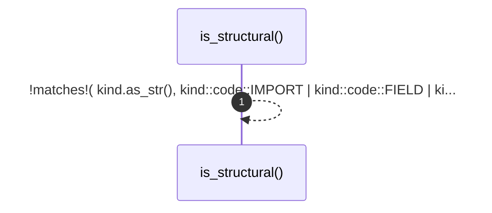

# `robby_render::is_structural`

[Self-model](../README.md) · [robby_render](index.md)

| | |
|---|---|
| kind | `code.function` |
| signature | `fn is_structural(kind: &robby_ir::Kind) -> bool` |
| location | [`crates/robby-render/src/lib.rs:163`](../../../crates/robby-render/src/lib.rs#L163) |
| provenance | extractor · confidence 1.00 |

> Kinds that belong in a module overview.

```rust
/// Kinds that belong in a module overview.
fn is_structural(kind: &robby_ir::Kind) -> bool {
    !matches!(
        kind.as_str(),
        kind::code::IMPORT
            | kind::code::FIELD
            | kind::code::VARIANT
            | kind::code::VERBATIM
            | kind::code::IMPL
    )
}
```



1 steps · 0 observed · 1 possible only

