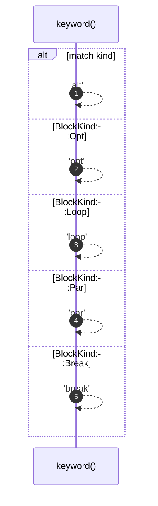

# `robby_render::keyword`

[Self-model](../README.md) · [robby_render](index.md)

| | |
|---|---|
| kind | `code.function` |
| signature | `fn keyword(kind: BlockKind) -> &'static str` |
| location | [`crates/robby-render/src/lib.rs:91`](../../../crates/robby-render/src/lib.rs#L91) |
| provenance | extractor · confidence 1.00 |

```rust
fn keyword(kind: BlockKind) -> &'static str {
    match kind {
        BlockKind::Alt => "alt",
        BlockKind::Opt => "opt",
        BlockKind::Loop => "loop",
        BlockKind::Par => "par",
        BlockKind::Break => "break",
    }
}
```



5 steps · 0 observed · 5 possible only

